# Bonus Report — Ablation: Model H Without Positional Embeddings (NoPE)

**Yogendra Patel** · Roll No. 2025201098 · CL3410 Language Models and Agents, Monsoon 2026

- **Code:** <https://github.com/CL3-410/individual-project-CReativeRebe1>
- **Checkpoints + data (Drive):** <https://drive.google.com/drive/folders/1lkP2GJKqgr-uzzz-WLeChOM_flqOe8xQ?usp=sharing>

**Headline.** Model H (Hindi) was retrained from scratch with its only source of position information
— rotary embeddings (RoPE) on queries and keys — removed. Everything else stayed identical: parameters,
data, tokenizer, optimiser, schedule, seed and token budget. The full Phase-2 evaluation suite was then
run on it.

- **Language modelling gets worse, but moderately.** Test perplexity 31.01 → **35.72** (×1.15), bits
  per byte 0.4819 → **0.5017** (+4.1%).
- **The penalty is a fixed tax, not a failure.** The validation-loss gap is 0.49 nats early in
  training, settles at ~0.145 nats by step 3,000, and stays there.
- **Generation degrades mainly at low temperature.** Greedy chrF 16.60 → 15.10, and 4-gram repetition
  0.732 → 0.790. At temperature 1.0 and above the two models are indistinguishable.
- **What breaks is where and how attention is organised, not whether order is used.** Without positions,
  layers 0–4 attend almost uniformly (normalised entropy up to 0.96). Local, previous-token behaviour
  appears only in layers 6–8, where it is *stronger* than in the standard model. The model still uses
  word order: shuffling the context costs it 87% of what it costs the standard model.

---

## Contents

1. What the bonus asked for
2. Ablation setup
3. Pretraining
4. Perplexity and bits-per-byte
5. Generation quality
6. Diversity and repetition
7. Qualitative samples
8. Attention analysis
9. Position diagnostics
10. What breaks without position information
11. Reproducibility and files

---

## 1. What the bonus asked for

> *Pick one of your two languages and retrain a model with positional embeddings removed. Run the full
> Phase 2 evaluation suite on that ablated model (perplexity / BPB, generation metrics including BLEU /
> chrF / ROUGE-L, diversity diagnostics, and attention heatmaps / entropy / distance) and compare it to
> your standard model for that language. Document the ablation setup, results, and a short explanation of
> what breaks without position information.*

| Requirement | Where |
|---|---|
| One language, retrained with positional embeddings removed | §2, §3 — Hindi (Model H) |
| Perplexity / BPB | §4 |
| BLEU / chrF / ROUGE-L | §5 |
| Diversity diagnostics | §6 |
| Attention heatmaps, entropy, distance | §8 |
| Comparison with the standard model | every section, side by side |
| Ablation setup | §2 |
| Explanation of what breaks | §9, §10 |

## 2. Ablation setup

### 2.1 Why Hindi

Model H's Phase-2 run completed in a single uninterrupted session on 2×T4. Its training record — one
`run_id`, no resume — is therefore the cleanest baseline to compare against. Its corpus is also the
smaller of the two (516M vs 571M tokens), so the retraining costs less GPU time.

### 2.2 What was removed

The standard Model H has exactly one source of position information: **RoPE**, applied to the
queries and keys inside every attention layer (`lma/model/rope.py`). There is no learned or sinusoidal
position table anywhere. The ablation adds one switch, `GPTConfig.use_rope`, and sets it to `False`:

```python
# lma/model/transformer.py — forward()
if self.config.use_rope:
    cos, sin = self.rope_cos[:T], self.rope_sin[:T]
else:
    cos, sin = None, None          # NoPE: attention sees content only

# lma/model/attention.py — CausalSelfAttention.forward()
if cos is not None:
    q = apply_rope(q, cos, sin)
    k = apply_rope(k, cos, sin)
```

With RoPE gone, q and k are pure functions of token content: two identical tokens at different positions
produce identical keys. A test asserts exactly this — with `use_rope=False`, layer 0 puts the same
attention on both copies of a repeated token; with RoPE it does not.

**The causal mask stays.** It is not a positional embedding, but it is the one channel through which a
decoder without positions can still infer order (§10).

### 2.3 What was kept identical

| | Standard Model H | NoPE Model H |
|---|---|---|
| Position information | RoPE on q, k (base 10,000) | **none** |
| Parameters | 23,846,784 | **23,846,784** (RoPE has no parameters; asserted) |
| Architecture | 10 layers, d_model 384, 6 heads, SwiGLU 1024, RMSNorm, tied embeddings | identical |
| Data | Hindi Phase-1 corpus, 515,972,223 training tokens | identical (same Kaggle dataset) |
| Tokenizer | Unigram 16k | identical |
| Optimiser | AdamW (0.9, 0.95), wd 0.1, clip 1.0 | identical |
| Schedule | peak LR 6e-4, 2% warmup, cosine to 10% | identical |
| Batch | 16 × 1024 × 4 accum × 2 GPUs = 131,072 tokens/step | identical |
| Steps / tokens seen | 3,936 / 515,899,392 (one epoch) | 3,936 / 515,899,392 |
| Seed, precision | 42, fp16 | identical |
| Hardware | Kaggle 2×T4, DDP | Kaggle 2×T4, DDP |
| Evaluation | `hindi/eval/evaluate.py`, `attention_report.py` | the same scripts, unchanged apart from output paths |

The NoPE run reuses the Phase-2 `TrainConfig` object itself rather than a copy, so the two runs cannot
drift apart in any hyperparameter. The only difference between them is position information.

## 3. Pretraining

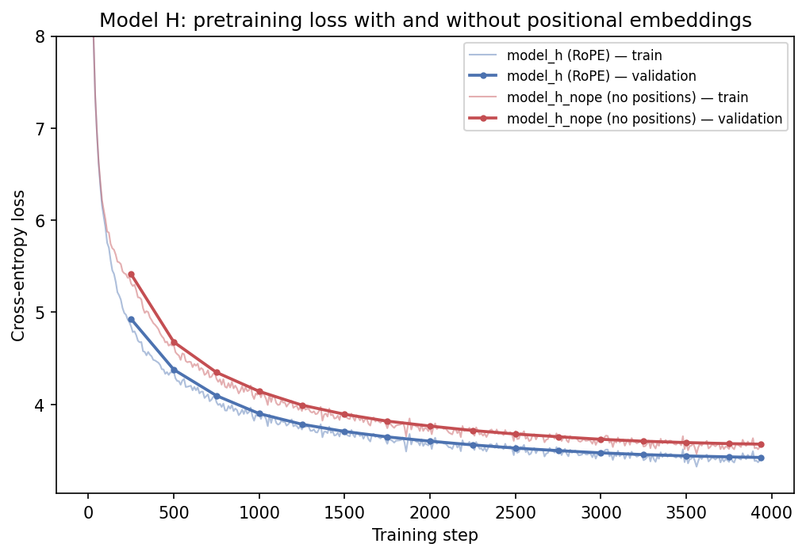

| | Standard | NoPE |
|---|---:|---:|
| Steps | 3,936 | 3,936 |
| Tokens seen | 515,899,392 | 515,899,392 |
| Sessions | 1 | 1 |
| Wall-clock (training loop) | 1 h 55 m | **1 h 37 m** |
| Median throughput | 75,698 tok/s | **89,837 tok/s** (+18.7%) |
| Peak GPU memory / device | 6.72 GB | 6.47 GB |
| First train loss | 9.109 | 9.102 |
| Train loss at step 1,000 | 3.906 | 4.135 |
| Final train loss | 3.437 | 3.579 |
| **Final validation loss** | **3.4237** | **3.5681** |
| Grad-norm mean / max | 0.440 / 1.545 | 0.561 / 1.568 |
| Logged steps with grad norm > 1.0 | 4 / 394 | 8 / 394 |
| fp16 loss scale | 65,536 → 131,072 | 65,536 (never grew) |

Validation loss during training:

| step | standard | NoPE | gap |
|---:|---:|---:|---:|
| 250 | 4.9273 | 5.4143 | +0.4870 |
| 500 | 4.3774 | 4.6771 | +0.2997 |
| 750 | 4.0945 | 4.3474 | +0.2529 |
| 1,000 | 3.8999 | 4.1415 | +0.2416 |
| 1,250 | 3.7841 | 3.9921 | +0.2080 |
| 1,500 | 3.7059 | 3.8926 | +0.1867 |
| 1,750 | 3.6469 | 3.8181 | +0.1712 |
| 2,000 | 3.6002 | 3.7647 | +0.1644 |
| 2,250 | 3.5598 | 3.7163 | +0.1565 |
| 2,500 | 3.5251 | 3.6781 | +0.1529 |
| 2,750 | 3.4977 | 3.6488 | +0.1511 |
| 3,000 | 3.4735 | 3.6209 | +0.1474 |
| 3,250 | 3.4546 | 3.6001 | +0.1455 |
| 3,500 | 3.4403 | 3.5852 | +0.1450 |
| 3,750 | 3.4298 | 3.5738 | +0.1440 |
| 3,936 | 3.4237 | 3.5681 | +0.1444 |

- **NoPE learns more slowly at first and never catches up.** The gap is widest early (0.49 nats at step
  250) and shrinks as the model learns, but stops shrinking at ~0.145 nats from about step 3,000. With
  one epoch and a decaying learning rate, the remaining gap is what the missing position signal costs at
  this budget.
- **Both runs were stable.** Neither diverged, and neither overfitted: validation loss fell at every
  evaluation in both. NoPE's gradients are somewhat larger on average (0.56 vs 0.44) and it clipped
  twice as often, and its fp16 loss scale never doubled — consistent with a slightly rougher
  optimisation, not an unstable one.
- **NoPE is faster.** Skipping RoPE removes the per-layer float32 rotation of every query and key, for
  +18.7% throughput and 18 minutes less wall-clock over the same number of steps.

## 4. Perplexity and bits-per-byte

Evaluated with the unchanged Phase-2 evaluator (`hindi/eval/evaluate.py`), full split sweep.

| | Standard val | NoPE val | **Standard test** | **NoPE test** |
|---|---:|---:|---:|---:|
| Cross-entropy (nats/token) | 3.4124 | 3.5556 | **3.4344** | **3.5756** |
| **Perplexity** | 30.34 | 35.01 | **31.01** | **35.72** |
| Bits per token | 4.923 | 5.130 | 4.955 | 5.159 |
| **Bits per byte** | 0.4744 | 0.4944 | **0.4819** | **0.5017** |
| Tokens scored (test) | | | 845,824 | 845,824 |

Test perplexity rises by a factor of **1.152** and bits-per-byte by **+0.0198 (+4.1%)**. The comparison
is exact per token here: both models share one tokenizer, so perplexity and bits-per-byte tell the same
story. (The Phase-2 reason for preferring bits-per-byte — different tokenizers — does not apply within
one language.)

## 5. Generation quality

Same protocol as Phase 2: 200 held-out test documents; 128-token prompt; 128 generated tokens scored
against the true continuation; 7 decoding settings; seed 42.

| setting | chrF std / NoPE | BLEU std / NoPE | ROUGE-L std / NoPE |
|---|---|---|---|
| greedy | **16.60 / 15.10** | 1.47 / 0.87 | 11.82 / 10.18 |
| T = 0.5 | 21.34 / 20.39 | 1.86 / 1.47 | 13.12 / 12.19 |
| T = 1.0 | 22.96 / 22.85 | 0.87 / 0.81 | 11.38 / 11.09 |
| T = 1.5 | 20.03 / 20.28 | 0.15 / 0.09 | 4.59 / 4.69 |
| T = 0.7, top-k 50 | 23.48 / 22.36 | 1.62 / 1.47 | 13.32 / 12.56 |
| T = 0.8, top-p 0.9 | 23.75 / 22.74 | 1.76 / 1.46 | 13.23 / 12.62 |
| T = 1.0, top-p 0.95 | 23.00 / 22.86 | 1.10 / 0.86 | 11.80 / 11.49 |

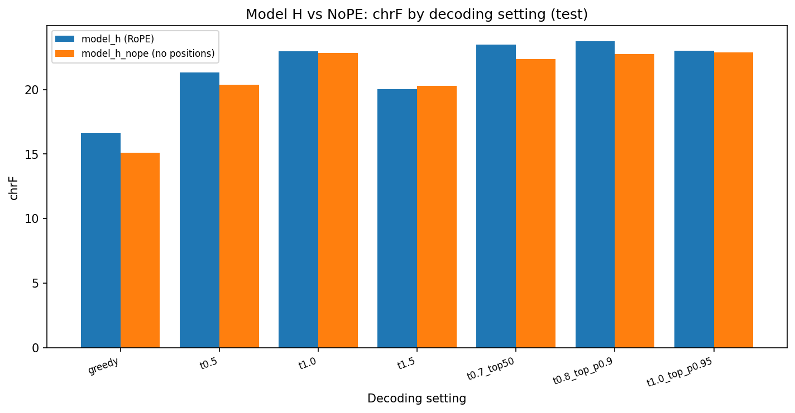

- **The loss shows up where the model's own ranking of tokens matters most.** Greedy loses 1.50 chrF, and
  T = 0.5, top-k 50 and top-p 0.9 lose 0.95–1.12. At T = 1.0, T = 1.5 and top-p 0.95 the difference is
  within ±0.25: sampling noise dominates the quality of the ranking.
- BLEU and ROUGE-L follow the same pattern. At this model size BLEU is below 2 for every setting in both
  models, so chrF is the more informative of the three (Phase 2 §6.3).

## 6. Diversity and repetition

All values are standard / NoPE, test split, same prompts.

| setting | distinct-1 | distinct-2 | distinct-3 | self-BLEU | 4-gram repetition | mean length (words) |
|---|---|---|---|---|---|---|
| greedy | **0.062 / 0.049** | **0.152 / 0.115** | **0.201 / 0.150** | 0.39 / 0.67 | **0.732 / 0.790** | 103.4 / 105.4 |
| T = 0.5 | 0.137 / 0.124 | 0.453 / 0.412 | 0.672 / 0.620 | 0.67 / 0.47 | 0.194 / 0.249 | 104.4 / 104.7 |
| T = 1.0 | 0.330 / 0.334 | 0.833 / 0.833 | 0.970 / 0.967 | 0.00 / 0.00 | 0.002 / 0.007 | 98.2 / 96.6 |
| T = 1.5 | 0.594 / 0.576 | 0.994 / 0.992 | 1.000 / 1.000 | 0.00 / 0.00 | 0.000 / 0.000 | 91.9 / 93.3 |
| T = 0.7, top-k 50 | 0.170 / 0.160 | 0.581 / 0.565 | 0.833 / 0.826 | 0.89 / 0.93 | 0.048 / 0.056 | 105.3 / 104.4 |
| T = 0.8, top-p 0.9 | 0.208 / 0.202 | 0.662 / 0.644 | 0.897 / 0.878 | 0.00 / 0.00 | 0.021 / 0.038 | 103.7 / 99.7 |
| T = 1.0, top-p 0.95 | 0.313 / 0.310 | 0.817 / 0.810 | 0.972 / 0.962 | 0.00 / 0.64 | 0.001 / 0.006 | 97.7 / 96.7 |

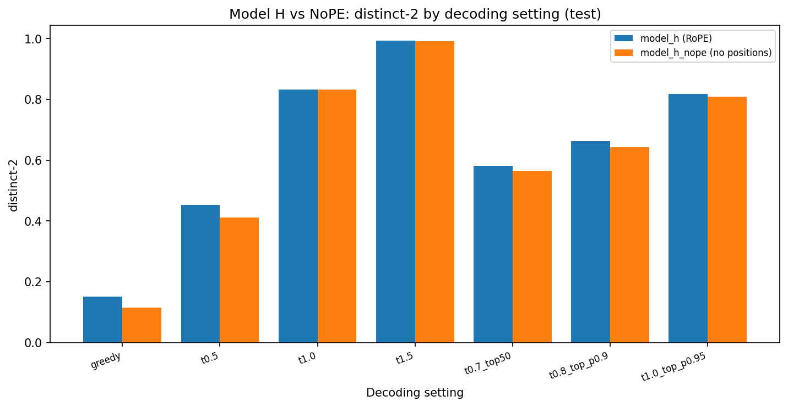
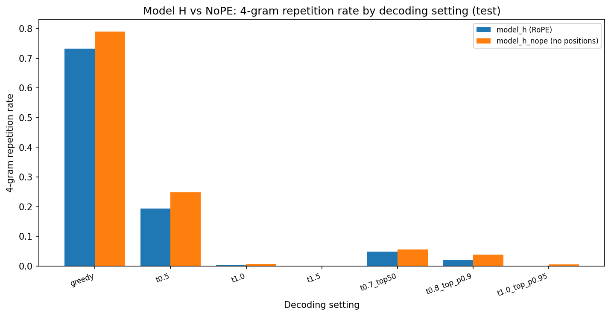
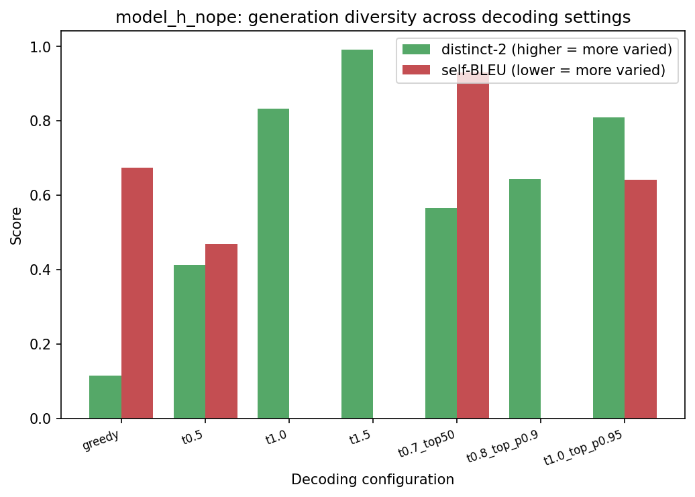


**NoPE repeats itself more at low temperature.** Greedy decoding: distinct-1 / 2 / 3 fall from
0.062 / 0.152 / 0.201 to 0.049 / 0.115 / 0.150 (−21% / −24% / −25%), and 4-gram repetition rises from
0.732 to 0.790. At T = 0.5, distinct-3 falls from 0.672 to 0.620 and repetition rises from 0.194 to 0.249.
At higher temperatures the differences vanish (all distinct-n within 0.02). Output length is not a
confound: both models write 92–105 words on average in every setting, and at greedy NoPE's outputs are
2 words *longer*, so its lower distinct-n comes from repeating words, not from writing fewer of them. Repetition is where missing position information is most
directly visible (§10): a model that cannot tell *where* it is in a loop has less to break the loop with.

## 7. Qualitative samples

T = 0.5, same held-out documents and same prompts for both models (`samples.json`).

**A continuation both models handle (doc 33).** The prompt is about unused hospital machines: "…केमिकल और
आवश्यक स्टाफ की कमी के चलते".

| | continuation (first sentences) |
|---|---|
| Standard | मरीजों को समय पर इलाज न मिलने से मरीजों को परेशानी उठानी पड़ रही है। अस्पताल के डॉक्टरों की देखरेख में मरीजों को बेहतर इलाज मिल रहा है। |
| NoPE | मरीजों को दिक्कत होने लगी है। ऐसे में इन मशीनों की हालत गंभीर हो गई है। अब मरीजों को इलाज के लिए एक-एक लाख रुपये की राशि खर्च करनी पड़ रही है। |

Both stay on topic, are grammatical, and inherit the prompt's vocabulary (मरीज, मशीन).

**A loop NoPE cannot escape (doc 52).** The prompt ends "…जिला शिक्षा पदाधिकारी को मुख्यमंत्री के नाम":

| | continuation |
|---|---|
| Standard | ज्ञापन सौंपा। इस अवसर पर संघ के सदस्यों ने कहा कि बिहार के मदरसों में शिक्षकेतर कर्मचारियों की वेतन वृद्धि के विरोध में प्रदर्शन कर रहे हैं। … |
| NoPE | ज्ञापन सौंपा। ज्ञापन में बताया कि जिला शिक्षा पदाधिकारी के नाम ज्ञापन पत्र पत्र पत्र पत्र पत्र पत्र पत्र पत्र … |
| Reference | ज्ञापन सौंपा। संघ के प्रवक्ता रशीद बेलाल ने बताया कि सरकार द्वारा अनुदानित संस्थानों की जांच प्रक्रिया पूरी कर ली गई है … |

Both models start with the correct "ज्ञापन सौंपा". NoPE then collapses into a single repeated word.
Across the 25 stored samples, a word repeated five or more times in a row occurs in 2 standard samples and
1 NoPE sample, so loops are not clearly *more frequent*. But the longest standard run is 18 words, while
NoPE's run is **115** — once in a loop, it did not get out. §10 explains why.

## 8. Attention analysis

Same toolkit and protocol as Phase 2 (`hindi/eval/attention_report.py`): 8 validation documents × 192
tokens, explicit attention path, per-head entropy, mean distance and previous-token mass.

### 8.1 Behaviour by depth

Mean over the 6 heads of each layer. Entropy is given both in bits and normalised by the maximum
possible entropy at each query position (1.0 = perfectly uniform over the visible history).

| layer | entropy (bits) std | NoPE | entropy (norm) std | NoPE | distance std | NoPE | prev-token mass std | NoPE |
|---:|---:|---:|---:|---:|---:|---:|---:|---:|
| 0 | 5.610 | 5.919 | 0.903 | **0.956** | 43.53 | 47.17 | 0.033 | 0.024 |
| 1 | 5.245 | 5.514 | 0.844 | 0.886 | 39.07 | 43.92 | 0.051 | 0.021 |
| 2 | 5.220 | 5.735 | 0.840 | 0.921 | 35.66 | 46.46 | 0.079 | 0.027 |
| 3 | 5.199 | **5.952** | 0.841 | **0.960** | 33.63 | **51.61** | 0.088 | 0.024 |
| 4 | 5.314 | 5.808 | 0.858 | 0.938 | 33.58 | 44.92 | 0.068 | 0.025 |
| 5 | 4.863 | 4.964 | 0.787 | 0.811 | 29.48 | 25.83 | 0.087 | 0.058 |
| **6** | 4.061 | **3.461** | 0.665 | **0.577** | **17.46** | **8.69** | 0.152 | 0.152 |
| 7 | 4.147 | 3.403 | 0.673 | 0.564 | 25.45 | 10.39 | 0.137 | 0.137 |
| 8 | 3.992 | 3.327 | 0.650 | 0.547 | 24.37 | 17.62 | 0.156 | **0.228** |
| 9 | 3.627 | 3.922 | 0.588 | 0.632 | 34.56 | 47.75 | 0.099 | 0.026 |

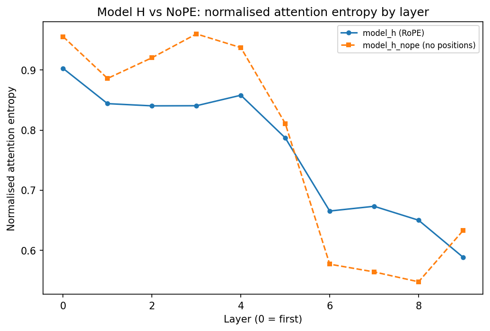
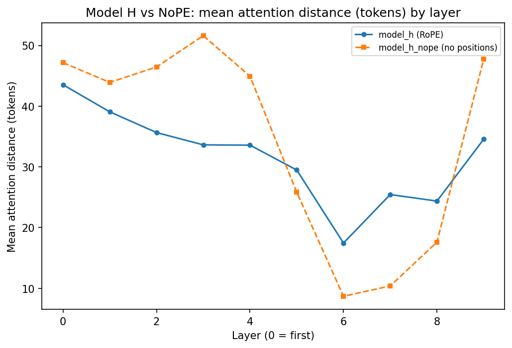
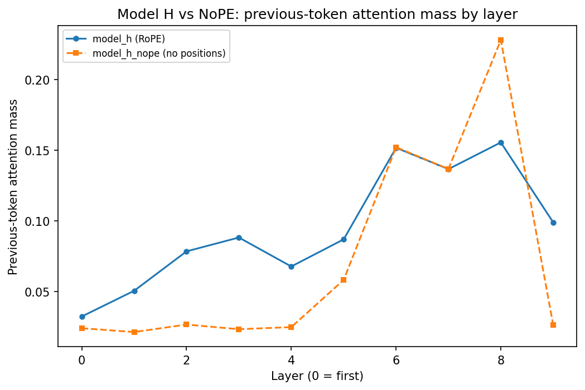

The two models organise attention by depth in clearly different ways:

- **Layers 0–4: NoPE is near-uniform.** Normalised entropy is 0.89–0.96 (standard 0.84–0.90), mean
  distance 44–52 tokens (standard 34–44), and previous-token mass is flat at ~0.02–0.03 in every one of
  these layers (standard rises to 0.09). Without positions, a query cannot prefer "the token just before
  me" — every earlier token that looks alike looks the same — so these layers spread attention broadly.
- **Layers 6–8: NoPE becomes *more* local than the standard model.** Distance falls to 8.7 / 10.4 / 17.6
  tokens (standard 17.5 / 25.5 / 24.4) and entropy to 0.55–0.58 (standard 0.65–0.67). Previous-token mass
  equals the standard model's at layers 6–7 (0.152, 0.137) and exceeds it at layer 8 (0.228 vs 0.156).
- **Layer 6 is the focusing layer in both models.** Phase 2 found layer 6 to be the sharpest focusing
  point in both Hindi and Nepali. Without positions it is still layer 6 — only much sharper (8.7 vs 17.5
  tokens).
- **Layer 9: NoPE widens again, more than the standard model** (47.8 vs 34.6 tokens, prev-token mass 0.026
  vs 0.099).
- **Raw entropy in bits tells the same story.** NoPE is 0.27–0.75 bits *higher* in layers 0–4 (largest at
  layer 3: 5.95 vs 5.20 bits) and 0.60–0.74 bits *lower* in layers 6–8 (layer 7: 3.40 vs 4.15). For scale,
  a head spreading attention evenly over a full 192-token history has log2(192) ≈ 7.6 bits.

### 8.2 Head taxonomy

| Role | Standard | NoPE |
|---|---:|---:|
| Diffuse / global | 46 | 42 |
| Mixed | 9 | 12 |
| Long-range | 4 | 5 |
| Previous-token | 1 | 1 |

| Strongest previous-token heads | Standard | NoPE |
|---|---|---|
| 1st | L8H1, 0.554 | **L8H0, 0.726** |
| 2nd | L7H1, 0.371 | L6H4, 0.357 |
| 3rd | L6H2, 0.296 | L7H1, 0.336 |

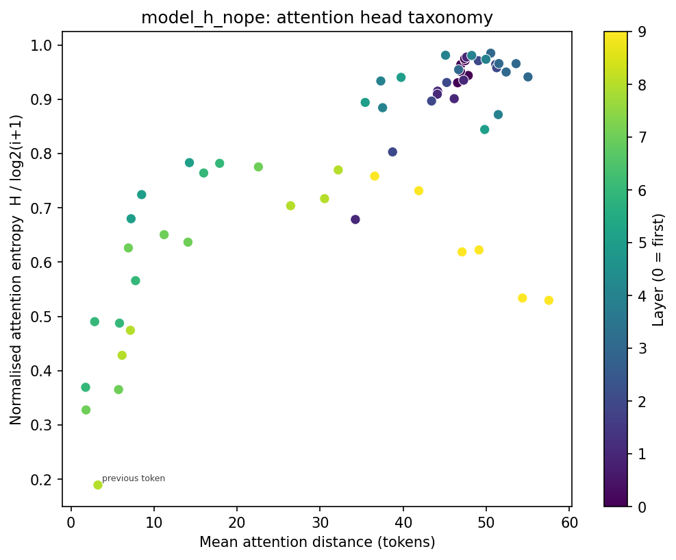


The coarse role counts barely change. The telling difference is the previous-token head. Both models
develop exactly one, in layer 8, but NoPE's is stronger (0.726 vs 0.554) — even though NoPE has no
position signal to build it from.

### 8.3 Heatmaps: same document, same heads

The same validation document through both models, at the heads plotted for the standard model in Phase 2
(the NoPE run was told to plot exactly these heads as well, plus its own extremes).

**Layer 0, head 3 (early)**


The standard head picks out specific tokens: bright cells on particular earlier words (e.g. "की", "तो",
"यह"), with distance 38.7 and normalised entropy 0.83. The NoPE head is a nearly flat wash over the whole
history (distance 47.5, entropy 0.97). The only visible structure is along the diagonal — a token
attending to itself, the one thing content-only matching can still single out.

**Layer 9, head 3 (late)**


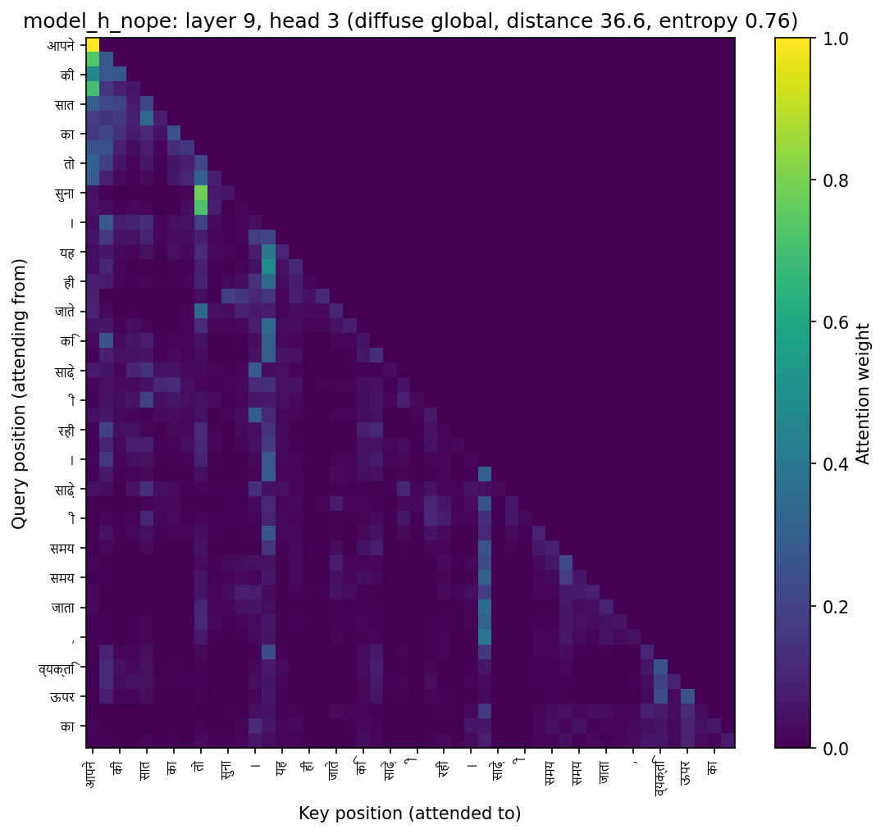

The standard head is a clean **recency band** just below the diagonal (distance 9.9, entropy 0.51):
each token looks at its immediate predecessors. The NoPE head has no such band. Instead it shows
**vertical stripes** — many later queries attending to the same few tokens, most visibly the danda "।"
and "तो" — at distance 36.6. The standard model uses this head for *where* (recent tokens); the NoPE model
uses it for *what* (punctuation and function words, wherever they are).

**Layer 0, heads 4 and 5 (early)**

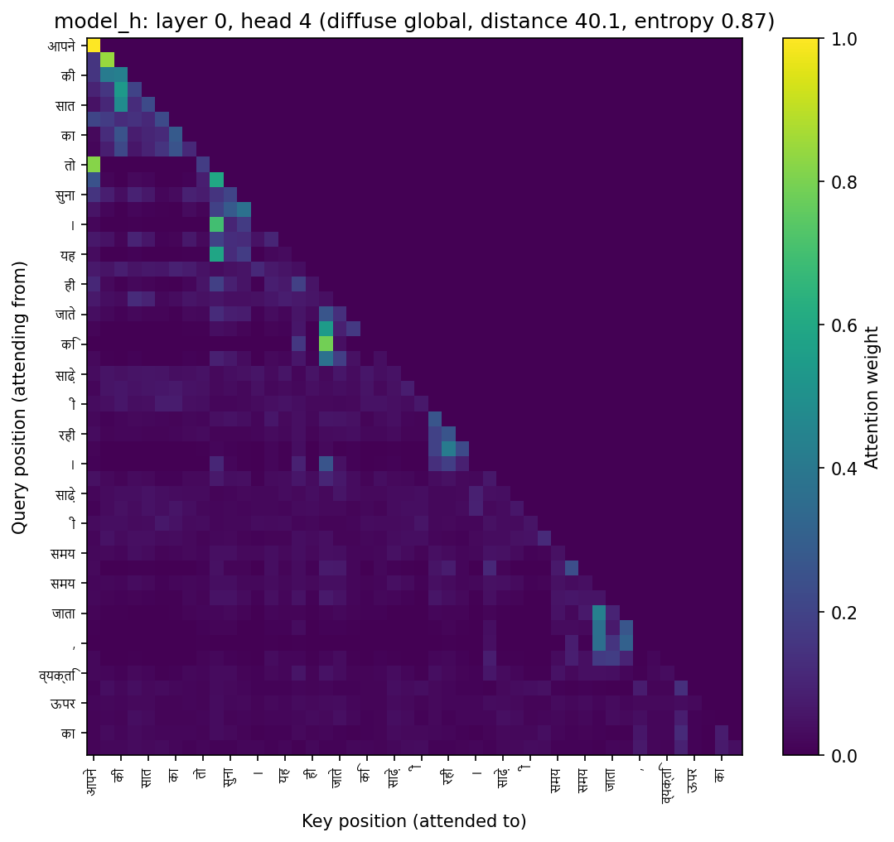
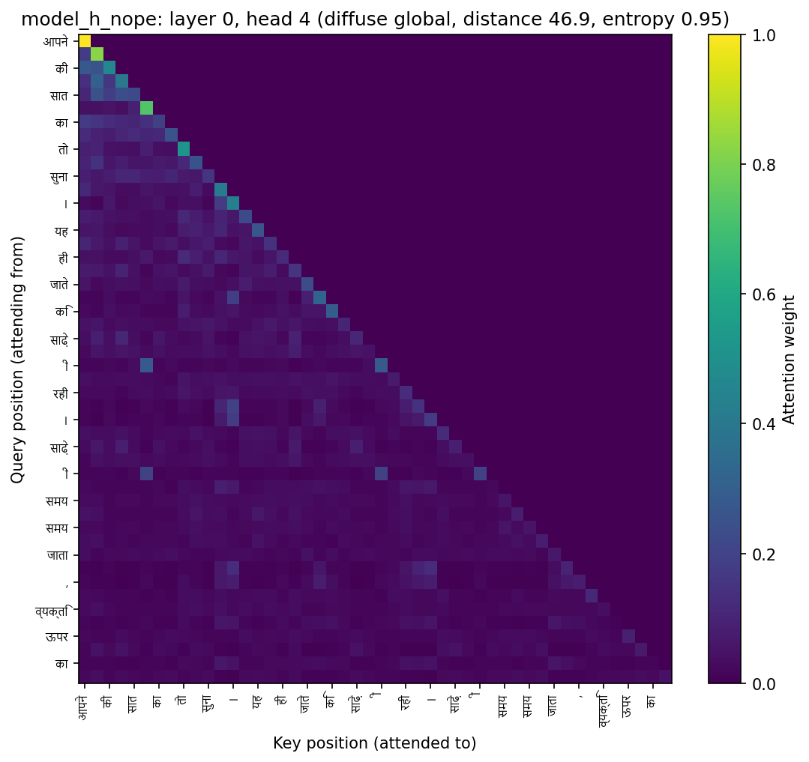

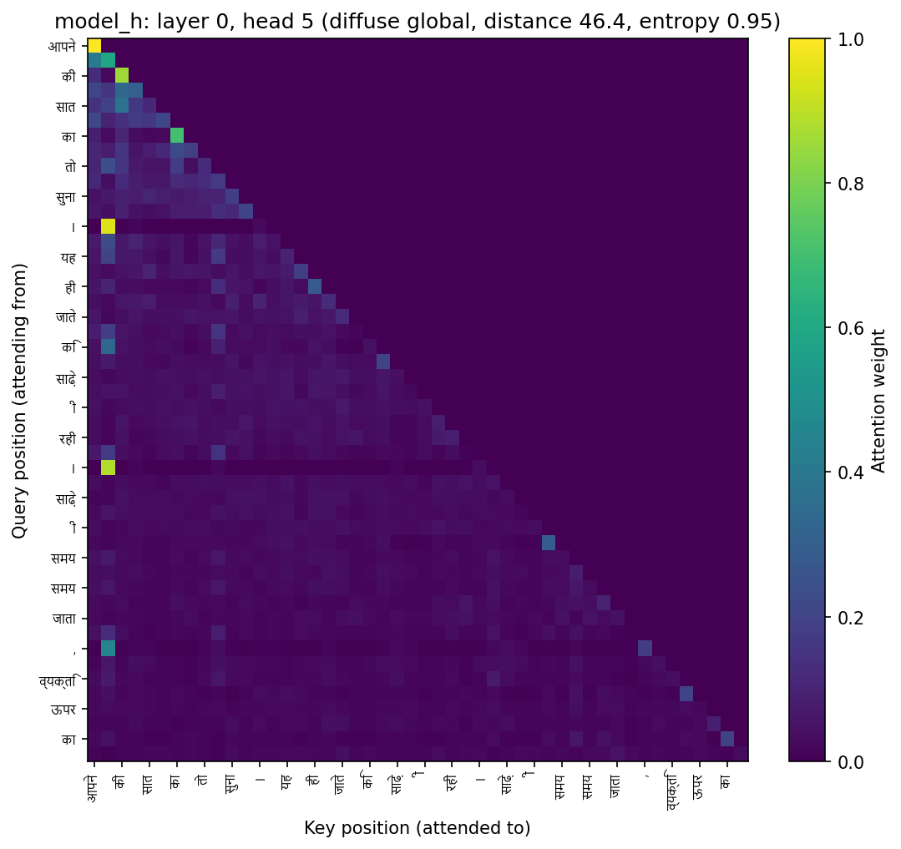


Same contrast as L0H3. Standard L0H4 has bright off-diagonal cells on particular earlier tokens (e.g. "तो"
back to the opening "आपने", and a group of queries around the first danda all on the same token next to
"सुना"; distance 40.1, entropy 0.87). NoPE L0H4 lights up mainly on the diagonal in the first rows and is
close to flat elsewhere (46.9, 0.95).
L0H5 is the most diffuse head in both models (standard 46.4 / 0.95, NoPE 47.4 / 0.97), but even here the
standard head keeps two sharp cells — both dandas "।" put most of their weight on the same early token —
which the NoPE head does not have.

**Layer 5, heads 0, 1 and 2 (middle)**

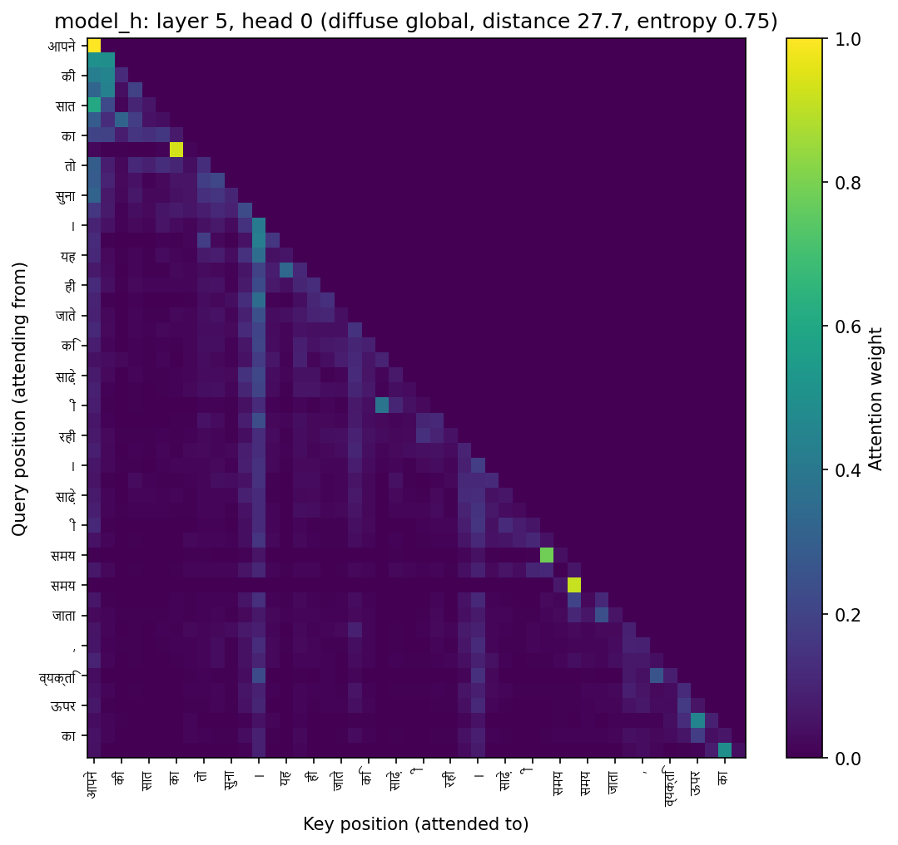
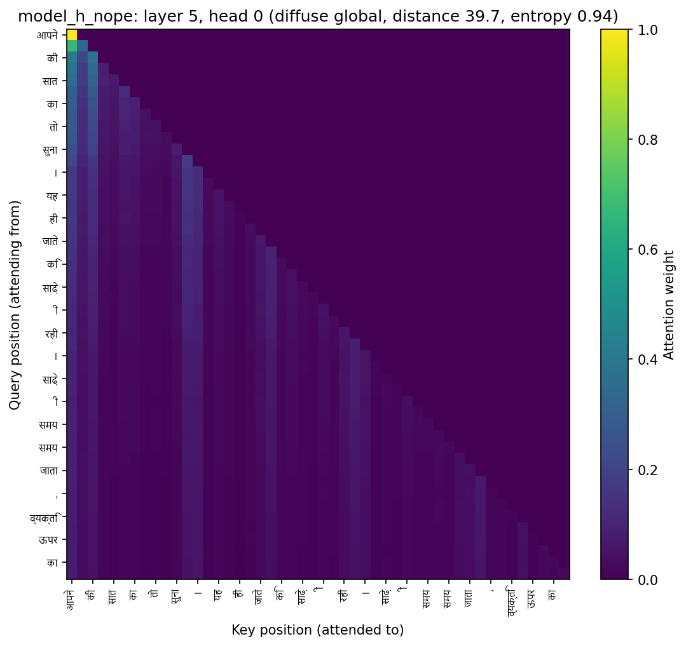


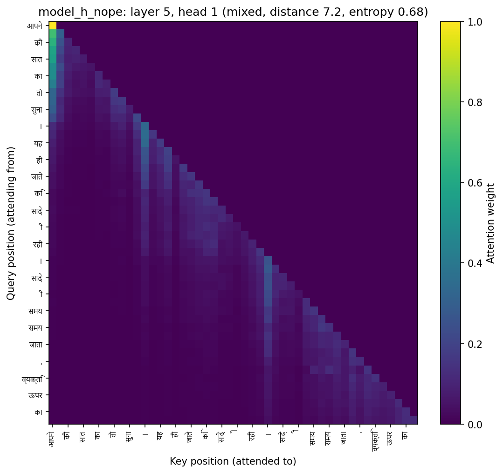


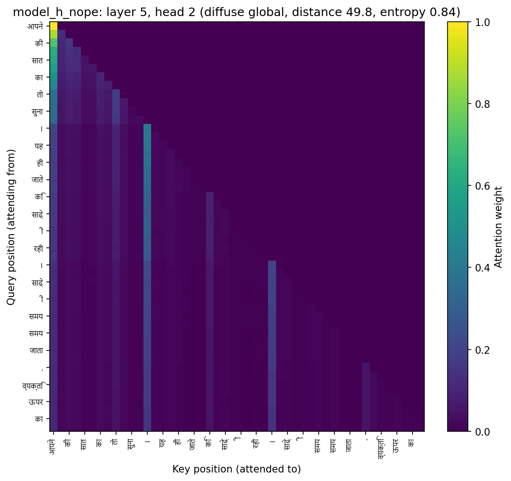

- **L5H0.** The standard head has isolated spikes of 0.6–0.9 on single tokens, several of them on the
  immediately preceding token, on top of a scattered background (27.7 / 0.75; previous-token mass 0.163). The NoPE head is smooth: a faint band along the diagonal and a column on the first
  tokens, nothing sharp (39.7 / 0.94; previous-token mass 0.029).
- **L5H1 is the one head where NoPE is clearly *more* local.** The standard head is diffuse (29.1 / 0.87).
  The NoPE head shows a smooth **recency band** just below the diagonal plus a column on each danda
  "।", and is classified *mixed* (distance 7.2, entropy 0.68). This is the first sign, already at layer
  5, of the local layers 6–8 in §8.1: once earlier layers have averaged over the causal prefix, a later
  layer has enough of an implicit position signal to prefer recent tokens (§10).
- **L5H2.** Both heads attend to the first token and to the dandas, but differently. The standard head also
  has sharp **content matches**: both occurrences of "साढ़े" and the tokens after them put 0.6–0.85 on the
  same few early tokens around "की सात", the number word at the start (36.9 / 0.71). The NoPE head is a set of clean **vertical stripes** — the first token, both dandas, "कि"
  — each fading smoothly as the query moves away (49.8 / 0.84). It knows *what* to look at but not
  *which* occurrence.

**Layer 9, head 0 (late)**


The standard head is diffuse with a first-token column and scattered cells (42.2 / 0.75). The NoPE head
is **long-range** (49.1 / 0.62): the first ~8 queries put most of their weight on the first token, and
from the first danda on most queries attend to that danda — the same *what, not where* pattern as
NoPE L9H3.

**NoPE's own extremes**

The heatmap script also plots, for each layer, the most focused head, the most diffuse head and the head
with the highest previous-token mass. For the NoPE model that adds three heads that are not in the
standard set:


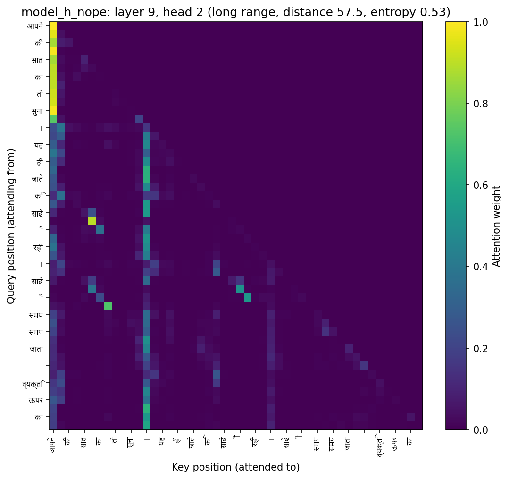

- **L0H0** (the most focused head of NoPE layer 0, still 46.5 / 0.93) and **L0H2** (the highest
  previous-token mass in that layer, only 0.025; 47.8 / 0.94): both are near-uniform. L0H0's only
  structure is a few self-attention spikes on the diagonal (e.g. "तो" to itself). Even the "most focused"
  and "most local" heads of NoPE layer 0 are effectively averages.
- **L9H2** (the most focused head of NoPE layer 9 and the longest-range head of the model: distance 57.5,
  entropy 0.53, first-token mass 0.167): an extreme version of L9H0. Early queries put nearly all of
  their weight on the first token, and later queries go to the first danda "।". Attention is anchored on
  fixed landmarks, not on recent tokens.

## 9. Position diagnostics

Two extra measurements (`hindi/nope/position_probe.py`, validation split) make the explanation in §10
concrete instead of speculative.

### 9.1 Loss by position in the window

Mean next-token loss at each position of a 1024-token window, over 320 windows.

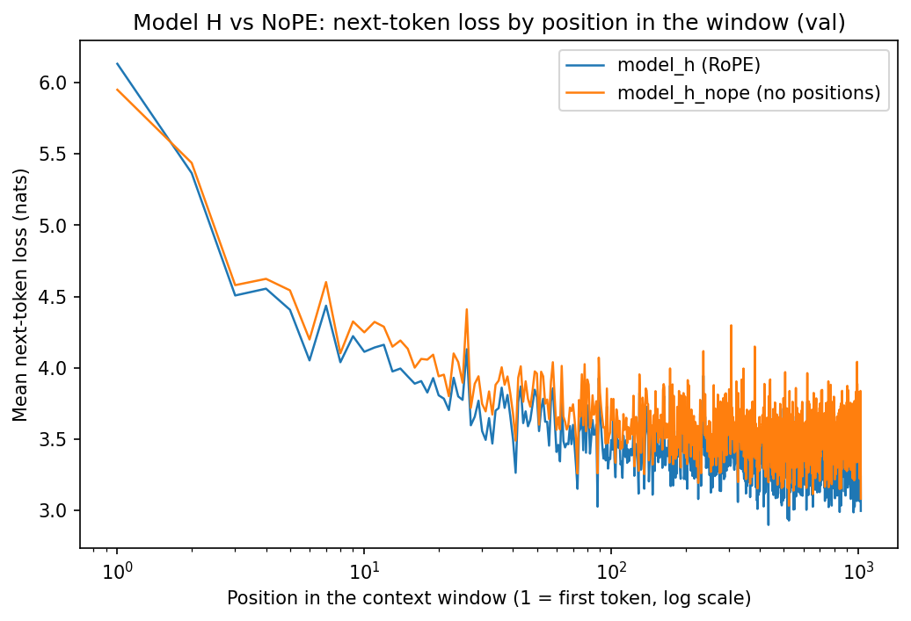

| positions | loss std | loss NoPE | gap |
|---|---:|---:|---:|
| 0 | 6.132 | 5.950 | −0.182 |
| 1 | 5.366 | 5.437 | +0.071 |
| 2–3 | 4.532 | 4.603 | +0.071 |
| 4–7 | 4.234 | 4.362 | +0.128 |
| 8–15 | 4.055 | 4.208 | +0.153 |
| 16–31 | 3.771 | 3.949 | **+0.179** |
| 32–63 | 3.650 | 3.815 | +0.165 |
| 64–127 | 3.467 | 3.627 | +0.160 |
| 128–255 | 3.429 | 3.577 | +0.148 |
| 256–511 | 3.371 | 3.516 | +0.145 |
| 512–1023 | 3.358 | 3.503 | +0.145 |

- **The penalty appears within the first ~16 tokens and then stays flat.** The gap grows from +0.07 at
  positions 1–3 to +0.18 at 16–31, then settles at +0.145 all the way to position 1023. It does **not**
  keep growing with distance into the window.
- **So NoPE does not "lose track" deeper into long contexts.** Whatever position estimate it builds, it is
  as good at token 1,000 as at token 100. The cost is a constant per-token tax — the same ~0.145 nats as
  the validation-loss gap in §3.
- At position 0 the model has one token of context and attention has nothing to choose between, so
  position information cannot help there. NoPE is slightly *better* at that position (−0.18); its
  capacity is spent differently, not on positions.

### 9.2 Order sensitivity

For 1,280 windows of 256 tokens: the loss on the second half (the continuation), once after the intact
first half and once after the same first-half tokens in random order. The continuation itself is never
shuffled.

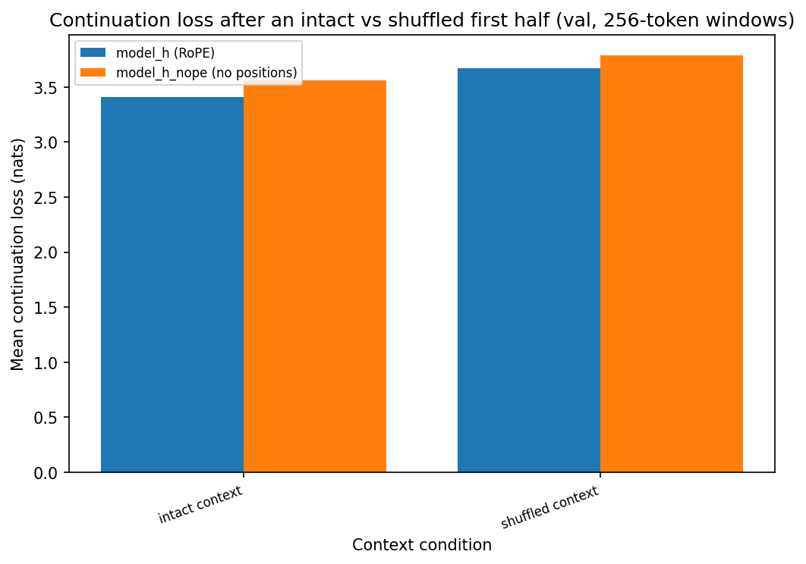

| | Standard | NoPE |
|---|---:|---:|
| Continuation loss, intact context | 3.4055 | 3.5569 |
| Continuation loss, shuffled context | 3.6690 | 3.7862 |
| **Increase from shuffling** | **+0.2635** | **+0.2294** |
| Relative to standard | 100% | **87%** |

**NoPE still uses word order.** If it treated its context as a bag of tokens, shuffling the context would
cost nothing. It costs 0.229 nats — 87% of the standard model's 0.264. Most of the order information that
RoPE provides explicitly, the NoPE model recovers by itself.

## 10. What breaks without position information

**How a decoder can know order at all without positions.** The causal mask means query position *i* can
attend to exactly *i*+1 keys. A head that attends roughly uniformly therefore returns an average over
*i*+1 value vectors, and the weight on any one of them is 1/(*i*+1). Deeper layers can read that shrinking
contribution as a crude signal of how far into the sequence they are. Relative order ("this token came
after that one") can be assembled from such signals, layer by layer. This is the known mechanism by which
decoder-only models without positional encodings still learn positional information (Haviv et al. 2022;
Kazemnejad et al. 2023). The measurements above show the Hindi model doing exactly this.

**What breaks:**

1. **Early layers lose position-based attention.** With content-only queries and keys, "attend to the
   previous token" is impossible in layer 0: the previous token is not distinguishable from any other
   token with similar content. Layers 0–4 of the NoPE model are near-uniform averaging layers (entropy up
   to 0.96, previous-token mass ~0.02) — which is precisely the kind of attention that produces the 1/(*i*+1)
   counting signal. The standard model's early layers can already do local, token-specific work; the NoPE
   model's must first build the position signal.
2. **Local structure is postponed, not lost.** Once position has been inferred, layers 6–8 implement
   recency: mean distance drops to 8.7 tokens and the strongest previous-token head (L8H0, 0.726) is
   stronger than the standard model's. NoPE ends up with the same kind of local heads — but deeper in the
   network, so fewer layers remain to use their output.
3. **The cost is a constant per-token tax.** Spending the lower half of a 10-layer network on
   reconstructing positions costs ~0.145 nats per token everywhere in the window (§9.1). That is test
   perplexity ×1.15 and bits-per-byte +4.1% (§4), and it does not shrink over the second half of training
   (§3).
4. **Repetition loops are harder to escape.** Identical tokens produce identical keys. Inside a loop of
   one repeated word, every copy looks the same to a content-based head, so attention cannot single out
   "the copy I just produced" or count how many copies there are. The only exit is the imprecise inferred
   position. The standard model has an exact rotation per position and can tell the copies apart. This
   matches the generation results: more repetition and lower distinct-2 at greedy and T = 0.5 (§6), and
   one 115-word loop against the standard model's longest of 18 (§7). At higher temperatures, sampling
   breaks loops regardless and the models converge.

**What does not break:**

- **Word order is still used** — 87% of the standard model's sensitivity to shuffled context (§9.2).
- **Long contexts are not specially hurt** — the loss gap at position 1,000 equals the gap at position 100
  (§9.1).
- **Training stays stable**, and the layer-6 focusing point from Phase 2 survives (§3, §8.1).

**In one sentence:** without positional embeddings, the Hindi model rebuilds order information from the
causal mask on its own, but doing so consumes its lower layers. It pays a steady ~15% perplexity cost,
and it gets worse at noticing that it is repeating itself.

## 11. Reproducibility and files

Run on Kaggle (2×T4), with the encoded Hindi corpus from the existing Phase-2 Kaggle dataset. The
step-by-step runbook is `notebooks/bonus_kaggle.md`.

```bash
python scripts/pack_bonus.py code                                   # code-only archive for Kaggle
# on Kaggle:
torchrun --standalone --nproc_per_node=2 hindi/nope/pretrain.py --data-dir <data>/hindi
python hindi/eval/evaluate.py --checkpoint hindi/nope/checkpoints/ckpt_best.pt --split test \
    --results-dir hindi/nope/results --figure-prefix hindi_nope --label model_h_nope
python hindi/eval/attention_report.py --checkpoint hindi/nope/checkpoints/ckpt_best.pt \
    --results-dir hindi/nope/results --figure-prefix hindi_nope --label model_h_nope \
    --extra-heads 0:3,0:4,0:5,5:0,5:1,5:2,9:0,9:3
python hindi/nope/position_probe.py --checkpoint hindi/nope/checkpoints/ckpt_best.pt --label model_h_nope
python hindi/nope/compare.py
python scripts/pack_bonus.py results                                # logs + results + figures archive
```

The heatmaps in this report were redrawn locally from the same checkpoint and documents, because Kaggle
had no Devanagari font and the original labels rendered as boxes. The redrawn attention statistics are
identical to Kaggle's for all 60 heads.

| What | Where |
|---|---|
| Position switch | `lma/model/transformer.py` (`use_rope`), `lma/model/attention.py`, `lma/model/block.py` |
| Ablation config and training entry point | `hindi/nope/config.py`, `hindi/nope/pretrain.py` |
| Position diagnostics | `lma/eval/position.py`, `hindi/nope/position_probe.py` |
| Comparison script | `hindi/nope/compare.py`, plots in `lma/viz/plots.py` |
| Tests (NoPE) | `tests/test_model.py` — identical tokens get identical layer-0 attention; parameter count and causal mask unchanged; fused and manual attention paths agree; old checkpoints still load with RoPE |
| Training log | `hindi/nope/logs/train_log.jsonl`, `train.log`, `summary.json` |
| Results | `hindi/nope/results/` — `metrics_test.json`, `metrics_val.json`, `attention_stats.json`, `position_probe_model_h{,_nope}.json`, `samples.json`, `comparison.{md,json}` |
| Figures | `report/figures/hindi_nope_*.png` |
| Checkpoint | Drive (`hindi/nope/checkpoints/ckpt_best.pt`, 286 MB) |
| Standard model baseline | Phase 2: `hindi/train/logs/`, `hindi/eval/results/`, `report/figures/hindi_*.png` |
