# Phase 1 Report — Data Collection and Tokenizer Construction

**Yogendra Patel** · Roll No. 2025201098 · CL3410 Language Models and Agents, Monsoon 2026

- **Code:** <https://github.com/CL3-410/individual-project-CReativeRebe1>
- **Dataset (Drive):** <https://drive.google.com/drive/folders/1lkP2GJKqgr-uzzz-WLeChOM_flqOe8xQ?usp=sharing>
- **Dataset (HuggingFace):** <https://huggingface.co/datasets/YogendraPatel/LMA_Individual_Project>

> This is the Markdown edition of the report. `report/phase1.tex` / `phase1_report.pdf` is the
> typeset version with the full pipeline diagram; the content is the same, except that this file can
> show Devanagari inline (the LaTeX build uses pdflatex and avoids Indic glyphs).

**Headline.** Two entirely independent corpora built from scratch: **Hindi
517,640,653 tokens** across 3,587,045 documents
(22.5% manually collected) and
**Nepali 572,506,257 tokens** across
5,536,928 documents
(24.7% manual). Both exceed the ~500M-token target and
both clear the ≥20% manual floor. 354 tests pass.

---

## 1. Language selection

**Hindi = Model H** (higher-resource), **Nepali = Model L** (lower-resource). The pairing is
deliberately hard:

- **Same script (Devanagari).** A Hindi and a Nepali document cannot be separated by character set,
  so language identification has to do real work — quantified in §5.
- **Genuine resource asymmetry**, visible throughout: fastText has seen far more Hindi, Nepali
  Wikipedia is 8.5M words against Hindi's 51.9M.
- **Shared vocabulary, divergent orthography.** A normalisation rule correct for Hindi *corrupts*
  Nepali (§4.1) — the clearest reason the two pipelines had to be separate.

The two languages share **code** (`lma/`) but never **artifacts**. Everything language-specific —
stopwords, boilerplate, normalisation, every threshold — lives in `hindi/clean/` or `nepali/clean/`.

## 2. Data collection

| Side | Source | Documents | Words |
|---|---|---:|---:|
| **Hindi** | Crawler | 68,446 | 27,671,716 |
| | Fast crawler | 103,134 | 79,001,007 |
| | Wikipedia dump | 116,889 | 51,939,070 |
| | **Manual total** | **288,469** | **158,611,793** |
| | IndicCorpV2 (downloaded) | 6,399,541 | 600,000,011 |
| **Nepali** | Crawler | 27,568 | 17,150,211 |
| | Fast crawler | 312,653 | 141,665,551 |
| | Wikipedia dump | 30,580 | 8,502,324 |
| | **Manual total** | **370,801** | **167,318,086** |
| | IndicCorpV2 (downloaded) | 10,119,070 | 600,000,086 |

Wikipedia is 33% of Hindi's manual words but only 5% of Nepali's, whose manual side is 85% news
fast-crawl. That single fact drives the threshold divergence (§4), the 20-point survival gap (§6),
and the opposite duplication behaviour (§8).

**Deduplication direction is one-way: duplicates are dropped from the downloaded side, never the
manual side.** Manual tokens are the scarce, graded resource; downloaded tokens are effectively
unlimited. The 600M target counts words *written*, so losses are absorbed by streaming further.
No cleaning is applied to the downloaded side — IndicCorpV2 is already cleaned, and re-filtering it
would blur the manual-vs-downloaded comparison.

## 3. The cleaning cascade (all 14 Yi steps)

| Yi step | Module | Notes |
|---|---|---|
| Data collection | `run.py` | streamed; never fully in memory |
| Language filtering | `lang.py` | Devanagari ratio → fastText → Hindi/Nepali marker vote |
| **Rule-based correction** | `repair.py` | **moved before filtering** |
| Text-metric filtering | `rules.py` | 11 Gopher/C4 rules, Devanagari-aware |
| Repetitive document removal | `rules.py` | top word / 2-gram / 3-gram, dup 5-grams, dup paragraphs |
| Perplexity filtering | `score.py` | char-4-gram model on our own Wikipedia |
| Document quality filtering | `score.py` | logistic classifier, structural features only |
| Coherence scoring | `score.py` | inter-paragraph TF-IDF cosine, char 4-grams |
| Paragraph deduplication | `dedup.py` | cross-document, **before** MinHash |
| MinHash deduplication | `dedup.py` | 128 perms, b=8, r=16, J≥0.80, verified vs `datasketch` |
| Exact deduplication | `dedup.py` | SHA-256 of normalised text |
| Semantic filtering | `safety.py` | TF-IDF char n-grams + MiniBatchKMeans, k=60 |
| Topic filtering | `safety.py` | ad-heavy clusters downsampled to 25% |
| Safety filtering | `safety.py` | blocklist + PII redaction |
| *(beyond Yi)* | `lma/dedup/decontaminate.py` | 13-gram train/held-out separation |

### Three deliberate deviations, each made on measurement

1. **Correction before filtering.** Repair fired on ~117,000 Hindi documents (JSON blobs 22,867;
   boilerplate lines 31,671; boilerplate phrase lines 25,100; repeated punctuation 36,683; mojibake
   607). A safety valve returns the document untouched if repair would remove >50% of its
   *characters* — measured in characters, not lines, because a crawled article is typically one long
   prose line plus a few short furniture lines, and a line-based valve read a 95%-prose document as
   60% boilerplate.
2. **Coherence uses character 4-grams.** Word-level cosine barely separated a coherent article from a
   stitched one (0.031 vs 0.029) — both languages are inflected, so paragraphs share stems, not
   surface forms. Char 4-grams separated the same pair 2× better (0.052 vs 0.024). The IDF is
   smoothed, `log((N+1)/(1+df)) + 1`; the textbook form is exactly zero for a term in 2 of 3
   paragraphs and scored every document 0.0000.
3. **Decontamination cleans the held-out side** (§8).

## 4. Per-language divergence

| Threshold | Hindi | Nepali | Evidence |
|---|---:|---:|---|
| fastText LID min confidence | 0.65 | **0.5** | lid.176 is right but unsure on Nepali (median confidence 0.69–0.76). Hindi's bar rejects **17.9%** of correctly-labelled Nepali Wikipedia; 0.50 rejects 3.0%. |
| Quality classifier min | 0.3 | **0.1** | Held-out means: Hindi wiki 0.841 / crawl 0.390; Nepali 0.766 / 0.177. At 0.30 only 19.2% of Nepali crawl survives; 0.10 keeps 49.4%, matching Hindi's operating point. |
| Perplexity cutoff | 16.68 | 18.01 | 99th percentile of each language's own Wikipedia. |
| Coherence min | 0.01234 | 0.01061 | 1st percentile of trusted text. The first hand-picked 0.04 sat at Wikipedia's *10th* percentile. |
| Chandrabindu folding | yes | **no** | §4.1 |
| Manual-fraction target | 0.215 | 0.25 | Hindi's manual side cleans down harder, and the downloaded budget derives from it. |

### 4.1 Normalisation: where a correct Hindi rule corrupts Nepali

Hindi folds **chandrabindu ँ (U+0901) → anusvara ं (U+0902)**: modern Hindi treats them as
interchangeable, and folding cuts vocabulary fragmentation. **Nepali must not** — ँ is standard
spelling in गाउँ (village), ठाउँ (place), हुँदा (when being), बाँकी (remaining). Folding would rewrite
गाउँ as गाउं, misspelt Nepali, fragmenting the tokenizer against every correct occurrence.

Both repair encoding corruption that is not spelling: repeated matras collapsed (हिन्दीी → हिन्दी),
word-initial matras dropped (a matra cannot begin a word), dangling viramas removed (क् → क). Nukta
is preserved in Hindi, since ज़/ज distinguish Perso-Arabic loanwords.

## 5. Language identification, measured out-of-sample

Labels come from the Wikipedia dump a document came from, read from **raw** shards before any filter.
fastText `lid.176` is pretrained and never trained here, so this is genuinely held-out.

| | Documents | fastText correct | Labelled as the *other* language | Marker vote correct |
|---|---:|---:|---:|---:|
| Hindi | 3,000 | **99.97%** | 0 | 97.30% |
| Nepali | 3,000 | **95.87%** | **119** | 99.97% |

**The confusion is one-directional**: 119 Nepali articles labelled Hindi,
**zero** the other way. Nepali is the low-resource side of that model and its errors fall toward the
higher-resource neighbour — exactly the leakage the independence requirement forbids. The marker vote
is the better detector on Nepali (99.97%), fastText on Hindi, so the two are combined
rather than ranked.

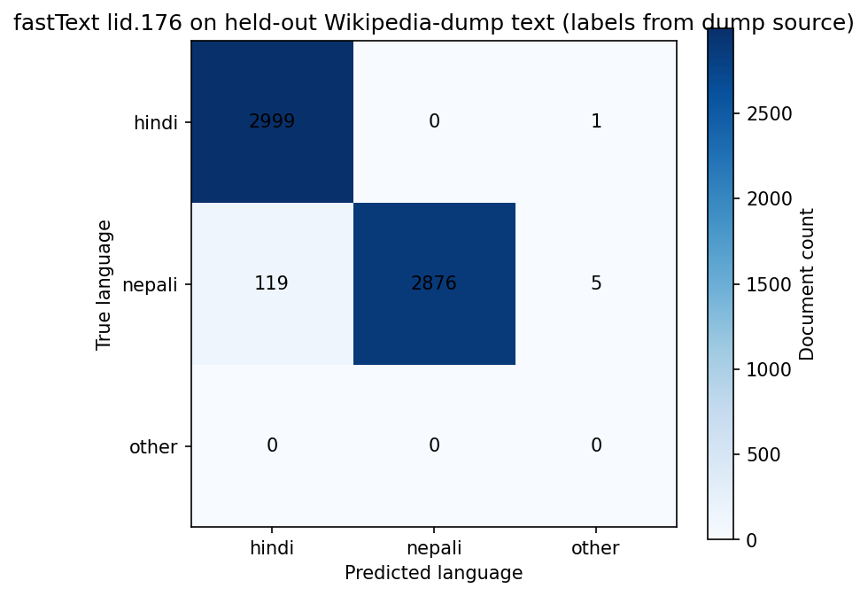

## 6. Cleaning funnel

| Stage | Hindi | % | Nepali | % |
|---|---:|---:|---:|---:|
| Collected (raw manual) | 288,469 | 100.0% | 370,801 | 100.0% |
| After language filtering | 269,182 | 93.3% | 344,932 | 93.0% |
| After repair + text-metric rules | 197,165 | 68.3% | 306,549 | 82.7% |
| After perplexity / quality / coherence | 157,285 | 54.5% | 286,181 | 77.2% |
| After paragraph dedup | 156,390 | 54.2% | 284,132 | 76.6% |
| After exact dedup | 156,012 | 54.1% | 282,598 | 76.2% |
| After near dedup (MinHash-LSH) | 154,669 | 53.6% | 275,946 | 74.4% |
| After topic filtering | 152,714 | 52.9% | 271,591 | 73.2% |
| **After safety filtering** | 152,699 | 52.9% | 271,589 | 73.2% |

Hindi retains **52.9%**, Nepali
**73.2%**. Hindi's crawl is dominated by news
portals whose hub pages are templates: its duplicate-5-gram fraction has a p90 of **0.88**, against
Nepali's p99 of **0.405**.

**Top rejection reasons — Hindi:** `symbol_to_word_ratio_too_high` 41,426, `quality_too_low` 34,405, `dup_ngram_fraction` 22,435, `dup_paragraph_fraction` 19,079, `low_devanagari_ratio` 18,269, `bullet_line_fraction_too_high` 7,662.

**Top rejection reasons — Nepali:** `symbol_to_word_ratio_too_high` 35,431, `quality_too_low` 18,124, `low_devanagari_ratio` 9,765, `lid_low_confidence` 6,650, `lid_said_hi` 5,050, `hindi_markers_dominant` 4,377.

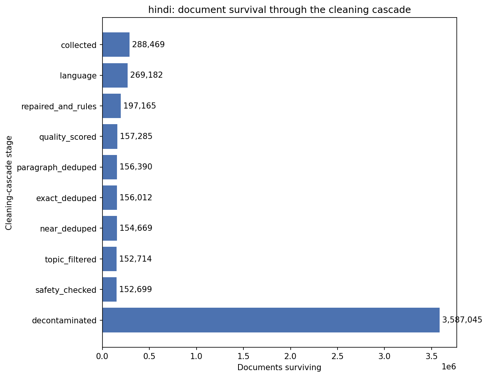
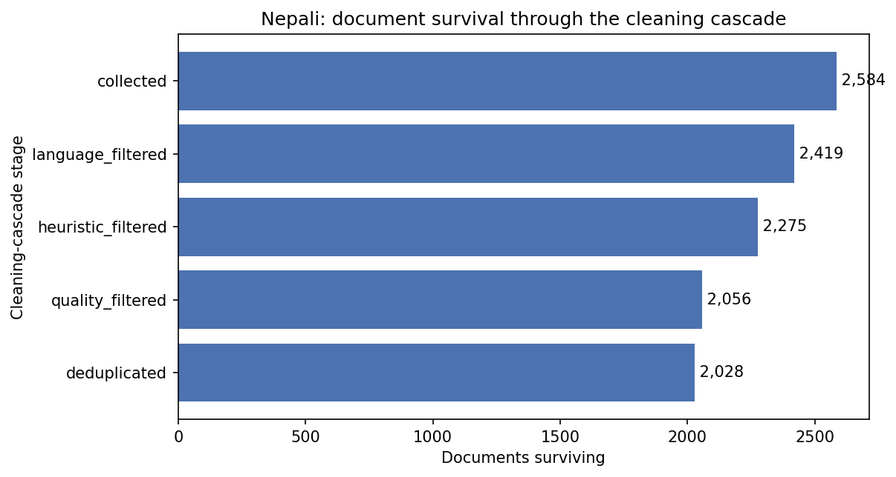

## 7. Deduplication

| | Hindi | Nepali |
|---|---:|---:|
| Paragraphs excised (cross-document) | 510,077 | 1,836,622 |
| …from documents | 67,059 | 189,039 |
| Exact duplicate documents | 378 | 1,534 |
| Near duplicates (clusters) | 1,343 (1,077) | 6,652 (6,584) |
| Ad-heavy clusters downsampled | 3 of 60 → 1,955 docs | 3 of 60 → 4,355 docs |

Paragraph dedup runs **before** MinHash, and Nepali's number shows why: 1,836,622
paragraphs removed across 189,039 documents — over half the surviving corpus carried a
paragraph recurring in ≥3 other documents (17% of bytes). Removing shared footers first stops two
unrelated articles from matching on boilerplate they both carry.

Two implementation problems had to be fixed first: **MinHash was not reproducible across processes**
(builtin `hash()` is `PYTHONHASHSEED`-salted; the same shingle hashed to 3735431355 in one process
and 2056009044 in another — replaced with `xxhash`, chosen on measurement: builtin 6.12M/s, xxhash
3.25M/s, blake2b 1.09M/s), and **LSH pair enumeration would have exhausted memory** (a k-member
bucket yields k(k−1)/2 pairs; replaced with a lazy generator plus a bucket cap that stars oversized
buckets — 5,000 identical documents go from ~12.5M pairs per band to 4,999).

## 8. Decontamination: which side pays

The conventional direction — dropping contaminated **training** documents — cost **123,357 of
266,189** Nepali manual training documents (46.3%) and pushed the manual share to **15.0%, below the
20% floor**. The Nepali crawl reuses syndicated agency sentences so heavily that each held-out
article collided with ~23 training articles. MinHash cannot see this: those documents are ~0.05
Jaccard-similar, not 0.8.

Capping the held-out set helped far less than expected, because the index scales with held-out
*length*, not count: the capped set was 54% long manual articles (~370 n-grams each) versus short
downloaded ones (~62), so it shrank only ~3× and the loss moved 48.4% → 46.3%.

**Adopted: decontaminate the held-out side.** Candidates colliding with training text are discarded
and replaced from an oversampled pool (2× the cap). Training keeps every document.

| | Hindi | Nepali |
|---|---:|---:|
| Training documents dropped | **0** | **0** |
| Held-out candidates offered | 20,000 | 20,000 |
| Candidates discarded | 3,293 (16.5%) | 8,596 (43.0%) |
| Final val / test | 5,000 / 5,000 | 5,000 / 5,000 |
| …of which manual | 803 / 771 | 580 / 552 |

**Cost, stated plainly:** held-out documents are by construction ones that do *not* share sentences
with training text, so val/test skew slightly toward less-syndicated writing. This is the standard
direction for benchmark construction, and the alternative violated the manual-collection floor.

**The collision rate is itself a finding:** 16.5% Hindi vs
43.0% Nepali — opposite to whole-document duplication, where Hindi is
the more duplicated. Hindi has repetitive template pages; Nepali has distinct articles sharing
sentences. Two pathologies, two stages.

## 9. Final corpus

| | Hindi | Nepali |
|---|---:|---:|
| Manual words | 86,845,726 | 102,346,029 |
| Downloaded words | 322,185,544 | 312,027,108 |
| **Total words** | **409,031,270** | **414,373,137** |
| Manual tokens (text only) | 115,682,511 | 140,233,982 |
| Downloaded tokens (text only) | 398,371,097 | 426,735,347 |
| EOS tokens (one per document) | 3,587,045 | 5,536,928 |
| **Total tokens (as encoded)** | **517,640,653** | **572,506,257** |
| Manual share (words / tokens) | 21.2% / **22.5%** | 24.7% / **24.7%** |
| Train / val / test docs | 3,577,045 / 5,000 / 5,000 | 5,526,928 / 5,000 / 5,000 |
| Train / val / test tokens | 515,972,223 / 821,762 / 846,668 | 571,227,702 / 634,788 / 643,767 |

The **20% floor is enforced in code**: each pipeline raises at the end of a run if the final manual
share falls below it (`MANUAL_FLOOR` in `<lang>/clean/run.py`), after writing `stats.json` so the
funnel is still available. An earlier run produced a 15.0% corpus and reported success with an
ordinary log line — that cannot happen now.

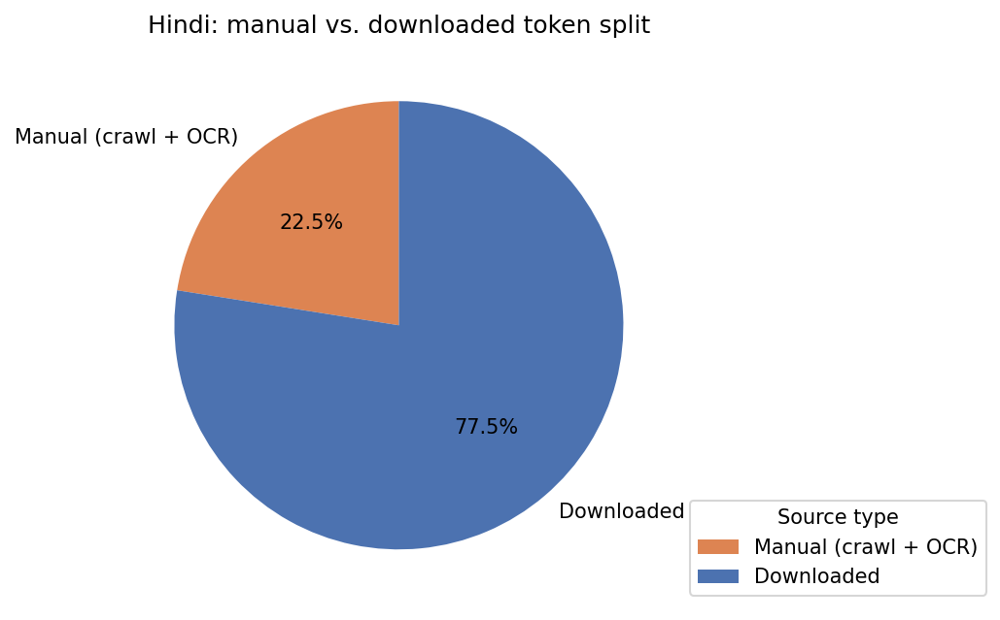
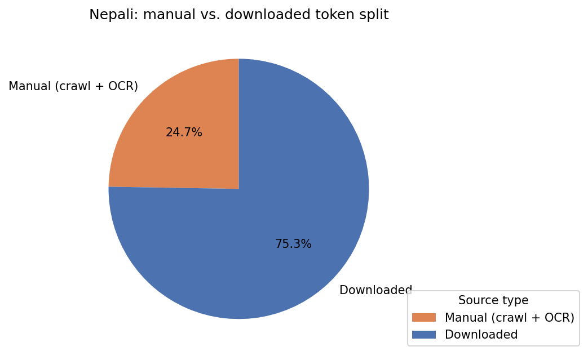
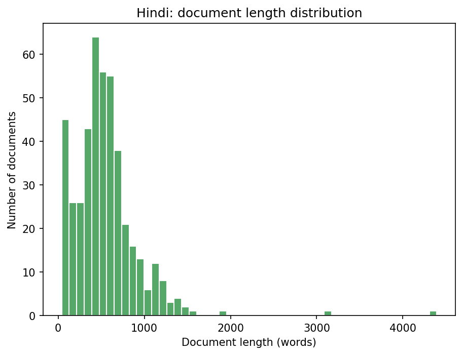
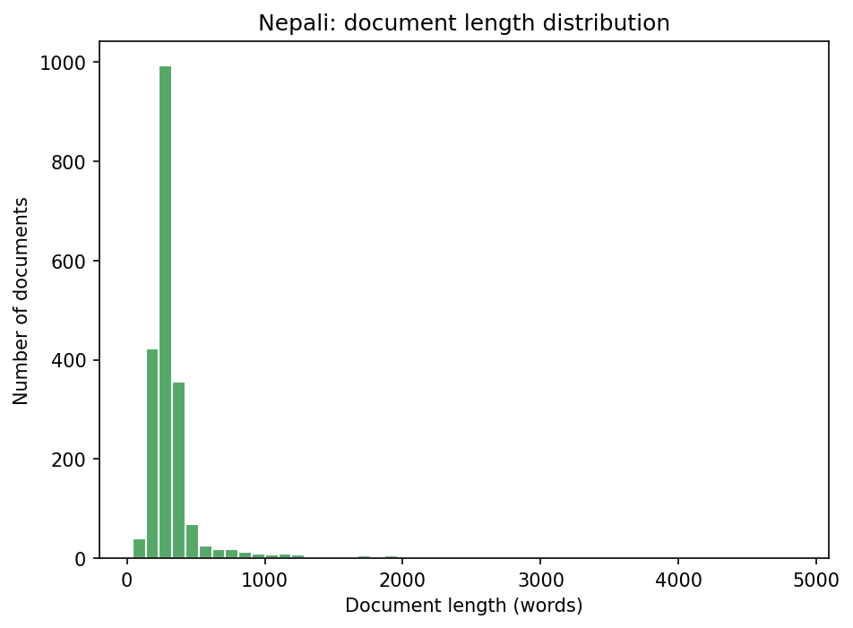
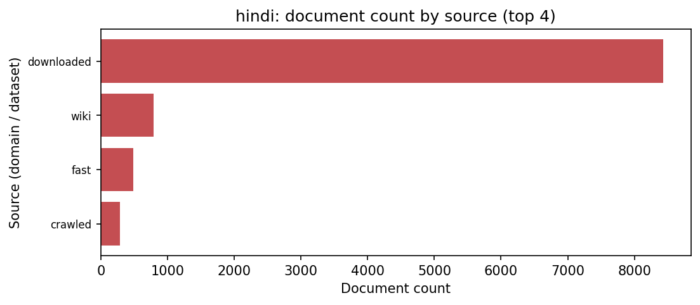
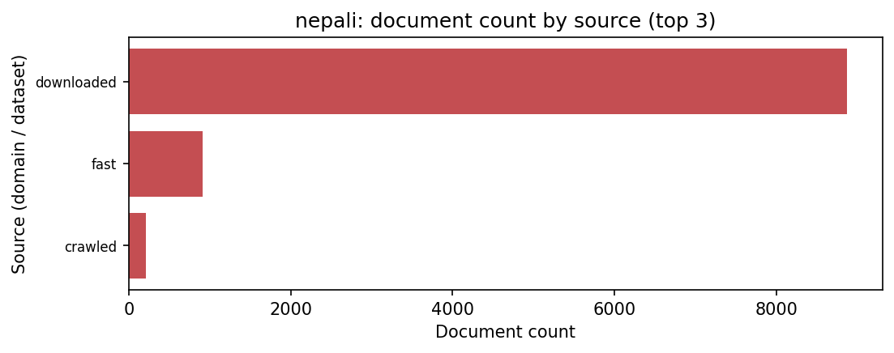

## 10. Tokenizer construction

2 algorithms × 6 vocabulary sizes = **12 tokenizers per language, 24 total**, each trained on a
sentence-split sample of its own training split and evaluated on its real held-out val split.
Settings fixed before measurement: `character_coverage=0.9995`, `byte_fallback=True`,
`pad=0, bos=1, eos=2, unk=3`.

**A silent bug had to be fixed first.** SentencePiece defaults `max_sentence_length` to **4192
bytes** and discards longer lines without warning. Devanagari costs 3 bytes/char, so that is ~1,400
characters, while splits are one document per line averaging ~1.6 kB. Training input is now split
into sentences on danda (।) by `lma/tokenizer/sample.py`. The sample is drawn by **stride**, not from
the head: splits are written manual-first, so a prefix sample would contain no downloaded text at all.

### Hindi sweep

| Vocab | Algorithm | Fertility | Chars/token | UNK | Vocab use | Embedding cost |
|---:|---|---:|---:|---:|---:|---:|
| 8,000 | bpe | 1.4197 | 3.661 | 0.0% | 0.967 | 16% |
| 8,000 | unigram | 1.3888 | 3.742 | 0.0% | 0.977 | 16% |
| 12,000 | bpe | 1.3390 | 3.882 | 0.0% | 0.958 | 25% |
| 12,000 | unigram | 1.3140 | 3.955 | 0.0% | 0.978 | 25% |
| 16,000 | bpe | 1.2926 | 4.021 | 0.0% | 0.948 | 33% |
| 16,000 | unigram | 1.2728 | 4.084 | 0.0% | 0.970 | 33% **← selected** |
| 24,000 | bpe | 1.2420 | 4.185 | 0.0% | 0.907 | 49% |
| 24,000 | unigram | 1.2305 | 4.224 | 0.0% | 0.915 | 49% |
| 32,000 | bpe | 1.2155 | 4.276 | 0.0% | 0.846 | 66% |
| 32,000 | unigram | 1.2073 | 4.305 | 0.0% | 0.841 | 66% |
| 48,000 | bpe | 1.1877 | 4.376 | 0.0% | 0.710 | 98% |
| 48,000 | unigram | 1.1841 | 4.389 | 0.0% | 0.695 | 98% |

### Nepali sweep

| Vocab | Algorithm | Fertility | Chars/token | UNK | Vocab use | Embedding cost |
|---:|---|---:|---:|---:|---:|---:|
| 8,000 | bpe | 1.5807 | 4.116 | 0.0% | 0.966 | 16% |
| 8,000 | unigram | 1.5411 | 4.222 | 0.0% | 0.972 | 16% |
| 12,000 | bpe | 1.4662 | 4.438 | 0.0% | 0.961 | 25% |
| 12,000 | unigram | 1.4393 | 4.521 | 0.0% | 0.975 | 25% |
| 16,000 | bpe | 1.4018 | 4.641 | 0.0% | 0.958 | 33% |
| 16,000 | unigram | 1.3802 | 4.714 | 0.0% | 0.970 | 33% **← selected** |
| 24,000 | bpe | 1.3271 | 4.903 | 0.0% | 0.936 | 49% |
| 24,000 | unigram | 1.3146 | 4.950 | 0.0% | 0.931 | 49% |
| 32,000 | bpe | 1.2852 | 5.063 | 0.0% | 0.893 | 66% |
| 32,000 | unigram | 1.2766 | 5.097 | 0.0% | 0.877 | 66% |
| 48,000 | bpe | 1.2385 | 5.254 | 0.0% | 0.789 | 98% |
| 48,000 | unigram | 1.2343 | 5.271 | 0.0% | 0.762 | 98% |

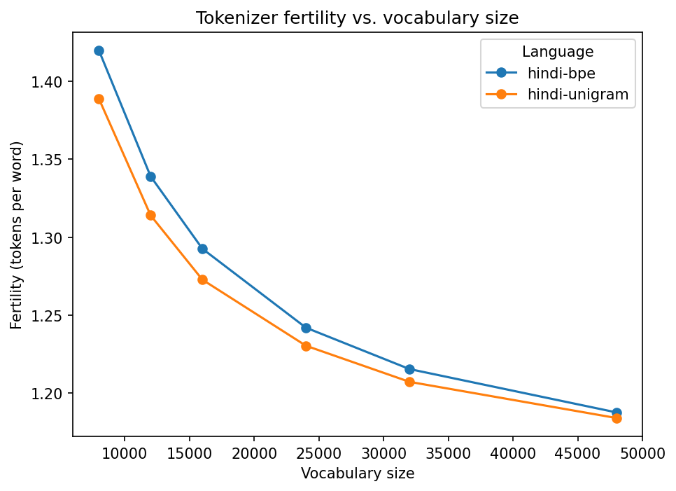
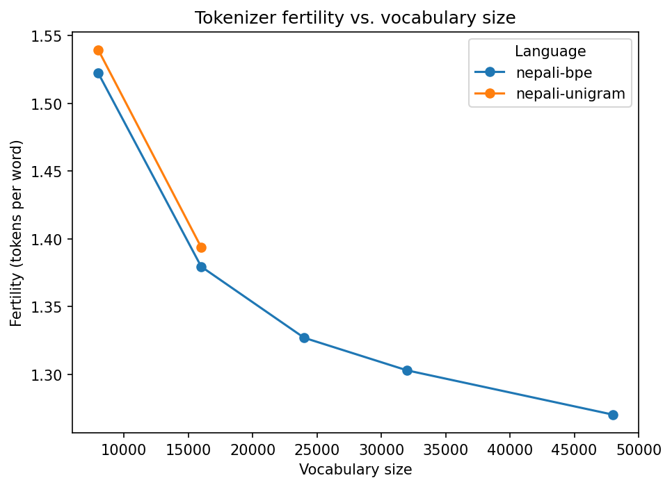

**Unigram beats BPE at every matched vocabulary size in both languages.**

**UNK rate is exactly 0.0% for all 24 models** — not luck, but `byte_fallback=True`: no input is
unrepresentable by construction. Verified independently in `tests/test_tokenizer_reference.py`, which
feeds the tokenizer Japanese text and an emoji and asserts UNK is still zero. No UNK plot is shown
because it would be a flat line at zero; the criterion collapses to fertility in practice.

### Selection: Unigram 16,000 for both languages

Embedding table = `vocab × d_model`; a decoder layer ≈ `12 × d_model²`. At d_model=512 with tied
weights, vocabulary trades directly against depth:

| Vocab | Embedding params | Share of 25M | Layers affordable |
|---:|---:|---:|---:|
| 8,000 | 4,096,000 | 16% | 6 |
| 12,000 | 6,144,000 | 25% | 6 |
| **16,000** | **8,192,000** | **33%** | **5 ← selected** |
| 24,000 | 12,288,000 | 49% | 4 |
| 32,000 | 16,384,000 | 66% | 2 |
| 48,000 | 24,576,000 | 98% | **0 — no model possible** |

48k would spend the entire budget on embeddings. 16k keeps 67% for the model, gives up ~3% fertility
against 24k, and has higher vocabulary utilisation (0.970 vs 0.915 Hindi).

**A flaw in automatic selection, worth recording.** The original elbow rule found each algorithm's
elbow independently, then compared them *at different vocabulary sizes*. On Nepali, BPE's improvement
never fell below 3%, so its search ran off the grid to 48k and "beat" Unigram's elbow at 24k. The
code now compares at a matched size and warns when an elbow never fires; the final choice is pinned
explicitly and recorded as pinned in `sweep_results.json`.

## 11. Qualitative subword tokenization samples and comparative analysis

Four real held-out sentences per language, segmented under **both** tokenizers. Word starts (U+2581)
are shown as `_`.

#### Hindi held-out sentences

> इन दोनों घटनाओं के पीछे सबसे बड़ा कारण नशा था।

- **hi tokenizer (11 pieces):** `_इन | _दोनों | _घटनाओं | _के | _पीछे | _सबसे | _बड़ा | _कारण | _नशा | _था | ।`
- **ne tokenizer (23 pieces):** `_इन | _दो | न | ों | _घटना | ओ | ं | _के | _पी | छ | े | _सब | से | _बड | <0xE0> | <0xA4> | <0xBC> | ा | _कारण | _न | शा | _था | ।`

> खुफिया ठिकानों पर पुलिस के आला अफसरों ने पूछताछ की।

- **hi tokenizer (11 pieces):** `_खुफिया | _ठिकानों | _पर | _पुलिस | _के | _आला | _अफसरों | _ने | _पूछताछ | _की | ।`
- **ne tokenizer (21 pieces):** `_खु | फ | िया | _ठिक | ान | ों | _पर | _पुलिस | _के | _आ | ला | _अफ | सर | ों | _ने | _पू | छ | ता | छ | _की | ।`

> जल्द ही घटना को वर्क आउट कर दिया जाएगा।

- **hi tokenizer (10 pieces):** `_जल्द | _ही | _घटना | _को | _वर्क | _आउट | _कर | _दिया | _जाएगा | ।`
- **ne tokenizer (16 pieces):** `_जल | ् | द | _ | ही | _घटना | _को | _वर्क | _आउट | _कर | _द | िया | _जा | ए | गा | ।`

> देर रात तक दस से ज्यादा लोगों को उठाया गया।

- **hi tokenizer (11 pieces):** `_देर | _रात | _तक | _दस | _से | _ज्यादा | _लोगों | _को | _उठाया | _गया | ।`
- **ne tokenizer (17 pieces):** `_द | ेर | _रात | _त | क | _दस | _से | _ज्यादा | _लोगो | ं | _को | _उठ | ा | या | _ग | या | ।`

#### Nepali held-out sentences

> तर यो नै साझा वा अन्तिम प्रतिवेदन होइन।

- **ne tokenizer (9 pieces):** `_तर | _यो | _नै | _साझा | _वा | _अन्तिम | _प्रतिवेदन | _होइन | ।`
- **hi tokenizer (10 pieces):** `_तर | _यो | _नै | _साझा | _वा | _अन्तिम | _प्रतिवेदन | _हो | इन | ।`

> प्रचण्डले शुक्रबारै नयाँ प्रतिवेदन पेश गरे।

- **ne tokenizer (8 pieces):** `_प्रचण्डले | _शुक्रबार | ै | _नयाँ | _प्रतिवेदन | _पेश | _गरे | ।`
- **hi tokenizer (14 pieces):** `_प्र | च | ण्ड | ले | _शुक्र | बार | ै | _नया | ँ | _प्रतिवेदन | _पेश | _ग | रे | ।`

> तर विहिबार उनले पेश गरेको प्रस्तावबारे नेताहरुले खुलेर बोल्न चाहेनन्।

- **ne tokenizer (13 pieces):** `_तर | _विहिबार | _उनले | _पेश | _गरेको | _प्रस्ताव | बारे | _नेताहरुले | _खुलेर | _बोल्न | _चाहे | नन् | ।`
- **hi tokenizer (25 pieces):** `_तर | _वि | हि | बार | _उन | ले | _पेश | _ग | रे | को | _प्रस्ताव | बार | े | _नेता | हर | ुल | े | _खुले | र | _बोल | ्न | _चाहे | न | न् | ।`

> “बैठकमा हामी झन्डै झन्डै सहमति नजिक पुगेका थियौं।

- **ne tokenizer (13 pieces):** `_“ | बै | ठ | क | मा | _हामी | _झन्डै | _झन्डै | _सहमति | _नजिक | _पुगेका | _थियौं | ।`
- **hi tokenizer (24 pieces):** `_“ | बै | ठ | क | मा | _हा | मी | _झ | न्ड | ै | _झ | न्ड | ै | _सहमति | _न | ज | िक | _पु | गे | का | _थि | य | ौं | ।`

### Comparative analysis

| Sentences | Words | Own tokenizer | Other tokenizer | Penalty |
|---|---:|---:|---:|---:|
| Hindi (4) | 39 | 43 tokens (1.103/word) | 77 tokens (1.974/word) | **+79.1%** |
| Nepali (4) | 32 | 43 tokens (1.344/word) | 73 tokens (2.281/word) | **+69.8%** |

**Not one of the eight sentences segments identically.** Four observations:

1. **Own-language tokenizers are near word-level; foreign ones shatter words.** Hindi's first sample
   (10 words) costs 11 pieces under Hindi and 23 under Nepali. The extreme case is प्रचण्डले, kept as a
   *single* piece by Nepali and broken into four (`_प्र | च | ण्ड | ले`) by Hindi — a name common in
   Nepali news is simply absent from a Hindi-built vocabulary.
2. **Byte fallback fires exactly where the orthographies differ.** बड़ा carries a nukta (U+093C),
   which Hindi uses and Nepali essentially does not, so the Nepali tokenizer decomposes it into raw
   UTF-8 bytes: `<0xE0> | <0xA4> | <0xBC>`. This is the 0% UNK rate made visible — nothing is
   unrepresentable, but representing it costs three tokens instead of being part of one.
3. **Shared Sanskrit vocabulary shows as near-agreement.** तर यो नै साझा वा अन्तिम प्रतिवेदन होइन। costs 9
   pieces under Nepali and 10 under Hindi — almost no penalty, because every content word is
   Sanskrit-derived. The same overlap gives the vocabularies 5,695 shared pieces (§12). The penalty
   is not uniform: small on shared vocabulary, large on language-specific morphology.
4. **Inflectional suffixes diverge most.** Nepali's -हरु, -ले, -मा, -बारे survive as single pieces in
   Nepali and are re-segmented character-by-character by Hindi; Hindi's -ों plurals behave
   symmetrically in reverse. The fertility gap between languages (1.2728 vs 1.3802) is largely this.

**Why it matters:** a 70–79% token penalty means training one model on the other's tokenizer would
consume ~1.7× the context window for the same content and inflate perplexity for reasons unrelated to
language ability. That is the practical argument for per-language tokenizers, independent of the
assignment requiring them.

## 12. Independence verification

| Check | Result |
|---|---|
| Directory separation | no cross-language path references |
| Document overlap | **0** (Hindi 3,587,040 vs Nepali 5,536,919; the checker skips blank lines, so a handful below the encoder's 3,587,045 / 5,536,928) |
| Tokenizer files | model hashes differ (`0683a15aa93d…` vs `371ebc2d5d05…`) |
| Vocabularies | both 16,000 pieces; 5,695 shared, 10,305 unique to each |
| Checkpoints | skipped — Phase 2 not started |

The 5,695 shared pieces are stated plainly rather than hidden: two languages sharing a script and a
Sanskrit-derived lexicon *will* share subwords, and zero overlap would indicate a broken tokenizer.
What the requirement forbids is a shared tokenizer or shared data, and both are verified distinct.

## 13. Encoding for Phase 2

`.bin` holds uint16 token ids, `.idx` holds uint64 cumulative document offsets, so document *i* is
`bin[idx[i]:idx[i+1]]` — memmap-friendly, so Phase 2 never loads the corpus.

| | Hindi | Nepali |
|---|---:|---:|
| Tokenizer | `hindi\tokenizer\hindi_unigram_16000.model` | `nepali\tokenizer\nepali_unigram_16000.model` |
| Total tokens | **517,640,653** | **572,506,257** |
| `.bin` size | 1.03 GB | 1.14 GB |
| Encoding time | 334 s | 458 s |

Each split is verified after writing: the arrays are read back and `.idx`/`.bin` counts checked
against what the encoder reported. An `.idx` disagreeing with its `.bin` would silently feed Phase 2
documents starting mid-sentence.

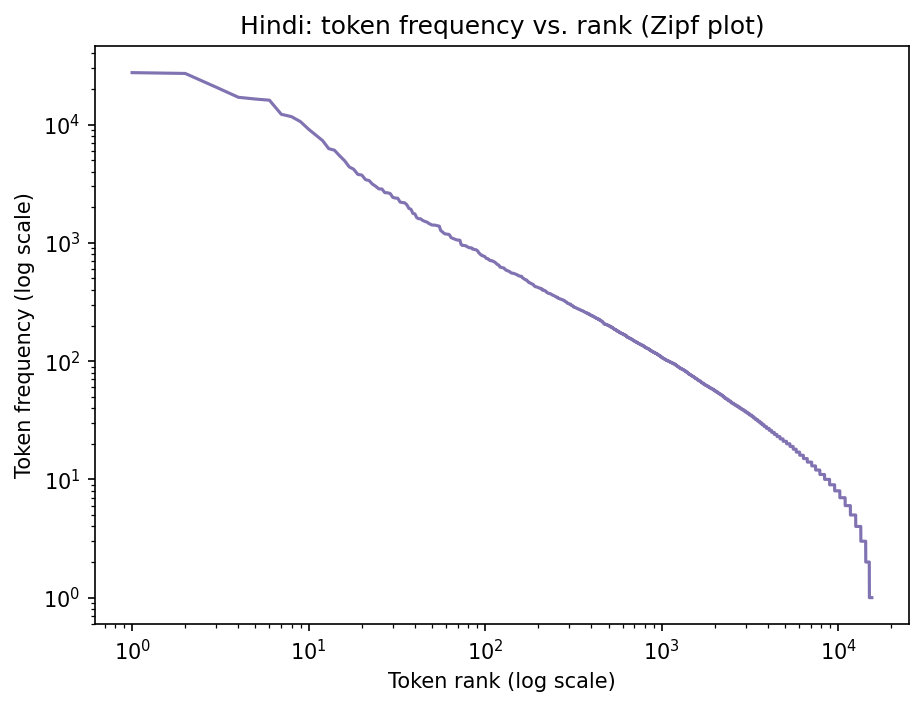
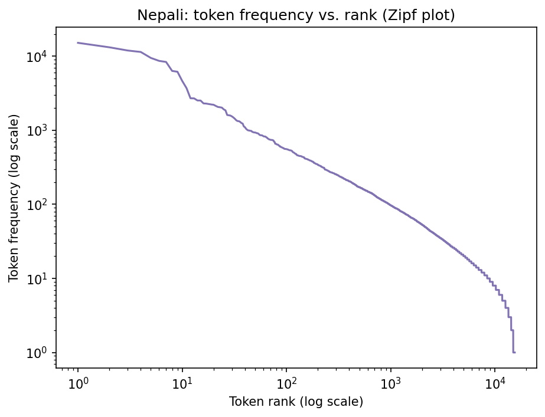
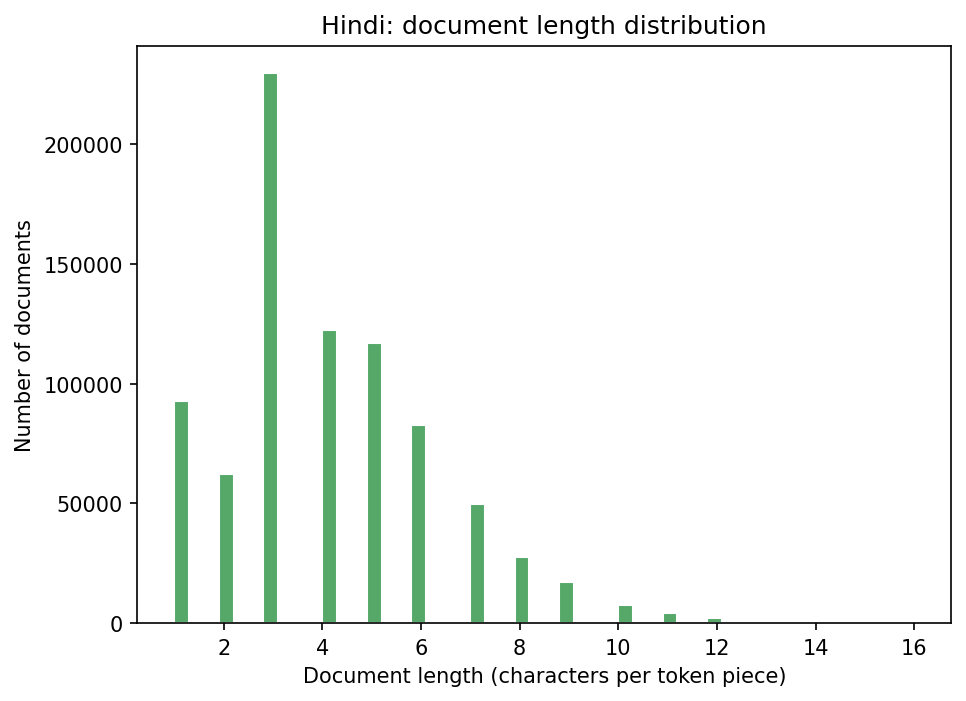
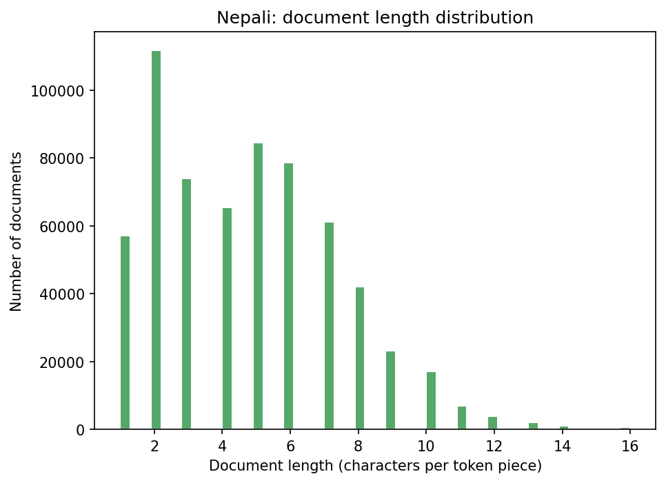

## 14. Reproducibility

`scripts/reproduce.sh` runs the whole pipeline end to end on a bundled sample in ~2 minutes, no GPU,
against an isolated demo directory. Beyond that, three properties:

1. **Deterministic hashing** (`xxhash`, not Python's salted builtin). Two independent full Nepali
   cascades produced byte-identical stage counts: 286,181 survivors, 43,378 recurring paragraphs,
   1,836,622 paragraphs removed.
2. **Deterministic splits** — held-out membership from a hash of the document itself, cap applied by
   stream position.
3. **Resumability** — `--from-interim` redoes only the split phase; the resumed and full paths call
   the same function, so they cannot drift.

**354 tests**, including cross-process MinHash determinism, MinHash validated against `datasketch`,
and tokenizer metrics validated against an independently trained HuggingFace BPE.

## 15. Bugs found by running, not reading

1. **Safety blocklist deleted good prose** — `"...".split()` shredded multi-word entries, leaving का
   ("of"), करें ("do"), कैसे ("how") in the blocklist. Every article hit two; 5.4% of good documents
   silently deleted. Now an explicit tuple, with single-token slurs and instructional phrases counted
   separately.
2. **Coherence scored zero for everything** — the IDF issue in §3.
3. **A hand-picked threshold wrong by an order of magnitude** — 0.04 sat at Wikipedia's 10th percentile.
4. **JSON metadata only stripped from the document start** — the blobs are mid-document and nested;
   1,285 documents were rejected for symbol density caused by metadata the pipeline thought it had
   removed. Fixed with a balanced-brace scanner.
5. **Thresholds that could never fire** — ad-cluster threshold 0.35 against a measured maximum of
   0.0214. Replaced with a relative rule (95th percentile + 2×-median guard).
6. **A threshold removing real prose** — dup-5gram 0.30 rejected legitimate Hindi news (gold prices
   city by city). Moved to 0.40 after reading the rejected documents.
7. **Three memory failures on a 7.4 GB machine** — cascade held the whole corpus (now streams through
   interim files, workers capped by *available memory*); SentencePiece died on 5M sentences (cut to
   1M, stride-sampled); the encoder concatenated every array (~2.3 GB peak, now streams).
8. **Splits desynchronised from manifests** — the writer sanitised only `\n`, but Python also splits
   on `\r`; **21,823 Hindi documents** were written as one line and read back as two, misattributing
   every document after the first. Caught by a lockstep length check.

## 16. Deliverables

| # | Deliverable | Location |
|---|---|---|
| 1 | Collection scripts | `scripts/run_crawl.py`, `fast_crawl.py`, `run_wiki.py`, `fetch_downloaded.py`, `lma/crawl/` |
| 2 | Preprocessing pipelines | `hindi/clean/`, `nepali/clean/` (10 modules each) + `scripts/build_corpus.py` |
| 3 | Dataset statistics | `<lang>/data/stats.json`, `result.md`, this report, `report/figures/` |
| 4 | Train/val/test splits | `<lang>/data/splits/` — on Drive + HuggingFace (5.5 + 7.5 = 13.0 GB) |
| 5 | Tokenizer training code | `lma/tokenizer/`, `scripts/tokenizer_sweep.py` |
| 6 | Vocabulary files | `hindi/tokenizer/hindi_unigram_16000.vocab`, `nepali/…_16000.vocab` |
| 7 | Tokenizer models | `hindi_unigram_16000.model`, `nepali_unigram_16000.model` |

Hosted externally (19.9 GB essential, 25.7 GB with intermediates): `raw/` 3.1+3.8 GB (irreplaceable),
`splits/` 5.5+7.5 GB, `encoded/` 1.0+1.2 GB, `interim/` 1.2+1.9 GB. Tokenizers and all statistics
files are committed, so every number here is checkable without downloading the corpus.

## 17. Limitations

1. **Held-out sets are mildly biased** by decontaminating the held-out side (§8).
2. **The downloaded side is not independently verified** — IndicCorpV2's quality is inherited.
3. **The parameter-budget analysis assumes** d_model=512 and tied embeddings; fertility measurements
   are unaffected.
4. **Vocabulary is defensibly chosen, not proven optimal** — 12k is a genuine alternative (25% of
   budget, highest utilisation measured, ~3% worse fertility).
5. **Emoji are not specifically filtered** — measured residue: 0.69% of Hindi documents and 0.05% of
   Nepali contain any emoji (0.00078% / 0.00007% of characters), caught only incidentally by the
   symbol-ratio rule; `byte_fallback` tokenises them losslessly.

---

*Every number here comes from `<lang>/data/stats.json`, `<lang>/tokenizer/sweep_results.json`,
`<lang>/data/encoded/encoding.json`, `report/figures/langid_confusion.json` and
`report/figures/tokenization_samples.json`, all produced by the pipeline and committed. `result.md`
is a regenerable side-by-side summary (`python scripts/summarize_runs.py`).*
