# Phase 2 Report — Model Implementation, Pretraining, and Evaluation

**Yogendra Patel** · Roll No. 2025201098 · CL3410 Language Models and Agents, Monsoon 2026

- **Code:** <https://github.com/CL3-410/individual-project-CReativeRebe1>
- **Checkpoints + data (Drive):** <https://drive.google.com/drive/folders/1lkP2GJKqgr-uzzz-WLeChOM_flqOe8xQ?usp=sharing>
- **Dataset (HuggingFace):** <https://huggingface.co/datasets/YogendraPatel/LMA_Individual_Project>

> This is the Markdown edition of the report. `report/phase2.tex` / `phase2_report.pdf` is the
> typeset version with the architecture diagram; the content is the same, except that this file can
> show Devanagari inline (the LaTeX build uses pdflatex and avoids Indic glyphs), so the generated
> samples in §7 appear here in the original script rather than transliterated.

**Headline.** Two decoder-only Transformers of **23,846,784 parameters** each, implemented from
scratch and pretrained independently for exactly one epoch on their own Phase-1 corpora — Model H on
**515,899,392** Hindi tokens, Model L on **571,211,776** Nepali tokens — on 2×T4 under DDP. Test
results: Model H **PPL 31.01 / 0.4819 BPB**; Model L **PPL 52.16 / 0.4561 BPB**. *The ranking
reverses between the two metrics* (§6.2). Validation loss fell monotonically at every evaluation in
both runs; neither model overfitted. Both models independently converge on layer 6 as a focusing
layer at mean attention distances of 17.46 and 17.43 tokens (§8.3). 453 tests pass.

---

## 1. Architecture

| Hyperparameter | Value | Reason |
|---|---:|---|
| Vocabulary | 16,000 | per language, from Phase 1's sweep |
| `d_model` | 384 | see depth/width argument below |
| Layers | 10 | deeper-narrower at fixed budget |
| Heads | 6 | `head_dim` = 64 |
| FFN hidden | 1,024 | (8/3)·d — SwiGLU at the cost of a 4d plain MLP |
| Context | 1,024 | |
| Norm | pre-norm RMSNorm | stability at depth (§1.4) |
| Activation | SwiGLU | |
| Positional | RoPE | zero parameters (§1.2) |
| Tying | yes | saves 6,144,000 params |
| Dropout | 0.0 | justified in §1.4 |

Built from `nn.Linear`, `nn.Embedding`, `nn.Dropout` and explicit tensor maths only. No
`nn.Transformer*`, no HuggingFace model classes, no pre-built attention, no pretrained weights.

### 1.1 Parameter budget

| Component | Parameters | Share |
|---|---:|---:|
| Token embedding 16,000 × 384 (tied to output head) | 6,144,000 | 25.8% |
| *Per block:* attention (fused QKV + out proj, 4d²) | 589,824 | |
| *Per block:* SwiGLU (gate + up + down, 3·d·1024) | 1,179,648 | |
| *Per block:* RMSNorm gains (2 × 384) | 768 | |
| **Per block total** | **1,770,240** | |
| All 10 blocks | 17,702,400 | 74.2% |
| Final RMSNorm | 384 | |
| Output head (tied — counted once above) | 0 | |
| **Total** | **23,846,784** | 100% |
| Non-embedding | 17,702,784 | |

**Depth/width trade-off.** The embedding costs `16,000 × d` regardless of depth — a tax on *width*,
not depth. At d=512 it alone would be 8,192,000 params and only ~6 layers would fit in ~24M. At
d=384 it costs 6,144,000 and ten layers fit. Depth buys composition, and the attention analysis (§8)
is direct evidence the depth is used: head behaviour changes systematically from layer 0 to layer 9.

**The count is asserted, not hoped for.** Both config files compute it analytically at import and
raise outside 23–25M. Writing the FFN width as the conventional `4d = 1536` — correct for a
*non*-gated MLP — gives 2,360,064 per layer and **29,745,024** total, 19% over budget, and nothing
in a training run would report it. A gated FFN has three matrices where a plain one has two, so the
width preserving the count is (8/3)d = 1024.

### 1.2 Positional encoding: RoPE

Chosen over a learned table for two reasons:

- **Cost.** A learned 1024×384 table is **393,216 parameters** — 1.6% of the budget on something
  rotary embeddings do free. Sinusoidal is also free, so this alone doesn't separate RoPE from it.
- **Behaviour, which does.** RoPE rotates Q and K so that after rotation `q_m · k_n` depends on m and
  n only through `m − n`. Position enters attention as *relative distance* with no bias table.
  Asserted numerically in `tests/test_model.py`: the same content vector at different absolute
  positions with a fixed gap gives dot products agreeing to 1e-4.

**How it constrains max sequence length.** A learned table has no entry past its training length —
a hard ceiling. RoPE has no table, so the ceiling is soft; the practical limit is the precomputed
cos/sin cache, built to `max_seq_len` and registered as a **non-persistent** buffer so it's rebuilt
from config on load rather than stored in the checkpoint. Extending context is a config change, not
retraining. Quality still degrades past the trained length (unseen relative distances), but smoothly.

Uses the paper's Eq. (34) interleaved convention — consecutive dims (0,1), (2,3)… form the rotation
planes — not the split-half `rotate_half` variant. The two are equally expressive but **not
interchangeable across a checkpoint**, so `lma/model/rope.py` is the single definition both the
training path and the analysis path call. Angles and rotation are computed in fp32 even under fp16
autocast: θ_p spans 1.0 down to 1e-4, and fp16's ~3 decimal digits would lose the high-frequency
planes.

### 1.3 Multi-head causal self-attention

Shapes: `[B,T,d]` → fused `Linear(d, 3d)` → split → `view` → `[B,T,h,d_k]` → `transpose(1,2)` →
`[B,h,T,d_k]`. Inverse is `transpose(1,2)` → `contiguous()` → `view` → `[B,T,d]`. The
`contiguous()` is required: `transpose` only permutes strides and `view` needs a contiguous buffer.

```
Attention(Q,K,V) = softmax(QKᵀ / √d_k + M) V
```

**Why the 1/√d_k scaling.** `q·k` sums d_k unit-variance products, so its std grows as √d_k. At
d_k=64 unscaled scores have std ≈ 8, spanning tens of units per row. Softmax over that is nearly
one-hot and its gradient nearly zero — the model stops learning *where* to attend almost immediately
while still training V and W_O, producing something that looks like it's learning with no working
attention.

**Causal mask, verified behaviourally.** `M` is additive, 0 allowed / −∞ future, applied *before*
softmax so masked positions get exactly zero. Inspecting the mask proves only that a mask exists.
The real check, exactly as the assignment describes: perturb token *t*, assert logits at all
positions *< t* are unchanged (to 1e-6) **and** that position *t* itself does change — the second
half matters, since a model ignoring its input would pass the first. Run against both attention
paths.

**Attention is implemented twice, deliberately.** `forward(..., output_attentions=False)` routes to
`F.scaled_dot_product_attention`, which fuses matmul–softmax–matmul and never materialises the
`[B,h,T,T]` tensor — at B=16, h=6, T=1024 that's 1.5 GB per layer in fp32, which doesn't fit on a
16 GB T4 beside the model, optimizer and activations. `output_attentions=True` runs the explicit
form and *returns* A; the fused kernel gives no way to read A back, which is precisely how it saves
the memory.

**A test asserts the two agree to `atol=1e-5`.** Without it, a divergence — missing scale, mask off
by one row, RoPE applied in a different order — would mean every attention figure in §8 describes a
model that was never trained, and the heatmaps would still look like plausible attention. That test
licenses the entire attention analysis.

*Defect found while auditing against the spec:* the fast path passed `dropout_p` to SDPA but the
manual path applied **no** dropout to attention probabilities. At any dropout > 0 in train mode the
two paths computed different functions, and the equivalence test would not have caught it because it
correctly runs in eval mode. Both paths now apply it.

### 1.4 Transformer block

```
x ← x + Dropout(Attn(RMSNorm(x)))
x ← x + Dropout(SwiGLU(RMSNorm(x)))
```

**Pre-norm.** Normalisation sits *inside* the residual branch, so the identity path is unnormalised
and gradients reach layer 0 without passing through ten norms. Post-norm puts the norm on the
residual path itself; at ten layers the gradient is attenuated by every one, and the standard remedy
(long warmup) becomes its own tuning problem. Pre-norm is why warmup here is 2% of training (78 and
87 steps) rather than several hundred.

**RMSNorm** rescales by RMS with no mean subtraction — one reduction instead of two, no bias. The
fp32 cast is not decoration: under fp16 autocast, squaring activations of magnitude ~300 overflows
fp16's 65504 ceiling, the sum-of-squares becomes `inf`, `rsqrt(inf)` is 0, and the layer silently
outputs zeros. A test feeds RMSNorm an fp16 tensor of 300.0 and asserts finite non-zero output.

**SwiGLU:** `down(SiLU(gate(x)) ⊙ up(x))`. Hidden width (8/3)d = 1024 so `3·d·(8/3)d = 8d² =
2·d·4d` — a gated FFN at the parameter cost of the plain one it replaces. At d=384 that's exactly
1024, also a clean multiple of 64 for tensor-core alignment.

**What breaks if removed.** Residuals → no short gradient path in a 10-layer pre-norm stack, training
stalls at init. Norm → activations compound multiplicatively with depth until fp16 overflows. Causal
mask → the model attends to the token it must predict, loss collapses toward zero, model worthless.
FFN → each block is a linear map of value vectors; attention alone has no elementwise non-linearity.
1/√d_k → attention stops learning while the rest of the model continues.

**Dropout is 0.0, and that's a decision.** Wired in all three conventional places (embeddings,
attention probabilities, both sublayer outputs) and set to zero. Each model sees ~22–24 tokens per
parameter for exactly *one* epoch, so no token is seen twice and there is nothing to memorise.
Empirical justification in §5: val loss fell monotonically in both runs, and Model L's final
training loss is *higher* than its validation loss.

### 1.5 Output head and objective

Linear d → vocab, weight-tied to the embedding: saves **6,144,000 parameters**, 26% of the budget or
roughly three more layers. Also regularises — a token's input and output representations are forced
to be the same vector. Objective is cross-entropy between logits at position *t* and the token at
*t+1*.

**A subtlety tying introduces.** A test written to assert untrained loss = ln(V) measured 3.98
against an expected 4.57. The cause is real: with a tied head the residual stream at position *i*
still carries `emb(x_i)`, so `logits[i, x_i]` is that vector dotted with itself — the *identity*
mapping is partly learned at initialisation. With genuine next-token targets the loss does start at
ln(V) (Model H's first logged loss is 9.109 against ln(16000) = 9.680). Both behaviours are now
asserted.

**Init.** All weights ~ N(0, 0.02²), except the two projections per block that *write* into the
residual stream (attention out, SwiGLU down), scaled by 1/√(2N). With N independent contributions
the stream's variance grows linearly with depth; the scaling keeps it flat.

---

## 2. Data pipeline

Phase 1 wrote each corpus as a flat `uint16` token stream (`.bin`) plus `uint64` cumulative document
offsets (`.idx`). Windows are cut straight out of the stream and may cross document boundaries — the
EOS token teaches the model where a document ends, and per-document padding would waste a large
fraction of every batch. The array is memmapped throughout, never materialised (1.01 GB and 1.13 GB
against a 7.4 GB development machine — the same constraint that shaped every Phase-1 stage).

**Windows come from a shuffled permutation, not sampling with replacement.** Drawing 504,000 windows
uniformly from 504,000 covers only 1 − e⁻¹ ≈ 63%: a third of the corpus never seen, some windows
seen three times, in a run reported as "one epoch". A permutation gives exact coverage, is seed-
reproducible, and makes resume a single integer.

**DDP ranks are interleaved, not split contiguously.** The Phase-1 splits are manual-first,
downloaded-second (the same ordering that forced stride sampling for tokenizer training). A
contiguous split would train rank 0 almost entirely on manual crawl and rank 1 on downloads; DDP
averages gradients so the model survives, but per-rank loss curves would diverge for reasons
unrelated to optimisation, and the single-GPU fallback would silently train on a skewed subset.
Rank *r* takes window indices `w ≡ r (mod R)` — disjoint **and** distributionally identical. Both
asserted in `tests/test_train.py`.

---

## 3. Optimisation

| Setting | Value | Reason |
|---|---|---|
| Optimizer | AdamW, β=(0.9, 0.95) | β₂=0.95, not 0.999 |
| Weight decay | 0.1, matrices only | not on RMSNorm gains or biases |
| Peak LR | 6e-4 | standard for ~25M at 131k tokens/step |
| Schedule | 2% linear warmup → cosine to 0.1× peak | |
| Warmup | 78 (H) / 87 (L) steps | derived per corpus |
| Grad clip | 1.0 global norm | |
| Micro-batch | 16 seq × 1024 tok per GPU | |
| Grad accumulation | 4 | |
| **Effective batch** | **131,072 tokens/step** | 16 × 1024 × 4 × 2 GPUs |

**β₂ = 0.95.** Adam's 0.999 gives the second-moment estimate a ~1000-step time constant; on a
3,936-step run that's a quarter of training with a stale variance estimate, and it reacts slowly to
the loss spikes a 16,000-way softmax produces early. At 0.95 it adapts over ~20 steps.

**Decay on matrices only.** Rule is dimensionality: ≥2 dims are matrices mapping between spaces and
can overfit; 1-D are per-feature scales. Decaying an RMSNorm gain pulls it toward zero, scaling that
layer's entire output toward zero.

**The schedule is a pure function of the step, not a scheduler object.** A `lr_scheduler` carries
state that must be restored in lockstep with the optimizer, and an off-by-one there is a classic
silent resume bug — the run continues at a learning rate hundreds of steps out of place and nothing
reports it. `lr_at(step, …)` cannot drift. Cosine floors at 0.1× peak because the last steps of a
cosine-to-zero take effectively no gradient step at all.

**fp16, not bf16 — hardware, not preference.** Kaggle's T4 is Turing (`compute_cap` 7.5): fp16
tensor cores, **no bf16 at all**. Requesting bf16 either raises or silently runs fp32 at ~⅓ the
throughput. Gradients are **unscaled before clipping**: they carry the scaler's factor at that
point, so clipping at 1.0 would clip at 1.0/scale in real terms — almost everything, almost always.
That ordering is the entire reason `GradScaler` exposes `unscale_()`.

**DDP** over `DataParallel`: DataParallel drives both GPUs from one process, replicating and
gathering through the host every step, and the GIL makes it slower than one GPU before it's faster
than two. `no_sync` suppresses the all-reduce on every micro-step but the last — without it,
4 micro-steps means 4 all-reduces per optimizer step with 3 discarded. Every helper in
`lma/train/ddp.py` also works when `torchrun` never ran, so the loop is written once for the
distributed case and the single-GPU path falls out of it.

---

## 4. Checkpointing and logging

Kaggle stops a session at 12 h and can end one on idle timeout, always without a catchable signal.
The guarantee needed isn't "save on exit" but *whatever is on disk is always loadable*.

**Atomic writes.** `torch.save` straight to `ckpt_last.pt` streams 273 MB for a second or two; a kill
inside that window leaves a truncated file **and** has already destroyed the previous good one.
Writes go to `.tmp` then `os.replace`. A test simulates a crash mid-save and asserts the previous
checkpoint still loads.

**Contents:** weights (DDP-unwrapped), optimizer state, scaler state, scheduler parameters, step,
tokens seen, sampler position, RNG states (torch/numpy/CUDA), model config. Optimizer moments are
two-thirds of the file; dropping them restarts AdamW cold, visible as a loss spike exactly at resume.

On scheduler state: there is no scheduler *object* by design. The scheduler state for this design is
the four numbers determining `lr_at` — peak LR, warmup steps, total steps, floor ratio — so the LR at
any step is recoverable from the checkpoint alone.

**Append-only logging.** Every file opened `"a"`, every time. A logger opened `"w"` — the default
nearly everywhere — erases the entire loss curve the moment a resumed session starts. Each record
carries a `run_id`.

*Bug caught by a test written for something else:* `read_log` originally keyed by step and
**replaced** on collision. The loop writes train metrics every `log_every` and val metrics every
`eval_every`, so an eval step writes the same step number twice — and the val record was deleting the
train record, losing one training point every 250 steps. Now **merges** within a `run_id` and
**replaces** across `run_id`s, which is correct for both cases (the second being a resumed run
legitimately recomputing steps after its last checkpoint).

---

## 5. Pretraining results

| | Model H (Hindi) | Model L (Nepali) |
|---|---:|---:|
| Steps | 3,936 / 3,936 | 4,358 / 4,358 |
| Tokens seen | 515,899,392 | 571,211,776 |
| Corpus | 515,972,223 | 571,227,702 |
| Coverage | 99.986% | 99.997% |
| Epochs | 1.000 | 1.000 |
| Sessions | 1 | **2 — died and resumed** |
| Compute (2×T4) | 1 h 55 m | ~2 h 00 m |
| Median throughput | 75,699 tok/s | 79,653 tok/s |
| Peak GPU mem/device | 6.72 GB | 6.72 GB |
| First train loss | 9.109 | 9.271 |
| Final train loss | 3.437 | 3.826 |
| Final val loss | 3.4237 | 3.9371 |
| Val evaluations | 16 (all improved) | 18 (all improved) |
| fp16 scaler backoffs | **0** | **0** |
| Scaler scales | 65,536 → 131,072 | 65,536 → 262,144 |
| Grad norm mean/max | 0.440 / 1.545 | 0.448 / 1.705 |
| Steps clipped (>1.0) | 4 / 394 | 5 / 441 |

**Step count is set by tokens-per-step, not by anything about quality:**

```
tokens_per_step = micro_batch × block_size × grad_accum × n_gpus = 16 × 1024 × 4 × 2 = 131,072
max_steps       = train_tokens // tokens_per_step
                = 515,972,223 // 131,072 = 3,936   (Hindi)
                = 571,227,702 // 131,072 = 4,358   (Nepali)
```

A setup with half the tokens-per-step reaches the same corpus in twice the steps. **Steps are not
comparable across configurations; tokens are.**

### Validation trajectory

| Step | H val loss | H PPL | | Step | L val loss | L PPL |
|---:|---:|---:|---|---:|---:|---:|
| 250 | 4.9273 | 138.01 | | 250 | 5.4498 | 232.72 |
| 500 | 4.3774 | 79.63 | | 500 | 4.8308 | 125.31 |
| 1000 | 3.8999 | 49.40 | | 1000 | 4.4219 | 83.25 |
| 1500 | 3.7059 | 40.69 | | 1500 | 4.2415 | 69.51 |
| 2000 | 3.6002 | 36.61 | | 2000 | 4.1370 | 62.62 |
| 2500 | 3.5251 | 33.96 | | 2500 | 4.0655 | 58.29 |
| 3000 | 3.4735 | 32.25 | | 3000 | 4.0121 | 55.26 |
| 3500 | 3.4403 | 31.20 | | 3500 | 3.9738 | 53.18 |
| **3936** | **3.4237** | **30.68** | | **4358** | **3.9371** | **51.27** |

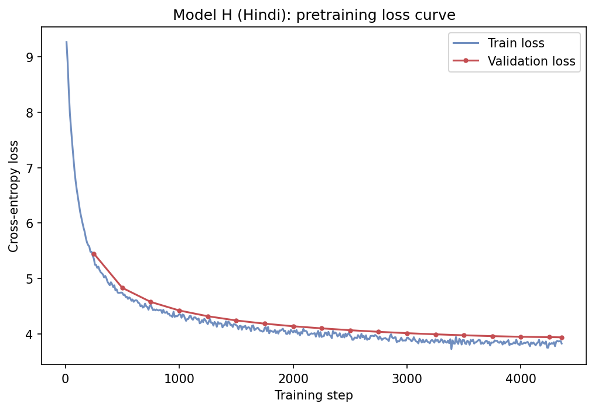


**Neither model overfitted.** Val loss decreased at *every one* of the 16 and 18 evaluations — never
once ticked up. Model L's train–val gap is **−0.112** (training loss *higher* than validation). Both
follow from the one-epoch design: no token seen twice, nothing to memorise, so the whole curve is
generalisation. This is also the empirical justification for dropout = 0.

**Why exactly one epoch.** Chinchilla-optimal is ~20N tokens; at 23.85M that's ~477M, and the corpora
hold 516M and 571M — so one epoch lands just past compute-optimal:

| | tokens/param |
|---|---:|
| Chinchilla optimal | 20.0 |
| Model H | 21.6 |
| Model L | 24.0 |

A second epoch would reuse tokens, making val loss no longer a clean generalisation measure.

**fp16 was never at risk.** Zero backoffs; the scale *grew*, and that growth is the evidence —
`GradScaler` only doubles after 2,000 **consecutive** overflow-free steps. Gradient norms averaged
0.44 against a 1.0 clip; 9 of 835 logged steps clipped across both runs, all in warmup. The clip
acted as a guard, never a brake.

**Resume proven in production.** Model L's Kaggle session died mid-run. Re-running the identical cell
resumed from `ckpt_last.pt`: two `run_id`s in the log, step counter continued, no history lost.

---

## 6. Language-modelling evaluation

All numbers below are **test** split, evaluated once, after every other decision was final.

### 6.1 Perplexity and bits-per-byte

| | H val | **H test** | L val | **L test** |
|---|---:|---:|---:|---:|
| Cross-entropy (nats/tok) | 3.4124 | **3.4344** | 3.9364 | **3.9544** |
| **Perplexity** | 30.34 | **31.01** | 51.23 | **52.16** |
| Bits/token | 4.923 | 4.955 | 5.679 | 5.705 |
| **Bits/byte** | 0.4744 | **0.4819** | 0.4545 | **0.4561** |
| Tokens scored | 821,248 | 845,824 | 633,856 | 643,072 |
| UTF-8 bytes | 8,521,544 | 8,696,890 | 7,920,263 | 8,042,895 |
| Bytes/token | 10.376 | 10.282 | 12.495 | 12.507 |

Test is 2.2% (H) and 1.8% (L) worse than validation — expected direction, about as small as such a
gap gets. Because val loss decreased monotonically, `ckpt_best.pt` and `ckpt_last.pt` are the same
checkpoint, so essentially **no model selection occurred** and the val numbers were already close to
unbiased.

### 6.2 Why the two models must be compared by bits-per-byte

> Model H's test perplexity (31.01) is 40% lower than Model L's (52.16), inviting the conclusion
> that the Hindi model is substantially stronger. **That conclusion is an artifact of the
> tokenizers.** Per byte the ordering *reverses*: 0.4819 (H) against **0.4561** (L).

Perplexity is per-*token*, and the assignment requires separately-trained tokenizers — which Phase 1
produced. A token is a different amount of language in each model. Nepali packs **12.507 bytes** per
token against Hindi's **10.282**: each Nepali token carries 22% more text, so predicting one is
correspondingly harder, and part of Model L's higher perplexity is the tokenizer's doing.

```
BPB = (total NLL in nats / ln 2) / total UTF-8 bytes = bits per token / bytes per token
```

Bytes are the same unit in both languages. BPB also cannot be gamed by tokenizer choice: a
vocabulary that merges more aggressively lowers perplexity by making each token carry more text and
leaves BPB untouched. Check: 4.9548 / 10.282 = 0.4819 ✓.

The byte count is **measured** by decoding evaluated token ids back to text, not estimated from a
fertility constant — a constant would silently reabsorb the very difference the metric removes.

### 6.3 Generation quality

**Protocol.** 200 held-out documents ≥256 tokens, chosen deterministically. First **128 tokens** as
prompt, **128 generated**, scored against that document's true next 128. Prompts are real document
openings (via the `.idx` boundaries), not arbitrary mid-sentence windows. BLEU is corpus-level
**BLEU-4**. Full protocol stored in `metrics_test.json` so the table regenerates exactly.

The four settings the assignment names are run as **pure** temperature sweeps with no top-k/top-p —
mixing nucleus truncation into a row labelled "T=1.0" would make the number describe the truncation
as much as the temperature. Three nucleus settings are supplementary.

| Model | Setting | chrF | BLEU-4 | ROUGE-L | Dist-1 | Dist-2 | Rep-4 |
|---|---|---:|---:|---:|---:|---:|---:|
| **H** | greedy | 16.60 | 1.47 | 11.82 | 0.062 | 0.152 | 0.732 |
| | **T = 0.5** | 21.34 | **1.86** | **13.12** | 0.137 | 0.453 | 0.194 |
| | **T = 1.0** | **22.96** | 0.87 | 11.38 | 0.330 | 0.833 | 0.002 |
| | **T = 1.5** | 20.03 | 0.15 | 4.59 | 0.594 | 0.994 | 0.000 |
| | T=0.7, top-k 50 | 23.48 | 1.62 | 13.32 | 0.170 | 0.581 | 0.048 |
| | T=0.8, top-p 0.9 | **23.75** | 1.76 | 13.23 | 0.208 | 0.662 | 0.021 |
| | T=1.0, top-p 0.95 | 23.00 | 1.10 | 11.80 | 0.313 | 0.817 | 0.001 |
| **L** | greedy | 18.35 | 0.78 | 7.50 | 0.082 | 0.160 | 0.675 |
| | **T = 0.5** | 23.56 | **1.09** | **8.56** | 0.219 | 0.568 | 0.152 |
| | **T = 1.0** | **26.26** | 0.70 | 7.33 | 0.442 | 0.917 | 0.001 |
| | **T = 1.5** | 23.86 | 0.00 | 3.03 | 0.591 | 0.993 | 0.000 |
| | T=0.7, top-k 50 | 25.70 | 0.95 | 9.06 | 0.277 | 0.722 | 0.031 |
| | T=0.8, top-p 0.9 | **26.54** | 1.17 | 8.80 | 0.317 | 0.789 | 0.018 |
| | T=1.0, top-p 0.95 | **26.54** | 0.73 | 7.57 | 0.415 | 0.901 | 0.002 |

**The three metrics peak at different temperatures, and the disagreement is the finding.** BLEU-4
and ROUGE-L peak at T=0.5 in both models; chrF peaks at T=1.0 in both. BLEU/ROUGE-L reward
reproducing *this particular* reference, favouring conservative decoding near the highest-probability
path; chrF keeps rewarding well-formed Devanagari morphology after the words diverge. At T=1.5 BLEU
falls to 0.15 (H) and **exactly 0.00** (L) while Dist-2 hits 0.994 — the fidelity/diversity trade-off
at its limit. Greedy is the other extreme: lowest Dist-2 and Rep-4 of 0.732 / 0.675.

The same ordering in both languages **and** both held-out splits makes it a property of the models,
not of one sample.

**Why each metric is or isn't informative:**

- **BLEU is close to uninformative here.** It needs exact 4-gram overlap against a single reference.
  Open-ended LM has no single correct continuation: a fluent, sensible Hindi paragraph that differs
  from the held-out one scores near zero — and so does gibberish. BLEU cannot separate those, which
  is the property that makes it useful in MT and useless here.
- **ROUGE-L is somewhat better** — its LCS basis rewards the right words in the right order without
  requiring adjacency, so it degrades gracefully where BLEU falls off a cliff.
- **chrF is the least bad of the three** for these languages. Both are heavily inflected: a correct
  word form differing by one suffix destroys up to four word-level n-gram matches while costing chrF
  a fraction of one character n-gram.

None of the three ranks Model H against Model L — each is computed against a different language's
references with a different tokenizer. **BPB remains the only cross-model comparison.**

### 6.4 Diversity and repetition

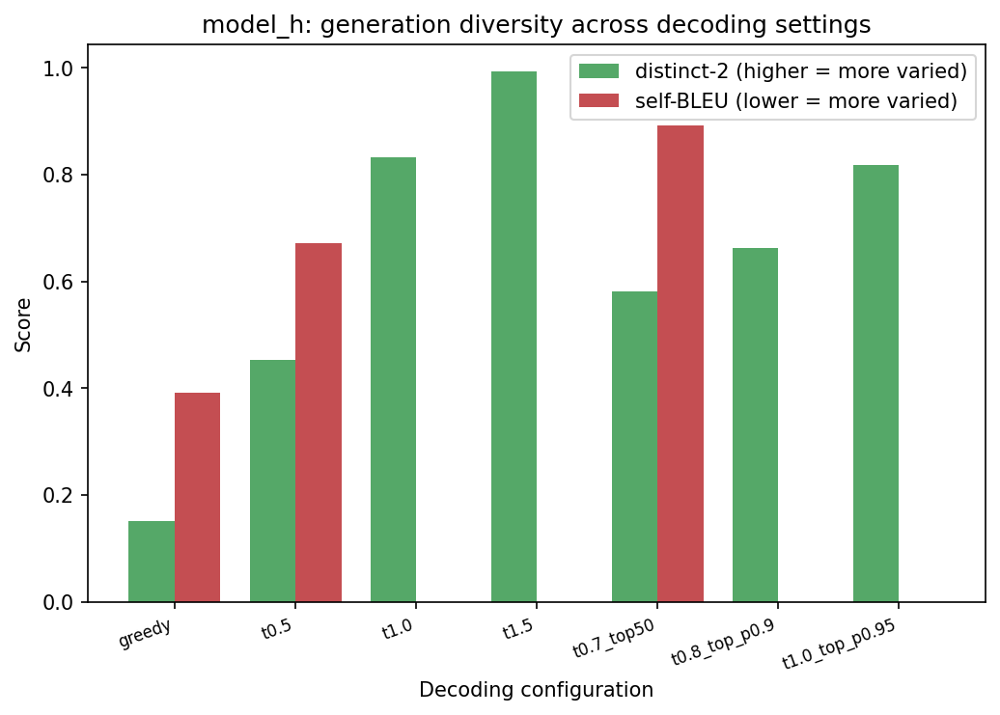
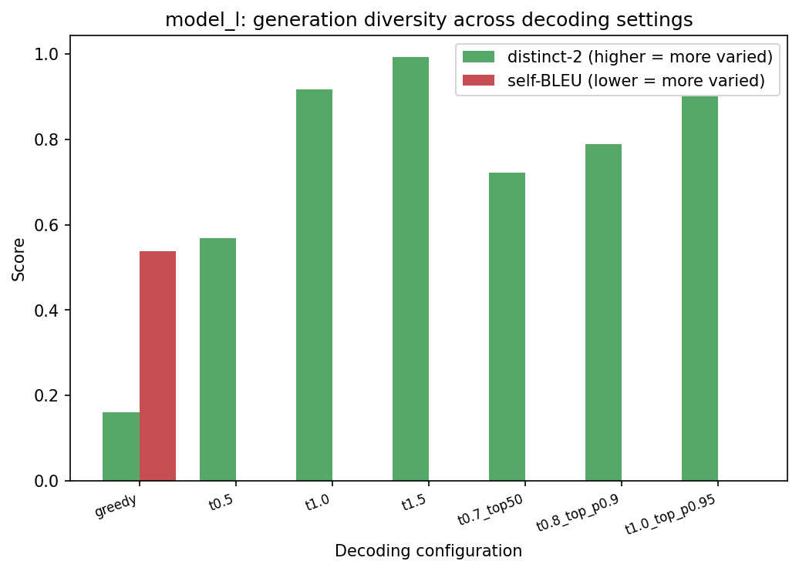

These exist because perplexity cannot see degeneration — it never samples, only scores the true
continuation.

**Greedy no longer collapses, and there's a control.** During development the same evaluation ran
against a deliberately under-trained 30-step checkpoint: greedy scored Dist-2 = **0.001** and
self-BLEU = **90.9** — total degeneration. Trained: Dist-2 0.152 / 0.160 with self-BLEU below 0.55.
The comparison shows the metrics respond to what they claim to measure.

**Self-BLEU ≈ 0** at nearly every sampled setting in both models — no cross-prompt repetition, so the
models are not emitting one memorised paragraph regardless of input.

**Rep-4 is the sharpest diagnostic:** 0.732 (greedy) → 0.194 (T=0.5) → 0.002 (T=1.0) for Model H.
Greedy repeats roughly three quarters of its 4-grams.

---

## 7. Qualitative assessment

From the 25 stored continuations per model in `<lang>/eval/results/samples.json` (T = 0.5).

### Model H (Hindi)

> **Prompt (tail):** …ग्रामीणों का आक्रोश सड़क पर दिखा। बड़ी संख्या में ग्रामीणों ने जुलूस
>
> **Generated:** निकालकर वन विभाग की कार्यप्रणाली पर सवाल खड़े किए। ग्रामीणों ने वन विभाग की कार्यशैली पर सवाल उठाए। ग्रामीणों ने वन विभाग की कार्यशैली पर सवाल उठाए और वन विभाग की कार्यशैली पर सवाल उठाए। …
>
> **Reference:** निकालकर वन विभाग कार्यालय का घेराव किया और वन अधिकार कानूनों के कथित उल्लंघन, विकास कार्यों में बाधा तथा पारंपरिक अधिकारों की अनदेखी का आरोप लगाया। …

Both continuations open with the same word (**निकालकर**), and the model's first sentence is entirely
plausible news Hindi. Then it loops: *वन विभाग की कार्यशैली पर सवाल उठाए* four times.

### Model L (Nepali)

> **Prompt (tail):** …ती दलका वरिष्ठ नेताहरु नै दृढ निश्चयी नदेखिनुलाई मुलुकलाई अन्यौल
>
> **Generated:** को विषय बनाउन लागेको बताउँछन्। "संविधानले व्यवस्था गरेको व्यवस्था अनुसार निर्वाचन गर्ने हो भने संविधान असफल हुने हो। अहिले त संविधान असफल भएको होइन। संविधान असफल भएको हो। संविधान असफल भएको हो। …

Correct case agreement with the prompt (**अन्यौल** + **को विषय**), correct Nepali verb morphology —
then the same loop failure, cycling *संविधान असफल भएको हो*.

### Findings

**Both models produce grammatically well-formed text in the correct language.** Hindi shows correct
postpositions and case (को, की, से, में), correct verb agreement, and news register picked up from
the prompt (उन्होंने कहा कि, ग्रामीणों का आरोप है कि). Nepali shows correct verb morphology (भएको,
गरेको, बताउँछन्, हुनुपर्छ), the ergative -ले, and honorifics.

**Nepali chandrabindu is preserved.** Forms like **बताउँछन्** and **खाँचो** retain U+0901. This is
downstream confirmation that Phase 1's decision *not* to fold ँ to anusvara for Nepali — the clearest
divergence between the two cleaning pipelines — was correct. Folded, this model would now be
generating misspelt Nepali, and no Phase-2 metric would have revealed it.

**Script purity:**

| | generated | reference |
|---|---:|---:|
| Hindi Devanagari | 99.71% | 99.67% |
| Nepali Devanagari | 99.60% | **100.00%** |

Nepali emits a small number of stray Latin characters (one sample opens mid-word with a bare "m") —
byte-fallback tokens surfacing. Small, but a real defect, named rather than rounded away.

**Local coherence good, global coherence absent.** Continuations stay on topic but don't develop an
argument and contradict themselves across sentences — one Hindi sample asserts बच्चों को स्कूल में
नहीं पढ़ाना चाहिए and two sentences later बच्चों को पढ़ाना चाहिए. This is what a 24M-parameter model
with no instruction tuning does.

**Type–token ratio quantifies the looping:**

| | generated | reference |
|---|---:|---:|
| Hindi unique words | 25% | 47% |
| Nepali unique words | 36% | 68% |

Nepali's gap is wider, matching its higher looping rate.

**Both over-produce sentence boundaries** — danda (।) per 100 words is 7.0 (H) and 9.0 (L) against
references at 5.5 and 6.0. The model resolves uncertainty by ending the sentence.

**One Hindi sample drifts into web boilerplate**, emitting *कॉपीराइट के बारे में नए जुड़े पन्नों की सूची*
— plainly Wikipedia navigation furniture. A Phase-1 data artifact surfacing at generation time:
boilerplate the cleaning cascade missed is reproducible from the trained weights. A more honest audit
of corpus cleanliness than any filter pass-rate statistic.

---

## 8. Attention analysis

Computed from the `[B,h,T,T]` tensors returned by the explicit attention path — the one a test proves
identical to the fused path the models were trained with.

### 8.1 Method

```
entropy        H(A_h)  = −Σ_j A[h,i,j] · log₂ A[h,i,j]      averaged over query positions i
normalised     H̃(A_h)  = H(A_h) / log₂(i+1)                 ∈ [0, 1]
mean distance  d(A_h)  = Σ_j (i − j) · A[h,i,j]             averaged over i
```

**Why entropy needs normalising.** Under causal masking, query *i* can attend over only *i+1* keys,
so the maximum achievable entropy at position *i* is log₂(i+1), not log₂ T. Raw mean entropy
therefore rises with position for purely arithmetic reasons, and a head behaving identically
everywhere reads as "spreading out over the sequence". Both forms are reported: raw for comparability
with the literature, normalised for interpretation. Query 0 sees one key, so its entropy and maximum
are both 0 — excluded rather than contributing 0/0.

Mean distance is non-negative by construction (causal masking puts zero mass on j > i). A
previous-token head scores exactly 1; a uniform-over-history head about i/2.

Validated against closed forms in `tests/test_eval.py`: one-hot row → entropy exactly 0; uniform-
over-history → normalised entropy exactly 1.0 and, over a 4-token window, mean distance exactly 1.0;
pure previous-token head → distance exactly 1.

**Setup.** 8 held-out documents × 192 tokens, batch 1, one layer's tensor at a time. The short context
is a memory requirement: `[1,6,1024,1024]` fp32 is 25 MB per layer, 250 MB for ten. **Consequence:
the largest measurable distance is 191 tokens** — a head attending 400 tokens back would be invisible
here, so "long-range" in these tables means within a 192-token window, not within the 1,024-token
training context.

### 8.2 Behaviour by depth

| Layer | H: *H* bits | H: *H̃* | H: dist | H: prev | L: *H* bits | L: *H̃* | L: dist | L: prev |
|---:|---:|---:|---:|---:|---:|---:|---:|---:|
| 0 | 5.610 | 0.903 | 43.53 | 0.033 | 5.422 | 0.873 | 41.11 | 0.048 |
| 1 | 5.245 | 0.844 | 39.07 | 0.051 | 5.446 | 0.878 | 41.73 | 0.035 |
| 2 | 5.220 | 0.840 | 35.66 | 0.079 | 5.410 | 0.872 | 36.36 | 0.063 |
| 3 | 5.199 | 0.841 | 33.63 | 0.088 | 5.361 | 0.866 | 36.42 | 0.068 |
| 4 | 5.314 | 0.858 | 33.58 | 0.068 | 5.077 | 0.822 | 31.74 | 0.093 |
| 5 | 4.863 | 0.787 | 29.48 | 0.087 | 5.107 | 0.825 | 32.01 | 0.089 |
| **6** | **4.061** | **0.665** | **17.46** | **0.152** | **4.006** | **0.654** | **17.43** | **0.134** |
| 7 | 4.147 | 0.673 | 25.45 | 0.137 | 3.680 | 0.603 | 17.30 | **0.236** |
| 8 | 3.992 | 0.650 | 24.37 | **0.156** | 3.768 | 0.604 | 36.81 | 0.048 |
| 9 | 3.627 | **0.588** | 34.56 | 0.099 | 4.070 | 0.660 | 30.23 | 0.113 |

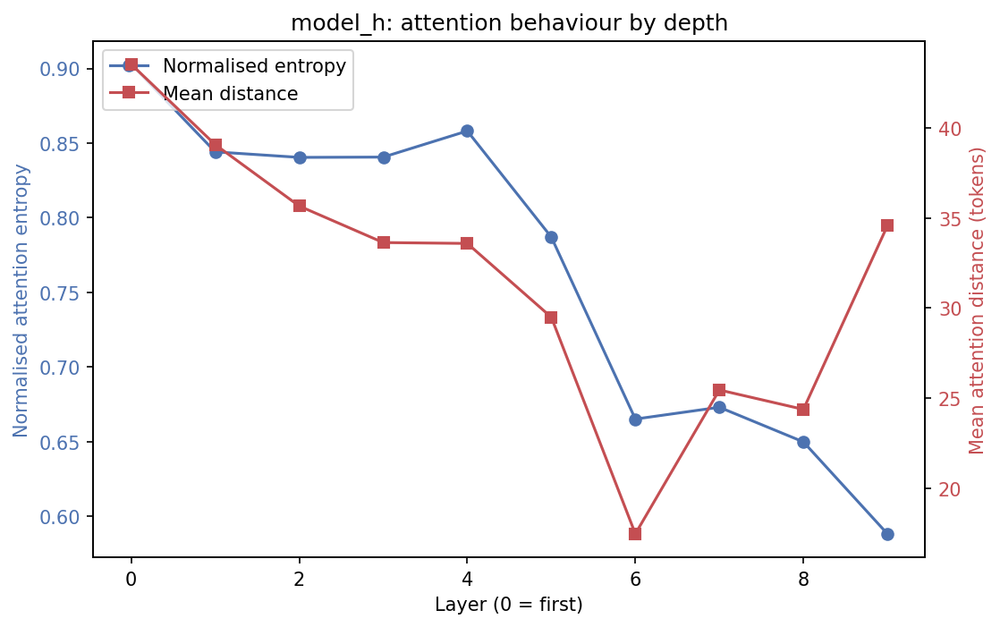
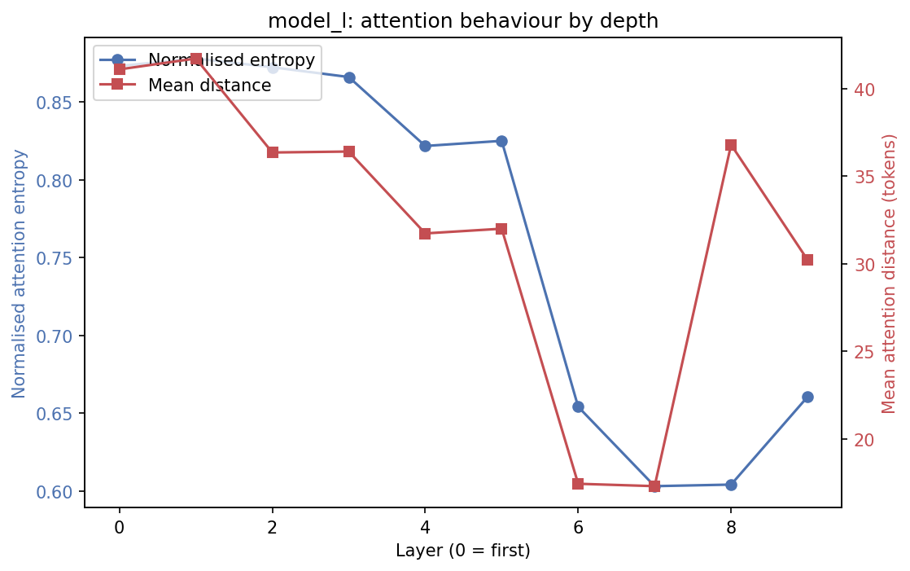

**Attention specialises with depth in both models.** Layer 0 is near-uniform (H̃ = 0.903 and 0.873),
reaching 40+ tokens back — what an uninformative head does, since softmax must sum to 1 and a head
with nothing to discriminate on spreads its mass. By the late layers H̃ falls to 0.588 and 0.604, and
previous-token mass rises roughly fivefold. The stack does something structurally different at the
top than the bottom — direct evidence the depth chosen in §1 is used.

### 8.3 The cross-language coincidence at layer 6

> Both models independently converge on **layer 6** as a focusing layer, at mean attention distances
> of **17.46** (H) and **17.43** (L) — agreement to three significant figures between two models
> trained on different languages, different corpora, different random initialisations.

Layer 6 is the sharpest single-layer drop in distance for both: 29.48 → 17.46 (H), 32.01 → 17.43 (L),
with normalised entropy dropping in step (0.787 → 0.665, 0.825 → 0.654).

The two models share architecture, token budget, optimiser and schedule but no data and no weights.
The natural reading: *the depth at which a decoder switches from diffuse mixing to local composition
is a property of the architecture and training budget rather than of the language.* This is a single
observation on two models and cannot carry more weight than that — confirming it needs several seeds
per language, which the compute budget did not allow — but it is a concrete, falsifiable claim Phase
3 can test.

The models diverge *after* layer 6: Model H's distance rebounds to 34.56 by layer 9, Model L's peaks
at layer 8 (36.81) then falls. Both re-widen, suggesting a late integration stage reached differently.

### 8.4 Head taxonomy

Thresholds are stated conventions to make a 60-head table readable, not discoveries:
previous-token if prev mass > 0.5; attention sink if position-0 mass > 0.5; local if H̃ < 0.3 and
distance < 5; diffuse global if H̃ > 0.7; long-range if distance > 20; else mixed.

| Role | Model H | Model L |
|---|---:|---:|
| Diffuse / global | 46 | 42 |
| Mixed | 9 | 10 |
| Long-range | 4 | 7 |
| Previous-token | 1 | 1 |
| **Total** | **60** | **60** |

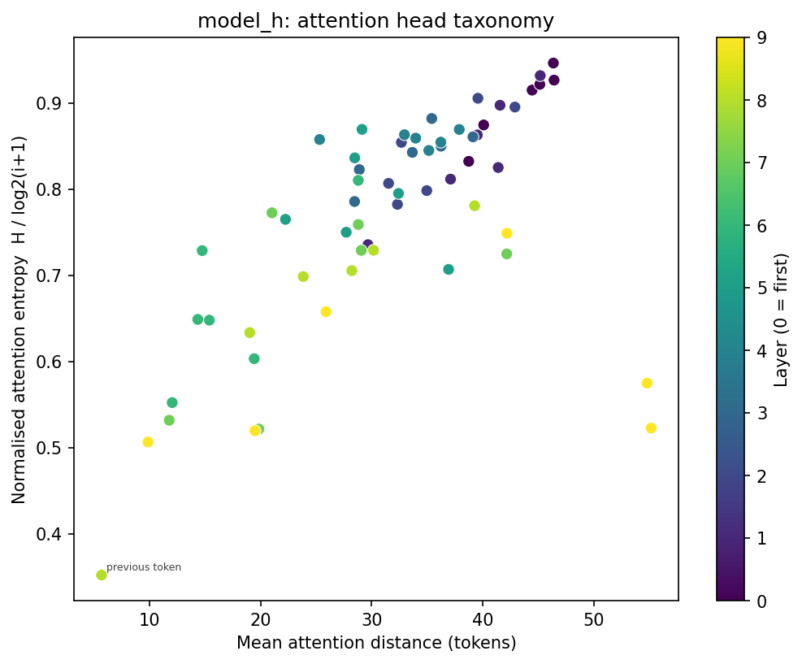
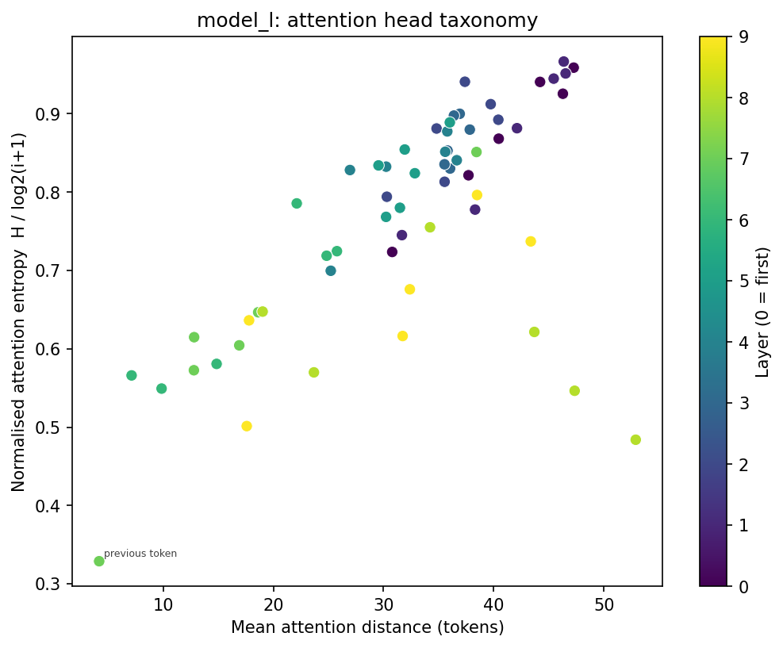

**Which heads look local/positional vs content-based.** Each model develops exactly **one** clear
previous-token head — positional in the strictest sense, visible in the scatter as the isolated point
at distance ≈6, H̃ ≈ 0.35. The local/positional group occupies the lower-left and is drawn almost
entirely from layers 6–9.

Content-based heads are harder to identify from two statistics, and this report doesn't overclaim.
What can be said: the *mixed* and *long-range* heads in layers 6–9 attend at long distances **while
maintaining low entropy** — they reach far back and still concentrate their mass, which positional
behaviour alone cannot produce, since a purely positional head at long range would necessarily be
diffuse. Those are the content-based candidates. Establishing it needs ablating token identity while
holding position fixed — outside this phase.

The dominance of "diffuse global" (46 and 42 of 60) is partly real for a small, briefly-trained model
and partly a threshold artifact: H̃ > 0.7 is a low bar after one epoch. The layer table is the more
informative view.

### 8.5 Heatmaps

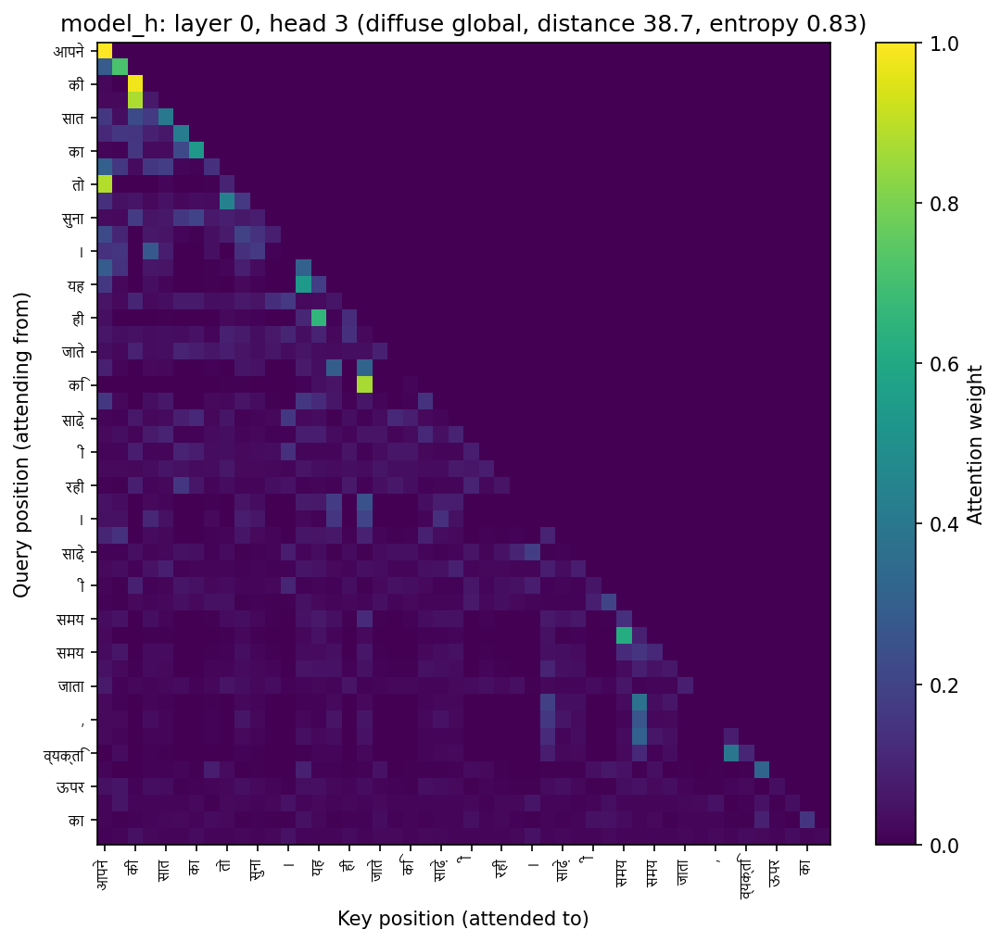
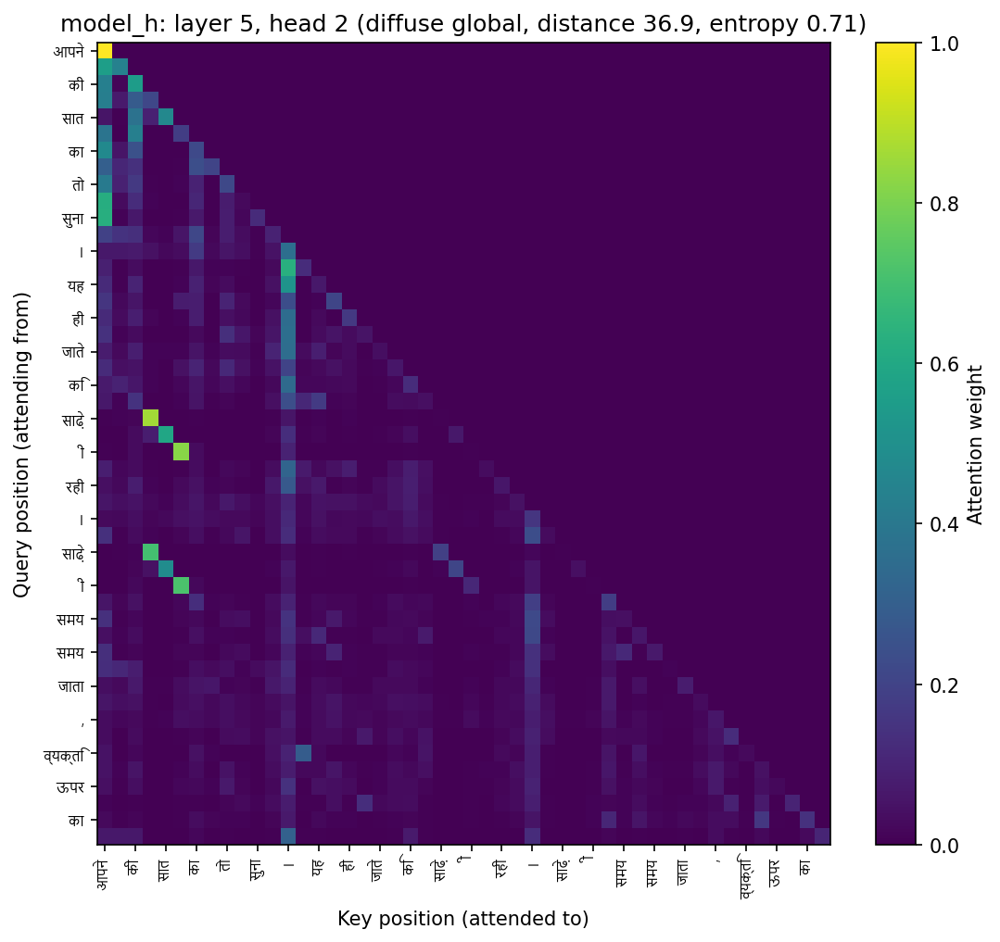
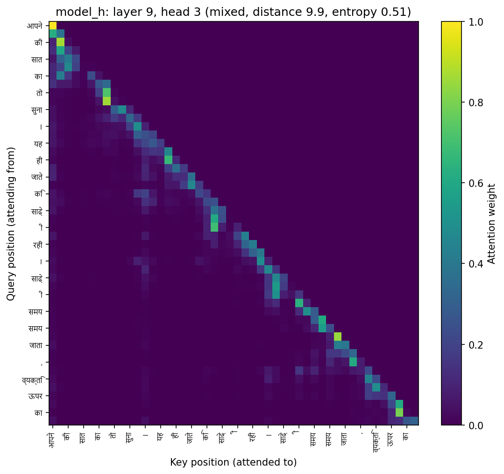
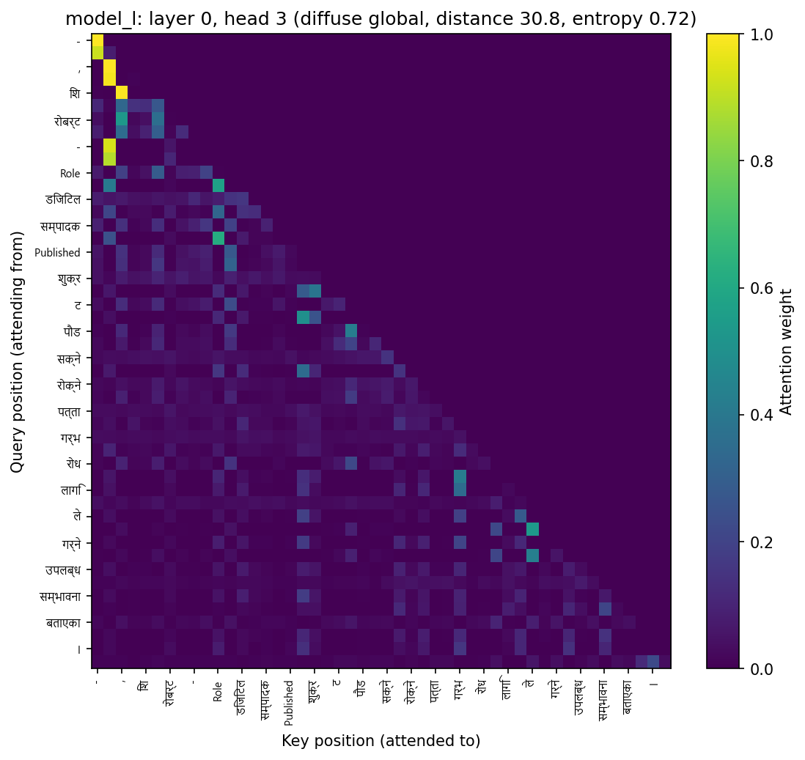
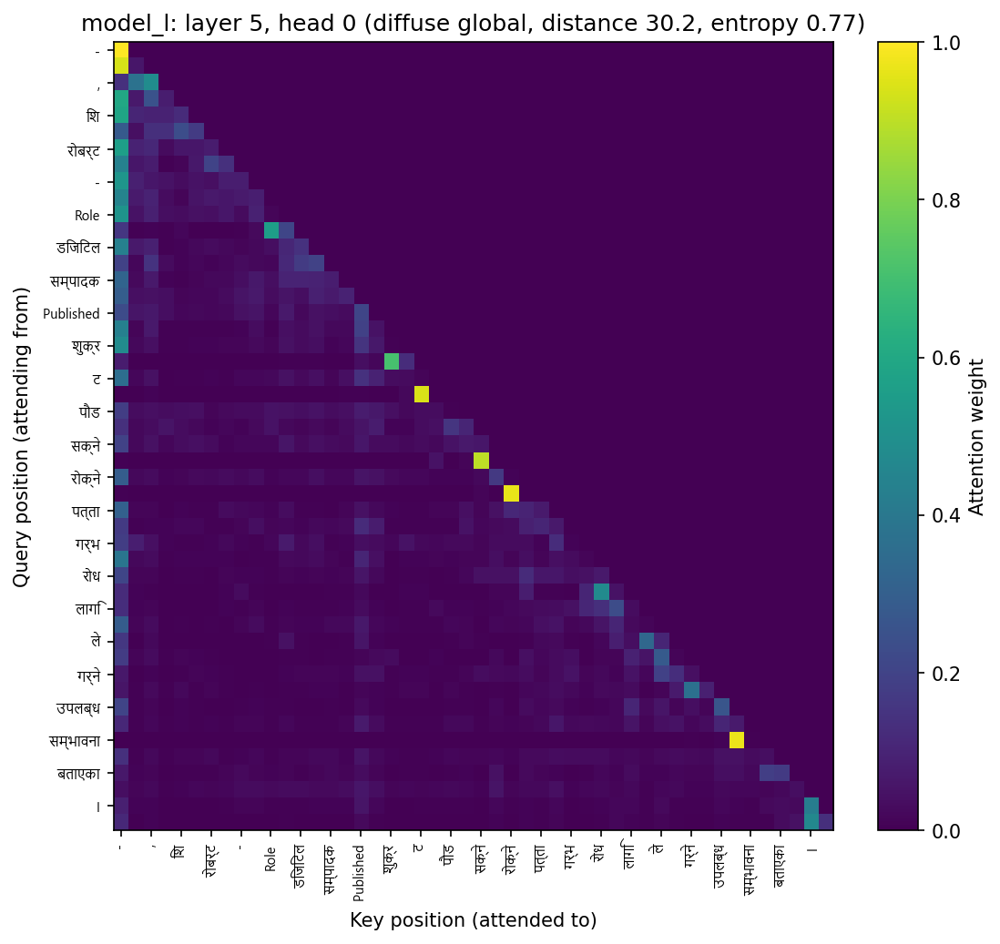
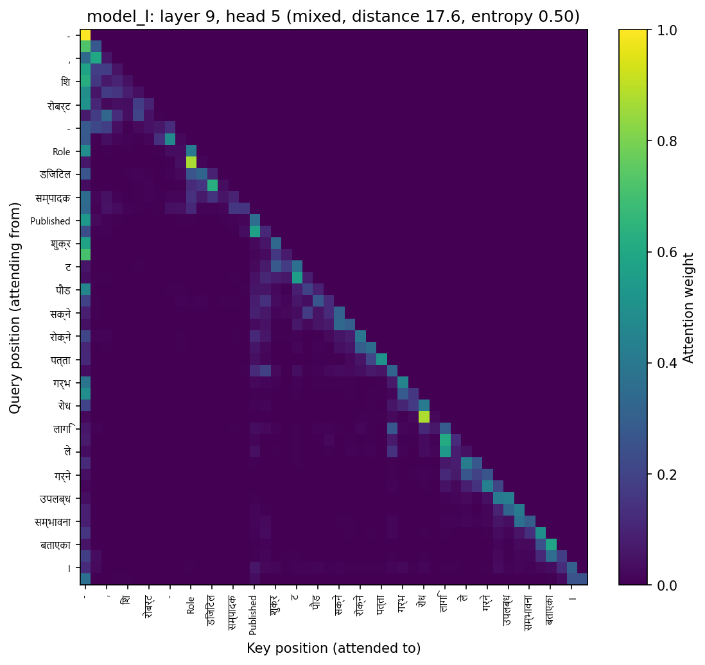

14 heatmaps total (8 for H, 6 for L) — three heads per layer at layers 0, 5, 9, deduplicated. Within
each layer the heads plotted are the most focused, the most diffuse, and the highest previous-token
mass: the extremes of the taxonomy, where contrast between heads of the *same* layer is visible.

The dark upper-right wedge in every panel is the causal mask — query *i* places exactly zero weight
on any key *j > i* — so the figures double as a visual check on the mask. Late-layer panels show a
crisp near-diagonal band, a learned recency head. The same head plotted on the 30-step checkpoint
during development was uniform noise, which is the control confirming the structure was learned
rather than imposed by the architecture.

### 8.6 How the two models differ

- **They agree on where specialisation happens** (layer 6, 17.46 vs 17.43) and on the depth trend.
- **Model L specialises harder and earlier** — layer-7 prev-token mass 0.236 against Model H's peak
  of 0.156, and its minimum H̃ (0.603 at layer 7) arrives two layers earlier than H's (0.588 at 9).
- **Model L keeps more long-range heads** (7 vs 4) and fewer diffuse ones (42 vs 46).
- **Model H's early layers are more diffuse** (H̃ 0.903 vs 0.873) and reach further (43.53 vs 41.11).

A plausible reading: Nepali's coarser tokenization (12.51 bytes/token vs 10.28) means a fixed
192-token window spans more language, so short-range dependencies are more informative — explaining
both the earlier focusing and the stronger previous-token head. A hypothesis consistent with the
numbers, not something this phase establishes.

---

## 9. Resource-level comparison

| | Model H (Hindi) | Model L (Nepali) |
|---|---:|---:|
| Training tokens | 515,899,392 | 571,211,776 |
| Training documents | 3,577,045 | 5,526,928 |
| Manual share (Phase 1) | 21.5% | 24.7% |
| Tokenizer fertility (Phase 1) | 1.231 tok/word | 1.278 tok/word |
| Bytes per token (measured) | 10.282 | 12.507 |
| Parameters | 23,846,784 | 23,846,784 |
| Tokens per parameter | 21.6 | 24.0 |
| Test perplexity | **31.01** | 52.16 |
| Test bits-per-byte | 0.4819 | **0.4561** |

**Nepali is not the disadvantaged model here, and the reason is a Phase-1 outcome.** The web-resource
asymmetry between Hindi and Nepali is real and large, but Phase 1's crawling closed it: the Nepali
corpus came out **larger** in tokens (571M vs 516M) and documents (5.53M vs 3.58M), with a higher
manual share. Model L trained on 11% more tokens and 24% more tokens per parameter. Its 5.4% better
BPB is consistent with that and should be attributed at least as much to the corpus as to the model.

**The perplexity gap is mostly tokenizer, not capability.** Bits per token 4.955 (H) vs 5.705 (L), a
ratio of 1.151; bytes per token 10.282 vs 12.507, a ratio of 1.216. **The tokenizer difference more
than accounts for the surprisal difference.** Reporting only perplexity would have supported exactly
the wrong conclusion about which model learned its language better — the single most important
methodological point in this report.

**Where a genuine resource difference does show:** Nepali's generated text has a worse type–token
ratio relative to its own reference (36% vs 68%, against Hindi's 25% vs 47%) and a higher stray-Latin
rate (0.40% vs a reference 0.00%). Both point at corpus *composition* rather than size — Phase 1
recorded the Nepali corpus as ~85% fast-crawl against Hindi's much larger Wikipedia share, and needed
lower quality and language-ID thresholds to retain enough text. Larger, but noisier, and the noise
surfaces in generation rather than in perplexity.

**Attention behaviour is essentially language-independent** at this scale — the cleanest cross-model
result in the report: whatever differs between these two models, the organisation of their attention
by depth does not.

---

## 10. Independence verification

`python scripts/verify_independence.py` — four checks, all pass.

| Check | Result |
|---|---|
| No cross-language path references | pass — no file under `hindi/` references a `nepali/` path or vice versa |
| Zero document overlap | pass — 3,587,040 vs 5,536,919 documents, content-hash intersection **0** |
| Tokenizers differ | pass — distinct SHA-256; 5,695 of 16,000 pieces shared, all common Devanagari substrings |
| Checkpoints independent | pass — see below |

**The checkpoint check does not rely on file hashes.** Two checkpoints of the *same* model at
different steps also differ byte-for-byte, so a hash proves only that neither file is a copy. Four
properties are checked instead:

1. file hashes differ;
2. **no tensor shares storage** — all 73 parameter tensors compared by `data_ptr` with both models
   loaded into one process;
3. **no parameter tensor is numerically identical** — two independently initialised and trained 24M
   models agree on no tensor, so an identical one would mean weights were copied;
4. embedding cosine similarity **+0.00448**, indistinguishable from unrelated.

Vocabulary size is deliberately **not** the proof. Phase 1 selected 16,000 for both languages, so the
embedding tables have the same *shape* (16000 × 384) — which is exactly why the check compares values
and storage rather than dimensions. A shape check would pass vacuously on two identical models.

---

## 11. Reproducibility

**453 tests pass** — 99 Phase-2 (`test_model.py`, `test_train.py`, `test_eval.py`) plus 354 carried
from Phase 1. The ones that matter most catch silent failures: manual-vs-fused attention
equivalence, behavioural causality, rank-disjoint sampling, atomic-write survival, append-only
logging across sessions, closed-form attention statistics.

| Step | Command |
|---|---|
| Full test suite | `python -m pytest tests/ -q` |
| DDP pre-flight | `python scripts/check_ddp.py` |
| Local smoke run | `python hindi/train/pretrain.py --smoke` |
| Pretrain (2 GPUs) | `torchrun --standalone --nproc_per_node=2 hindi/train/pretrain.py` |
| Evaluate | `python hindi/eval/evaluate.py --checkpoint ... --split test` |
| Attention analysis | `python hindi/eval/attention_report.py --checkpoint ...` |
| Independence | `python scripts/verify_independence.py` |

`notebooks/phase2_kaggle.md` is the exact Kaggle runbook used; `scripts/pack_kaggle.py` builds the
single archive uploaded.

**One caveat, recorded rather than hidden.** Generation seeds once per call, so the batch shape
determines how many values each `multinomial` draw consumes — the same model and seed at a different
`--gen-batch` walks a different random stream and moves chrF by a few tenths. The full protocol
including batch size is stored in the metrics JSON so these tables regenerate exactly.

---

## 12. Deliverables

| # | Deliverable | Where |
|---:|---|---|
| 1 | Transformer implementation (MHA, positional embeddings, causal mask) | `lma/model/` — `rope.py`, `attention.py`, `block.py`, `transformer.py`; §1 |
| 2 | Model configuration files (H and L) | `hindi/model/config.py`, `nepali/model/config.py` |
| 3 | Parameter counts; training scripts; Drive links to checkpoints | 23,846,784 each (§1.1); `<lang>/train/pretrain.py`; Drive link at top |
| 4 | Training logs and loss curves | `<lang>/train/logs/train_log.jsonl`, `train.log`; §5 |
| 5 | PPL / BPB tables; BLEU, chrF, ROUGE-L | §6; `<lang>/eval/results/metrics_test.json` |
| 6 | Generated samples and diversity / repetition stats | `<lang>/eval/results/samples.json`; §6.4, §7 |
| 7 | Attention heatmaps plus entropy / distance summaries | 14 heatmaps in `report/figures/`; `attention_stats.json`; §8 |
| 8 | Resource-level comparison write-up | §9 |

---

## 13. Limitations

- **One seed per model.** Every cross-model claim in §8, including the layer-6 coincidence, rests on
  a single run each. Two free-tier Kaggle sessions did not allow replication. Layer 6 is stated as a
  falsifiable hypothesis for Phase 3, not an established finding.
- **The models were still improving when training stopped.** Val loss was descending at the final
  evaluation in both runs. Stopping at one epoch is by design, but the models are compute-limited,
  not converged.
- **BLEU and ROUGE-L are reported because the assignment names them**, not because they are
  informative here (§6.3).
- **Content-based heads are not positively identified.** Entropy and distance separate local from
  long-range but cannot establish content-dependence; that needs a perturbation study.
- **Attention measured only to 192 tokens** against a 1,024-token training context, for the memory
  reason in §8.1. Behaviour beyond 192 tokens is unmeasured.
- **Phrase-level looping is unaddressed.** Greedy repeats ~70% of its 4-grams in both models.
  Repetition penalties or contrastive decoding would mitigate it; neither is implemented, because
  both change the sampling distribution and would have made the required temperature sweep harder to
  interpret.
