# Phase 3 Report — Reasoning Finetuning, Attention Analysis, and Final Project Report

**Yogendra Patel** · Roll No. 2025201098 · CL3410 Language Models and Agents, Monsoon 2026

- **Code:** <https://github.com/CL3-410/individual-project-CReativeRebe1>
- **Checkpoints + data (Drive):** <https://drive.google.com/drive/folders/1lkP2GJKqgr-uzzz-WLeChOM_flqOe8xQ?usp=sharing>
- **Dataset (HuggingFace):** <https://huggingface.co/datasets/YogendraPatel/LMA_Individual_Project>


**Headline.** Each model was finetuned, independently and with its own tokenizer, on a synthetic
comparative-reasoning dataset of 20,000 examples written in its own language. The test design is a
2×2 of *seen / unseen entities* × *seen / held-out wording*, with 3 seeds per condition.

- **Before finetuning:** both pretrained models score **0.000 exact match** on every split,
  zero-shot and three-shot.
- **After SFT with pretraining replay:** Model H reaches **0.422 ± 0.045** on seen entities and
  **0.397 ± 0.036** under held-out wording. Model L reaches **0.368 ± 0.011** and **0.352 ± 0.011**.
- **On unseen names both collapse to ~0.10.** 56–67% of those errors are a *training* name that
  does not occur in the question — L9's memorisation failure, reproduced with a 140-name pool.
- **On `test_both`, candidate choice is 0.27–0.34 for every finetuned model** (chance 0.30).
  Finetuning taught the format and a seen-entity association, not a comparison that transfers to
  new names.
- **Replay removes catastrophic forgetting.** Phase-2 validation perplexity after plain SFT: H 30.3 →
  142 ± 85, L 51.2 → 418,137. With replay: H 35.5 ± 0.1, L 76.3 ± 0.2, at equal or better accuracy.
- **Attention:** finetuning creates *answer-pointer* heads in the top layers of both models
  while leaving the lower layers, and the entropy/distance profile on ordinary text, unchanged.

---

## Contents

1. What Phase 3 had to deliver
2. The reasoning dataset
3. Finetuning setup
4. Results: pretrained vs finetuned
5. Qualitative successes and failures
6. Error analysis
7. Forgetting and data size
8. Model H vs Model L on reasoning
9. Post-finetuning attention analysis
10. The whole project: answers to the four questions
11. Independence verification
12. Reproducibility and deliverables
13. Limitations

---

## 1. What Phase 3 had to deliver

Per language, independently (assignment §3):

| Requirement | Where |
|---|---|
| Synthetic comparative / transitive reasoning dataset in the language's own script and phrasing; train/val/test; size, template variety, leakage avoidance; generator released | §2, `<lang>/reasoning/generate.py`, `results/dataset_stats.md` |
| Finetune each pretrained checkpoint, tokenizer fixed, hyperparameters documented, resume-capable checkpoints | §3, `<lang>/reasoning/finetune.py`, `config.py` |
| Pretrained vs finetuned exact match; qualitative successes and failures; H vs L comparison | §4, §5, §8 |
| Finetuning loss curves; error analysis | §3.3, §6 |
| Attention: pretrained vs finetuned heatmaps (early and late layer); local vs long-range; head specialisation on comparative prompts | §9 |
| Final report consolidating the project, answering the four questions; README with reproduction steps and all Drive links | §10, `README.md` |

The Module-5 lectures add the evaluation discipline this phase follows (L9 slide 34): test on a
disjoint entity pool; write four surface forms, train on three and hold out the fourth; report
these accuracies separately with more than one seed; and report pretraining validation perplexity
before and after finetuning.

## 2. The reasoning dataset

### 2.1 Facts first, words second

Every example is generated as **structured facts** first — entities, values or pairwise relations, a
question — and only then rendered into Hindi or Nepali by that language's own templates
(`lma/reasoning/facts.py`, `<lang>/reasoning/templates.py`). An **independent solver** recomputes every
label from the facts. For chain tasks it does this by transitive closure over the stated relations,
without ever reading the hidden generation order, and a test asserts that it agrees with every
rendered label. A template bug that flipped a comparative would otherwise "teach the error fluently"
(L9 slide 16).

| Task | Premises | Question | Example answer |
|---|---|---|---|
| `cmp2` | two entities with explicit values | which is greater / smaller | an entity, or **बराबर** on a tie |
| `cmp3` | three entities with explicit values | greatest / smallest | an entity, or **बराबर** when the extreme is tied |
| `ext3` | A > B, B > C (shuffled, random direction) | greatest / smallest | A or C |
| `pair3` | the same premises | A vs C — the transitive step itself | A or C |
| `ext4` | A > B > C > D as three relations | greatest / smallest | A or D |

Six attributes cover all four the assignment names: **age, height, weight** of people; **price,
weight** of objects; **quantity** (how many of an item a person has).

The `cmp3` tie is placed *at the asked extreme*. A tie between the other two values would leave the
answer unchanged and teach nothing about equality.

### 2.2 Natural phrasing, per language

Four surface-form families per language. **F1–F3 train; F4 is held out** and appears only in
`test_wording` and `test_both`.

| Family | Hindi | Nepali |
|---|---|---|
| F1 adjective | राहुल, अमित से बड़ा है। · सबसे बड़ा कौन है? | हरि श्यामभन्दा जेठो छ। · सबैभन्दा जेठो को हो? |
| F2 noun + more/less | राहुल की उम्र अमित से ज्यादा है। · किसकी उम्र सबसे ज्यादा है? | हरिको उमेर श्यामभन्दा बढी छ। · कसको उमेर सबैभन्दा बढी छ? |
| F3 synonym noun + comparison | अमित की तुलना में राहुल की आयु अधिक है। | श्यामको तुलनामा हरिको आयु अधिक छ। |
| F4 held out | अमित के मुकाबले राहुल बड़ा है। · इनमें सबसे बड़ा कौन है? | श्यामभन्दा हरि जेठो छ। · यीमध्ये सबैभन्दा जेठो को हो? |

**Every family states each relation in both directions** ("A, B से बड़ा है" / "B, A से छोटा है"), and
each premise picks a direction at random. Without this the greater entity would always be the
grammatical subject, and "answer the first name" would solve every chain task. It also avoids the
reversal-curse confound (a model trained only on "A > B" is not guaranteed to handle "B < A").

Grammar and orthography follow each language, and several choices were **measured on the Phase-1
corpora rather than taken from a dictionary**:

| Decision | Hindi | Nepali |
|---|---|---|
| Digits | ASCII — 92% of digits in the Hindi corpus | Devanagari ०-९ — 90% of digits in the Nepali corpus |
| Comparative | separate postposition: अमित **से** | attached suffix: श्याम**भन्दा** |
| Agreement | adjective agrees with subject (बड़ा/बड़ी); genitive agrees with the possessed noun (की उम्र, का वजन) | adjective (जेठो/जेठी) and copula (छ/छिन) agree with subject |
| Counts | plural noun: 7 सेब, 5 किताबें | classifier + singular: ७ वटा स्याउ छन |
| Spelling | ज्यादा (366 in corpus) not ज़्यादा (20); वजन not वज़न; anusvara plurals (चूड़ियां) because the Hindi normaliser folds chandrabindu | chandrabindu kept (गह्रौँ); **छन / छिन without final virama**, because the Nepali normaliser strips it and the model never saw छन् |
| Entity constraint | no masculine noun ending in -ā (पंखा → पंखे से would break exact match) | no name may be a prefix of another (मनिष/मनिषा, बिजय/बिजया removed), since suffixes attach |

These are Phase 1's per-language divergences again, in a new place. Hindi folds chandrabindu and
Nepali does not (Phase 1 §4.1); Hindi writes ASCII digits and Nepali Devanagari. A rule that is
correct for one language is wrong for the other, so each rule had to be decided per language.

### 2.3 Entities and splits

200 hand-curated person names (with gender) and 60 objects per language. No person name is shared
across languages, and no name is a substring of another (both asserted by tests). Pools are split
**70/30 per gender** into seen and unseen names before anything is sampled. The pool is large
deliberately: L9 slide 24 shows a model finetuned on 20 names scoring 0.000 on unseen names.

| | seen wording (F1–F3) | unseen wording (F4) |
|---|---|---|
| **seen entities** (140 persons, 42 objects) | `test_id` | `test_wording` |
| **unseen entities** (60 persons, 18 objects) | `test_entity` | `test_both` |

Sizes per language: **train 20,000 · val 1,000 · each test split 1,000**. `val` uses seen entities
and F1–F3 and is the only split used for any decision. Task × attribute × family combinations are
*cycled* rather than sampled, so every split has exactly the same mix. The first build cycled them
separately, which locked F1 to two attributes. The template-variety count exposed that, and a test
now asserts all 90 combinations appear in train.

### 2.4 Size, variety, leakage — measured

| | Hindi | Nepali |
|---|---:|---:|
| Examples (train / val / tests) | 20,000 / 1,000 / 4 × 1,000 | 20,000 / 1,000 / 4 × 1,000 |
| Distinct prompts | all unique | all unique |
| Tie answers in train | 1,982 | 1,982 |
| Prompt tokens, median / p95 / max (train) | 33 / 43 / 56 | 32 / 40 / 49 |
| Observed sentence templates F1 / F2 / F3 / F4 | 50 / 43 / 39 / 51 | 53 / 42 / 39 / 54 |
| Generator seed | 1234 | 1234 |

Template variety is counted **from the data**. Each prompt sentence is abstracted (entities → X,
numbers → N, items → I) and distinct skeletons are counted, which measures variety as generated
rather than as the template file claims.

**Leakage checks (all zero in both languages):**

| Check | Hindi | Nepali |
|---|---:|---:|
| Prompt overlap between any two splits | 0 | 0 |
| **Fact-level overlap** between any two splits (same comparison, any wording) | 0 | 0 |
| Seen / unseen pool overlap | 0 | 0 |
| Unseen names in seen-entity splits; seen names in unseen-entity splits | 0; 0 | 0; 0 |
| Template families shared by train-wording and held-out splits | none | none |
| Tokenizer round-trip failures (all 25,000 prompts) | 0 | 0 |

The fact-level check is stricter than prompt comparison. Every problem is reduced to a canonical key,
and a key used by any split is rejected, so the same comparison cannot appear in train and test under
different wording. Evaluation splits are generated first and claim their keys; train is the split
that has to avoid them.

**Heuristic shortcuts sit at or below chance** (test splits; chance = uniform over candidates = 0.300):

| split | first mentioned | last mentioned | most frequent | random candidate |
|---|---:|---:|---:|---:|
| test_id | 0.241 | 0.263 | 0.119 | 0.303 |
| test_entity | 0.245 | 0.280 | 0.115 | 0.316 |
| test_wording | 0.274 | 0.265 | 0.132 | 0.313 |
| test_both | 0.243 | 0.257 | 0.128 | 0.296 |

(The same numbers hold in both languages because the facts are generated by the same seeded process;
only the words differ.) Positions are read from the premises only. Computed over the whole prompt,
"last mentioned" scored 0.51 on `pair3`, but only because the question names its two options last:
a coin flip between the right candidates, not a leak.

The generator is fully seeded; a test asserts that two builds produce byte-identical JSONL.

## 3. Finetuning setup

### 3.1 Format and loss

```
[EOS] प्रश्न: <premises> <question> उत्तर: ▁<answer> [EOS]
|------------------- prompt, label −100 -----------| |-- loss --|
```

- **Loss on the answer tokens and the closing EOS only** (L9 slide 8). `GPT.forward` already applies
  `ignore_index = −100`.
- **The leading EOS** reproduces what pretraining saw at the start of every document.
- **The closing EOS is a target**, so the model learns to stop (L9 slide 9).
- **Prompts are single-line.** Neither Phase-1 tokenizer round-trips `\n`, and there is no special
  answer token (the vocabulary is fixed), so a natural-language marker — `उत्तर:` — is the only
  compliant separator.
- Prompt and answer are encoded separately, so every candidate answer shares identical prompt tokens.

The tokenizer and vocabulary are the Phase-1 ones, unmodified; the model loads its own Phase-2
checkpoint (`<lang>/train/<lang>_ckpt_best.pt`).

### 3.2 Hyperparameters

| | Value | Why |
|---|---|---|
| Peak LR | **H 1e-4, L 3e-4** — selected from {5e-5, 1e-4, 3e-4} on val EM | per-language sweep (§3.4) |
| Schedule | linear warmup 5%, cosine to 10% of peak | same shape as pretraining |
| Optimiser | AdamW β = (0.9, 0.95), weight decay 0.1 on matrices only, clip 1.0 | unchanged from pretraining, so not a confound |
| Batch / epochs | 64 examples × 3 epochs = 938 steps | ~1M answer-and-prompt tokens per epoch |
| Dropout | **0.1** (pretraining: 0.0) | SFT repeats examples; pretraining never did |
| Selection | best **validation exact match**, evaluated every 100 steps; patience 4 | the assignment's metric, not the loss |
| Replay condition | + 8 × 256-token pretraining windows per step, loss weight 1 | InstructGPT's pretraining-mix idea |
| Precision / hardware | bf16 autocast, one RTX 3050 Laptop (4 GB) | 2.5–4 min per run |
| Seeds | 3 per main condition (0, 1, 2) | L9 slide 34 |

Every hyperparameter is stored in the checkpoint (`extra["sft_config"]`) and in the run's
`run_start` log record. Checkpoints use the Phase-2 resume-capable format, and resume is tested: a
killed run continues at the same step, with the optimiser state and sampler position restored, into
the same append-only log.

### 3.3 Finetuning curves

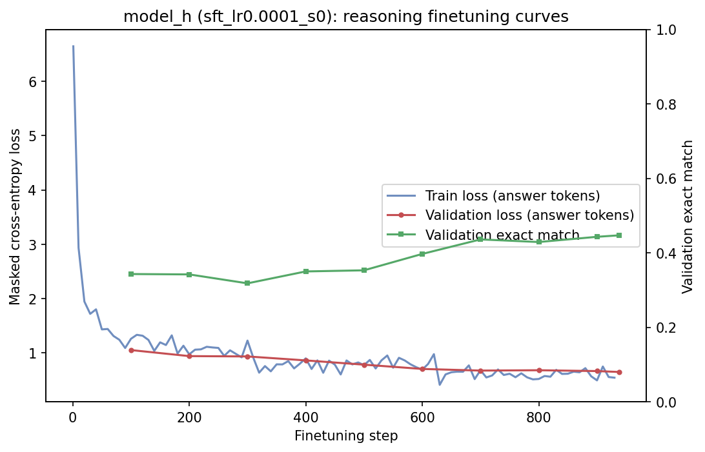
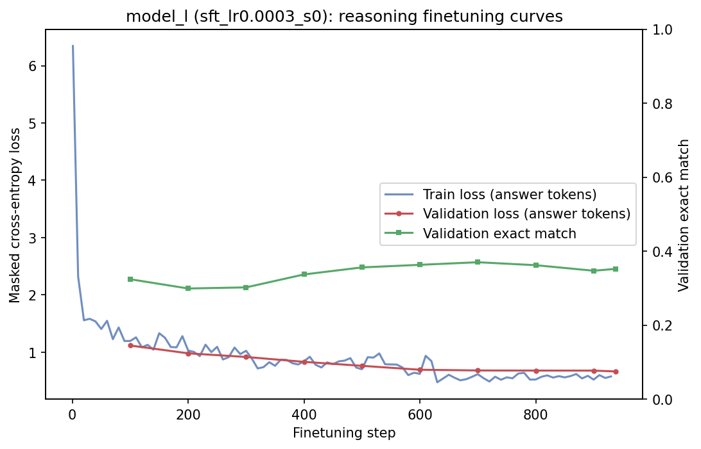

The masked loss falls from ~6.4 to ~1 within the first epoch (312 steps) and to ~0.6 by the end. Validation
exact match rises within the first 100 steps — mostly from learning the format and stopping — then
creeps up by only a few points while the loss keeps decreasing. That gap is why selection uses
exact match rather than loss.

### 3.4 The learning-rate sweep diverges between languages

| Val EM (seed 0) | 5e-5 | 1e-4 | 3e-4 |
|---|---:|---:|---:|
| Model H | 0.368 | **0.447** | 0.362 |
| Model L | 0.339 | 0.356 | **0.370** |

The sweep was scored on `val` only. Test splits were evaluated only after selection, so no test
number existed for any configuration while it was still a candidate. The same rule picks different
learning rates for the two models. §7.1 shows what Model L's higher LR costs in language modelling.

## 4. Results: pretrained vs finetuned

### 4.1 Exact match (mean ± std over 3 seeds)

**Model H (Hindi)**

| Condition | val | test_id | test_entity | test_wording | test_both |
|---|---:|---:|---:|---:|---:|
| Pretrained, zero-shot | 0.000 | 0.000 | 0.000 | 0.000 | 0.000 |
| Pretrained, 3-shot | 0.001 | 0.000 | 0.000 | 0.000 | 0.000 |
| SFT | 0.408 ± 0.038 | 0.388 ± 0.049 | 0.136 ± 0.043 | 0.331 ± 0.056 | 0.102 ± 0.020 |
| **SFT + replay** | **0.434 ± 0.029** | **0.422 ± 0.045** | 0.129 ± 0.009 | **0.397 ± 0.036** | 0.102 ± 0.005 |

**Model L (Nepali)**

| Condition | val | test_id | test_entity | test_wording | test_both |
|---|---:|---:|---:|---:|---:|
| Pretrained, zero-shot | 0.000 | 0.000 | 0.000 | 0.000 | 0.000 |
| Pretrained, 3-shot | 0.000 | 0.000 | 0.000 | 0.000 | 0.000 |
| SFT | 0.368 ± 0.003 | 0.353 ± 0.007 | 0.103 ± 0.002 | 0.322 ± 0.002 | 0.085 ± 0.003 |
| **SFT + replay** | **0.371 ± 0.005** | **0.368 ± 0.011** | **0.134 ± 0.004** | **0.352 ± 0.011** | **0.107 ± 0.006** |

Chance (uniform over the candidates, including बराबर where a tie is possible) is 0.300 on every split.

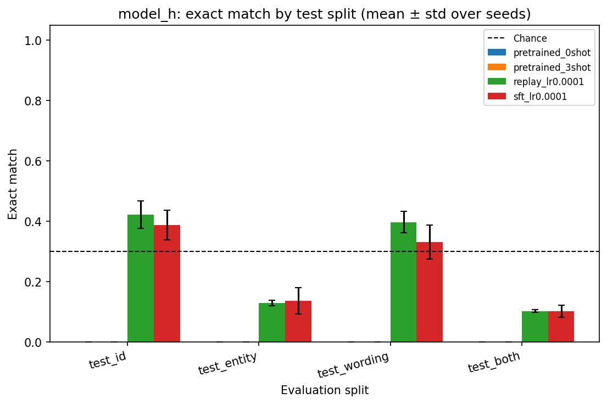
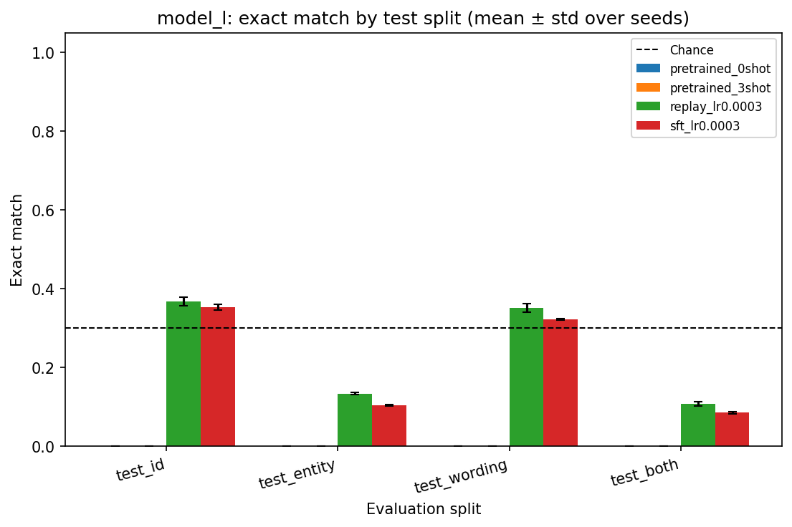

**The pretrained result reproduces L9 slide 4** (0/150 on this very task). Neither model produces a
bare name and stops: stop rates are 1–2% zero-shot. Three demonstrations raise stopping (Model L
1% → 18%) but not accuracy. In-context examples "steer a capability the weights already hold; they
do not add one" (L8), and here there was no capability to steer.

### 4.2 Candidate-choice accuracy separates format from reasoning

Exact match needs the model to produce the name *and stop*. Candidate choice ranks every candidate
answer by its log-likelihood after the prompt — no generation, no format.

| test_both | Model H | Model L |
|---|---:|---:|
| Pretrained zero-shot | 0.221 | 0.265 |
| Pretrained 3-shot | 0.249 | 0.267 |
| SFT | 0.319 ± 0.012 | 0.273 ± 0.004 |
| SFT + replay | 0.339 ± 0.006 | 0.292 ± 0.003 |

Before finetuning, candidate choice is *below* chance (0.22–0.27 vs 0.30), so the zero exact match is
not a format problem hiding real knowledge. After finetuning, on seen entities candidate choice
tracks exact match almost exactly (H SFT `test_id`: 0.386 vs 0.388): the model outputs what it
ranks highest.

On `test_both`, candidate choice is **0.27–0.34 for every finetuned condition**, against chance
0.30. Exact match falls further, to ~0.10, because the model often generates a name that is not among the candidates
at all (§6). **L10's claim that SFT "changes reliably: format, task behaviour; unreliably:
reasoning" is borne out directly.** The format is learned perfectly (100% stop rate in every
finetuned model); the comparison barely transfers beyond the entities it was trained on.

### 4.3 Per task type

Exact match by task type on every test split, mean over 3 seeds.

**Model H (Hindi)**

| split | condition | cmp2 | cmp3 | ext3 | pair3 | ext4 |
|---|---|---:|---:|---:|---:|---:|
| test_id | SFT | 0.444 | 0.322 | 0.426 | 0.460 | 0.286 |
| test_id | SFT + replay | 0.503 | 0.375 | 0.411 | 0.508 | 0.308 |
| test_entity | SFT | 0.290 | 0.254 | 0.052 | 0.052 | 0.024 |
| test_entity | SFT + replay | 0.288 | 0.254 | 0.020 | 0.066 | 0.007 |
| test_wording | SFT | 0.343 | 0.267 | 0.379 | 0.354 | 0.313 |
| test_wording | SFT + replay | 0.474 | 0.318 | 0.424 | 0.458 | 0.310 |
| test_both | SFT | 0.198 | 0.264 | 0.030 | 0.010 | 0.003 |
| test_both | SFT + replay | 0.219 | 0.264 | 0.012 | 0.007 | 0.003 |

**Model L (Nepali)**

| split | condition | cmp2 | cmp3 | ext3 | pair3 | ext4 |
|---|---|---:|---:|---:|---:|---:|
| test_id | SFT | 0.351 | 0.283 | 0.379 | 0.492 | 0.263 |
| test_id | SFT + replay | 0.365 | 0.276 | 0.414 | 0.529 | 0.254 |
| test_entity | SFT | 0.271 | 0.237 | 0.000 | 0.000 | 0.000 |
| test_entity | SFT + replay | 0.296 | 0.237 | 0.035 | 0.049 | 0.042 |
| test_wording | SFT | 0.355 | 0.233 | 0.313 | 0.439 | 0.269 |
| test_wording | SFT + replay | 0.373 | 0.251 | 0.325 | 0.529 | 0.283 |
| test_both | SFT | 0.180 | 0.241 | 0.000 | 0.000 | 0.000 |
| test_both | SFT + replay | 0.190 | 0.251 | 0.030 | 0.032 | 0.029 |

| task chance | 0.333 | 0.250 | 0.333 | 0.333* | 0.250 |
|---|---:|---:|---:|---:|---:|

\* `pair3` lists three candidates, but the question names two, so an answer that only reads the
question is right half the time.

- **On seen entities no task is far above its chance level.** The best is H `cmp2` at 0.50 against
  0.33. Numeric comparison (`cmp`) is not easier than transitive comparison, despite the values
  being written out, so the multi-digit tokenisation confound flagged in planning does not dominate
  the result.
- **Unseen names break the chain tasks, not the value tasks.** On `test_entity` and `test_both`,
  `cmp2`/`cmp3` stay at 0.18–0.30 while `ext3`, `pair3` and `ext4` fall to 0.00–0.07. In a `cmp`
  prompt every entity sits next to its own number; in a chain prompt entities appear only in
  relation to each other, and that is where the models substitute training names (§6).
- **Held-out wording costs little on any task.** Under replay, `test_wording` is within 0.09 of
  `test_id` for every task (largest drop: Nepali `ext3`, 0.414 → 0.325). The largest drops overall
  are under plain SFT on Hindi (`cmp2` 0.444 → 0.343, `pair3` 0.460 → 0.354), which replay largely
  removes (0.503 → 0.474, 0.508 → 0.458).

### 4.4 Per attribute

Exact match by attribute, mean over 3 seeds.

**Model H (Hindi)**

| split | condition | age | height | weight (person) | price | weight (object) | quantity |
|---|---|---:|---:|---:|---:|---:|---:|
| test_id | SFT | 0.381 | 0.351 | 0.403 | 0.400 | 0.364 | 0.430 |
| test_id | SFT + replay | 0.427 | 0.375 | 0.438 | 0.458 | 0.400 | 0.434 |
| test_entity | SFT | 0.109 | 0.145 | 0.169 | 0.070 | 0.160 | 0.164 |
| test_entity | SFT + replay | 0.087 | 0.129 | 0.175 | 0.068 | 0.147 | 0.166 |
| test_wording | SFT | 0.331 | 0.321 | 0.295 | 0.395 | 0.325 | 0.317 |
| test_wording | SFT + replay | 0.403 | 0.379 | 0.337 | 0.465 | 0.418 | 0.380 |
| test_both | SFT | 0.092 | 0.118 | 0.110 | 0.096 | 0.116 | 0.082 |
| test_both | SFT + replay | 0.092 | 0.112 | 0.114 | 0.096 | 0.114 | 0.086 |

**Model L (Nepali)**

| split | condition | age | height | weight (person) | price | weight (object) | quantity |
|---|---|---:|---:|---:|---:|---:|---:|
| test_id | SFT | 0.349 | 0.280 | 0.399 | 0.329 | 0.358 | 0.406 |
| test_id | SFT + replay | 0.391 | 0.312 | 0.399 | 0.351 | 0.368 | 0.386 |
| test_entity | SFT | 0.062 | 0.097 | 0.127 | 0.060 | 0.137 | 0.137 |
| test_entity | SFT + replay | 0.089 | 0.111 | 0.157 | 0.106 | 0.188 | 0.152 |
| test_wording | SFT | 0.267 | 0.333 | 0.329 | 0.331 | 0.349 | 0.319 |
| test_wording | SFT + replay | 0.289 | 0.361 | 0.369 | 0.359 | 0.378 | 0.353 |
| test_both | SFT | 0.074 | 0.092 | 0.094 | 0.076 | 0.108 | 0.068 |
| test_both | SFT + replay | 0.080 | 0.118 | 0.120 | 0.106 | 0.135 | 0.086 |

- **No attribute is systematically easier.** Under replay, the attributes on `test_id` lie within
  0.09 of each other in both languages (H 0.375–0.458, L 0.312–0.399), and the best attribute differs
  between them (price for Hindi, person weight for Nepali).
- **The unseen-entity collapse is uniform across attributes** (`test_both` 0.07–0.14 everywhere), so
  it is a property of the names, not of any one attribute's vocabulary. Object attributes (price,
  object weight) draw on only 18 unseen objects, and are not consistently worse than the person
  attributes drawn from 60 unseen names.
- Price has by far the widest value range (20–950, mostly three digits). It is the lowest attribute
  on Hindi `test_entity` under both conditions (0.07) and on Nepali under plain SFT (0.060), but not
  under Nepali replay (0.106). The number-tokenisation confound is at most a small effect.

### 4.5 Per surface-form family

Exact match by wording family, mean over 3 seeds. F1–F3 appear in `test_id` and `test_entity`; the held-out F4 appears only in `test_wording` and `test_both`.

| model | condition | test_id F1 | test_id F2 | test_id F3 | test_entity F1 | test_entity F2 | test_entity F3 | test_wording F4 | test_both F4 |
|---|---|---:|---:|---:|---:|---:|---:|---:|---:|
| Model H | SFT | 0.353 | 0.424 | 0.386 | 0.152 | 0.108 | 0.148 | 0.331 | 0.102 |
| Model H | SFT + replay | 0.392 | 0.442 | 0.431 | 0.139 | 0.120 | 0.127 | 0.397 | 0.102 |
| Model L | SFT | 0.337 | 0.372 | 0.350 | 0.119 | 0.087 | 0.104 | 0.322 | 0.085 |
| Model L | SFT + replay | 0.350 | 0.361 | 0.391 | 0.149 | 0.110 | 0.142 | 0.352 | 0.107 |

- **The three training families are learned about equally** — within 0.08 of each other on
  `test_id` in every model and condition. F2 (noun + more/less) is best for Model H; for Model L the
  best family changes with the condition.
- **The held-out family F4 is not harder than the ones trained on.** Under replay, F4 on
  `test_wording` (H 0.397, L 0.352) sits inside the F1–F3 range on `test_id` (H 0.392–0.442, L
  0.350–0.391). With unseen names, F4 on `test_both` (0.102 / 0.107) is only slightly below F1–F3 on
  `test_entity` (0.110–0.149). The comparison, where it is learned, is not tied to the training
  phrasings; what fails to transfer is the entity names.


## 5. Qualitative successes and failures

All examples are real outputs of the replay seed-0 models on test splits.

**Model H — successes**

| split | prompt | gold | output |
|---|---|---|---|
| test_id `ext3` | अनुज के पास सरिता से कम आम हैं। सरिता के पास सलोनी से कम आम हैं। सबसे ज्यादा आम किसके पास हैं? | सलोनी | **सलोनी** ✓ |
| test_id `pair3` | घंटी का वजन झाड़ू से ज्यादा है। पतंग का वजन झाड़ू से कम है। घंटी और पतंग में से किस चीज का वजन कम है? | पतंग | **पतंग** ✓ |
| test_both `ext3` (unseen names, F4) | इंदु के मुकाबले रोशनी छोटी है। अशोक के मुकाबले इंदु छोटी है। इनमें सबसे लंबा कौन है? | अशोक | **अशोक** ✓ |
| test_both `cmp2` tie | तौलने पर इंदु का वजन 45 किलो निकला। तौलने पर आरती का वजन 45 किलो निकला। आरती या इंदु, दोनों में हल्की कौन है? | बराबर | **बराबर** ✓ |

**Model H — failures**

| split | prompt | gold | output | type |
|---|---|---|---|---|
| test_id `pair3` | काजल, सतीश से भारी है। तान्या, सतीश से हल्की है। काजल और तान्या में से कौन भारी है? | काजल | तान्या | reversed extreme |
| test_id `ext3` | अभिषेक, शालिनी से भारी है। शालिनी, कीर्ति से भारी है। सबसे हल्का कौन है? | कीर्ति | शालिनी | middle entity |
| test_both `ext3` | कल्पना के मुकाबले रोहित लंबा है। रोहित के मुकाबले धीरज लंबा है। इनमें सबसे लंबा कौन है? | धीरज | मयंक | out-of-prompt name |
| test_both `cmp2` | नापने पर लोकेश की लंबाई 170 सेंटीमीटर निकली। नापने पर पूर्णिमा की लंबाई 179 सेंटीमीटर निकली। लोकेश या पूर्णिमा, दोनों में लंबा कौन है? | पूर्णिमा | बराबर | equal-case miss |

**Model L — successes**

| split | prompt | gold | output |
|---|---|---|---|
| test_id `ext3` | बिपिनको तौल बर्षाभन्दा कम छ। बिपिनको तौल प्रकृतिभन्दा बढी छ। कसको तौल सबैभन्दा कम छ? | प्रकृति | **प्रकृति** ✓ |
| test_id `pair3` | उज्ज्वलको तुलनामा गोकुलको लम्बाइ अधिक छ। जीवनको तुलनामा गोकुलको लम्बाइ कम छ। जीवन र उज्ज्वलमा कसको लम्बाइ अधिक छ? | जीवन | **जीवन** ✓ |
| test_both `ext3` | सुनिलभन्दा कुसुम गह्रौँ छिन। सुनिलभन्दा रुद्र हलुका छ। यीमध्ये सबैभन्दा गह्रौँ को हो? | कुसुम | **कुसुम** ✓ |
| test_both `pair3` | पन्युभन्दा कैँची सस्तो छ। कम्बलभन्दा पन्यु सस्तो छ। कैँची कि कम्बल, दुईमध्ये महँगो कुन हो? | कम्बल | **कम्बल** ✓ |

**Model L — failures**

| split | prompt | gold | output | type |
|---|---|---|---|---|
| test_id `pair3` | केशर सुजनभन्दा गह्रौँ छ। तेज सुजनभन्दा हलुका छ। केशर र तेजमध्ये को गह्रौँ हो? | केशर | तेज | reversed extreme |
| test_id `ext3` | बन्दनाको उमेर उत्तमभन्दा कम छ। उत्तमको उमेर करुणाभन्दा कम छ। कसको उमेर सबैभन्दा कम छ? | बन्दना | उत्तम | middle entity |
| test_both `ext3` | उपेन्द्रभन्दा रुपा अग्ली छिन। रुपाभन्दा नबिन अग्लो छ। यीमध्ये सबैभन्दा अग्लो को हो? | नबिन | नविना | out-of-prompt name |
| test_both `cmp2` | अजितले २८ वर्ष पूरा गरेको छ। सुमित्राले २८ वर्ष पूरा गरेकी छिन। अजित कि सुमित्रा, दुईमध्ये जेठो को हो? | बराबर | सुदिप | out-of-prompt name |

The Model L out-of-prompt error नबिन → **नविना** is revealing. नविना is a *training* name that shares
its first tokens with the unseen answer: the model started copying the right entity, then completed
it as a name it had memorised.

## 6. Error analysis

Every wrong answer is assigned exactly one cause from the first word of the output (`score.py`).
Counts on `test_both`, mean over seeds:

| | no stop | reversed extreme | middle entity | equal-case miss | out-of-prompt name | format failure |
|---|---:|---:|---:|---:|---:|---:|
| H pretrained 0-shot | 139 | 150 | 354 | 38 | 21 | 298 |
| H SFT | 0 | 13 | 2 | 291 | **560** | 32 |
| H SFT + replay | 0 | 3 | 0 | 267 | **598** | 30 |
| L pretrained 0-shot | 20 | 16 | 29 | 5 | 2 | **928** |
| L SFT | 0 | 0 | 0 | 386 | **528** | 0 |
| L SFT + replay | 0 | 21 | 17 | 348 | **501** | 5 |

And on `test_id` (seen entities), replay condition: H — reversed extreme 373, middle 114, equal miss
91, out-of-prompt **0**; L — 340, 145, 147, **0**.

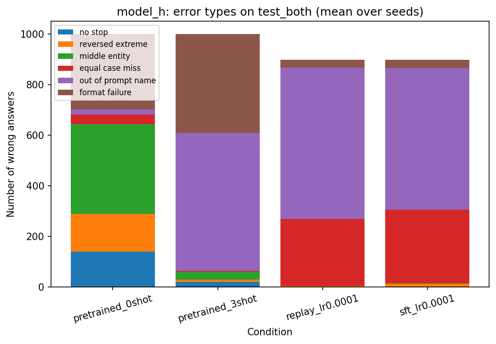
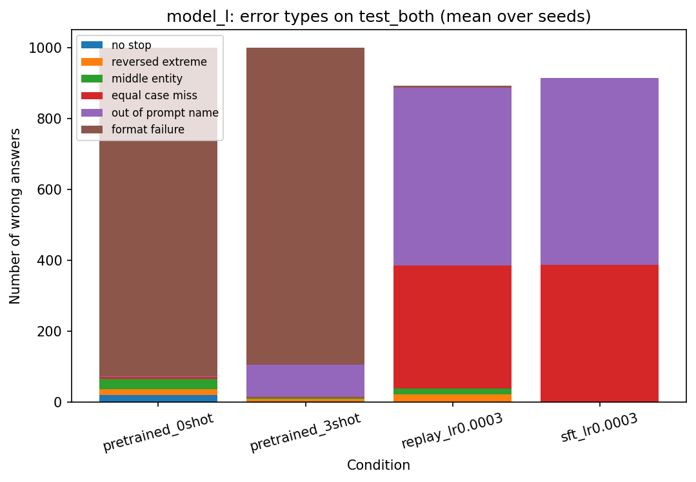

**How the models fail, not only how often:**

1. **Format is fixed completely.** Before finetuning, Model L's errors are 93% format failures (not a
   name at all) and Model H's are spread across every class. After finetuning, no model ever fails
   to stop.
2. **On seen entities the failure is direction.** Reversed extreme is the largest class (~350 per
   seed): the model finds the two ends of the ordering but not reliably which end the polarity word
   (बड़ा/छोटा, जेठो/कान्छो) asks for. Middle-entity errors (~115–150) are rarer, so the model has
   partly learned "not the one mentioned twice".
3. **On unseen entities the failure is memorisation.** 56–67% of `test_both` errors are a
   training-pool name that is not in the prompt. L9 slide 24 shows this with 20 names, and a pool
   of 140 did not prevent it. The model binds answers to name *identity*, and on an unfamiliar name
   it falls back on a familiar one.
4. **Equal-case misses are the second unseen-entity failure.** "बराबर" is a one-word answer the
   model can always produce, and it becomes a fallback when the entities are unfamiliar (H: 91 on
   `test_id` → 267 on `test_both`).

## 7. Forgetting and data size

### 7.1 Catastrophic forgetting, and replay

Phase-2 validation perplexity, recomputed on the same split by the Phase-3 evaluator:

| | Model H | Model L |
|---|---:|---:|
| Pretrained | 30.34 | 51.23 |
| SFT (3 seeds) | 142.4 ± 85.2 | **418,137 ± 313,846** |
| **SFT + replay** (3 seeds) | **35.51 ± 0.11** | **76.32 ± 0.19** |

**Plain SFT damages the language model**, and Model L's higher sweep-selected learning rate destroys
it: perplexity above 400,000 means the model no longer assigns meaningful probability to Nepali
text. This is L9's example (1.33 → 194.7 with "no pretraining text mixed back in") at a larger
scale. It is also a warning about selecting on the task metric alone: val EM preferred 3e-4 by 1.4
points while perplexity rose four orders of magnitude.

**Replay fixes it at no cost to the task.** Mixing 8 × 256 pretraining tokens into every step keeps
perplexity within 17% (H) and 49% (L) of the pretrained value. Exact match stays equal or better on every
split except H `test_entity` (0.136 → 0.129), and seed variance on the unseen-entity splits shrinks
(H `test_entity` std 0.043 → 0.009, `test_both` 0.020 → 0.005). Replay is the finetuned model this report recommends.

### 7.2 Data size: more examples, more memorisation

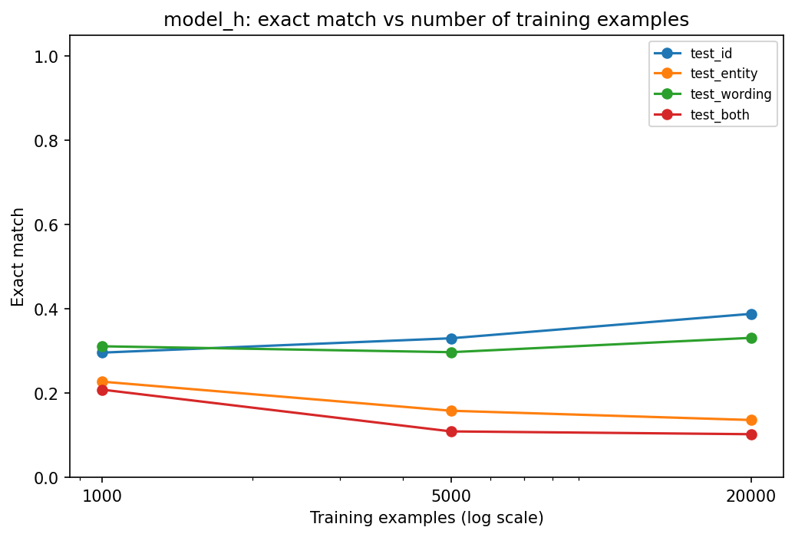
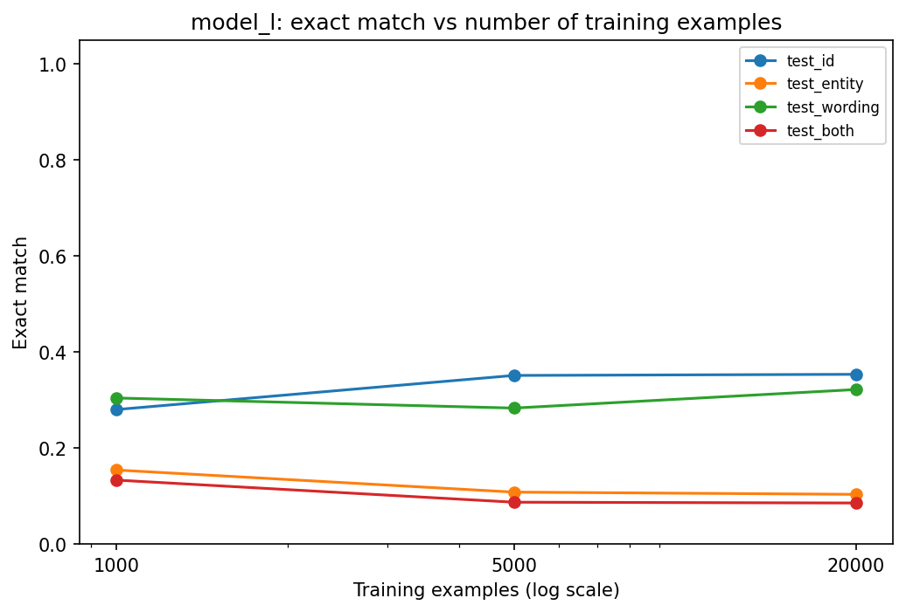

| | 1,000 | 5,000 | 20,000 |
|---|---:|---:|---:|
| H test_id | 0.296 | 0.330 | 0.388 |
| H test_entity | **0.227** | 0.158 | 0.136 |
| L test_id | 0.280 | 0.351 | 0.353 |
| L test_entity | **0.154** | 0.108 | 0.103 |

(1k and 5k: seed 0; 20k: 3-seed mean. Epochs fixed at 3, so smaller sets also mean fewer steps.)

1,000 examples already teach the format (100% stop rate), at chance accuracy. More data raises
seen-entity accuracy and **lowers unseen-entity accuracy**: the additional examples are spent
binding answers to the training names. LIMA's point that coverage matters more than quantity
applies here in a specific form. Adding examples over the same 140 names increases the coverage
of those names, not of the comparison.

## 8. Model H vs Model L on reasoning

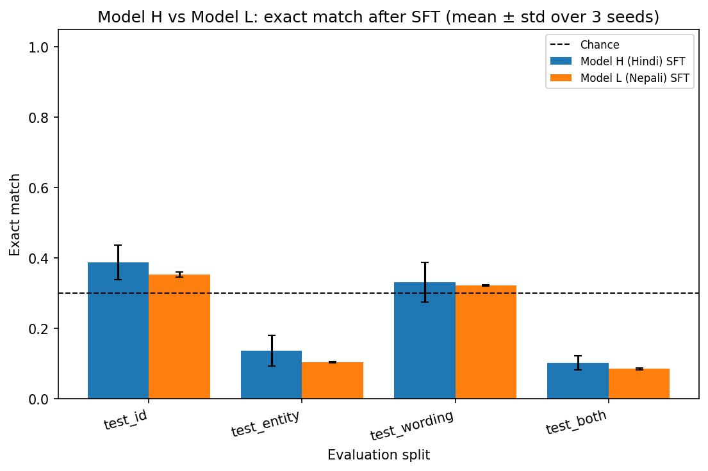

| Replay condition (3 seeds) | Model H | Model L | Δ (H − L) |
|---|---:|---:|---:|
| val | 0.434 ± 0.029 | 0.371 ± 0.005 | +0.063 |
| test_id | 0.422 ± 0.045 | 0.368 ± 0.011 | +0.054 |
| test_entity | 0.129 ± 0.009 | 0.134 ± 0.004 | −0.005 |
| test_wording | 0.397 ± 0.036 | 0.352 ± 0.011 | +0.045 |
| test_both | 0.102 ± 0.005 | 0.107 ± 0.006 | −0.005 |
| Candidate choice, test_both | 0.339 ± 0.006 | 0.292 ± 0.003 | +0.047 |
| Phase-2 val PPL after finetuning | 35.5 (pretrained 30.3) | 76.3 (pretrained 51.2) | |
| Best LR | 1e-4 | 3e-4 | |

- **Model H is ~5–6 points better on seen entities and seen or held-out wording.** The gap is about
  five times Model L's seed std and about equal to Model H's. Model H is also more variable across
  seeds (std 0.045 vs 0.011), so the gap is real but not large.
- **On unseen entities the two are indistinguishable** (0.129 vs 0.134; 0.102 vs 0.107). Both hit
  the same memorisation floor.
- **Held-out wording costs both the same** (H −2.5, L −1.6 points against `test_id`). Neither model's
  learning is tied to the three training phrasings.
- **Model L needed a 3× higher learning rate** to reach its best val EM, and forgot more for it.

Why Model H does better on seen entities, from the evidence in this project:

- **Names are one token more often in Hindi.** 170 of 200 Hindi person names are a single token
  under Model H's tokenizer (mean 1.18 tokens). Only 116 of 200 Nepali names are single tokens under
  Model L's (mean 1.54). A multi-token name must be copied across several steps, and the name-prefix
  substitutions (नबिन → नविना) are exactly that failure.
- **Nepali attaches its postpositions** (हरिभन्दा, हरिको, हरिसँग). The name and its grammatical role
  then share a word, and often a token boundary that differs from the bare name the answer needs.
  Hindi keeps the name and "से" separate. This is the Phase-1 finding that Nepali's inflectional
  suffixes drive its higher fertility (1.380 vs 1.273), now showing up in a copying task.
- It is not a difference in language-modelling quality: by bits-per-byte Model L was the *better*
  language model (Phase 2: 0.4561 vs 0.4819).

## 9. Post-finetuning attention analysis

The Phase-2 toolkit (`lma/eval/attention.py`) is applied unchanged to the pretrained checkpoint and
to the recommended finetuned model of each language: **SFT + replay, seed 0** (H
`replay_lr0.0001_s0`, L `replay_lr0.0003_s0`). Replay is the right model to analyse, not only because
it is the one the report recommends. Plain SFT also destroys Model L as a language model
(perplexity 418,137), so its attention changes mix "learned the task" with "forgot Nepali". Replay
keeps perplexity close to pretrained (§7.1), so any change it shows belongs to the task.

Statistics are computed twice: on 200 `test_id` reasoning prompts and on 8 × 192-token held-out
validation documents (Phase 2's protocol). A change seen on both inputs is global drift; a change
seen only on reasoning prompts is task-specific. One metric is new.

### 9.1 Answer-pointer heads appear at the top of both models

From the last prompt position (after `उत्तर:`, where the answer's first token is predicted), for each
layer and head:

```
pointer score = attention mass on the correct entity's tokens − mean mass on each distractor's tokens
```

computed over 178 prompts whose answer is an entity.

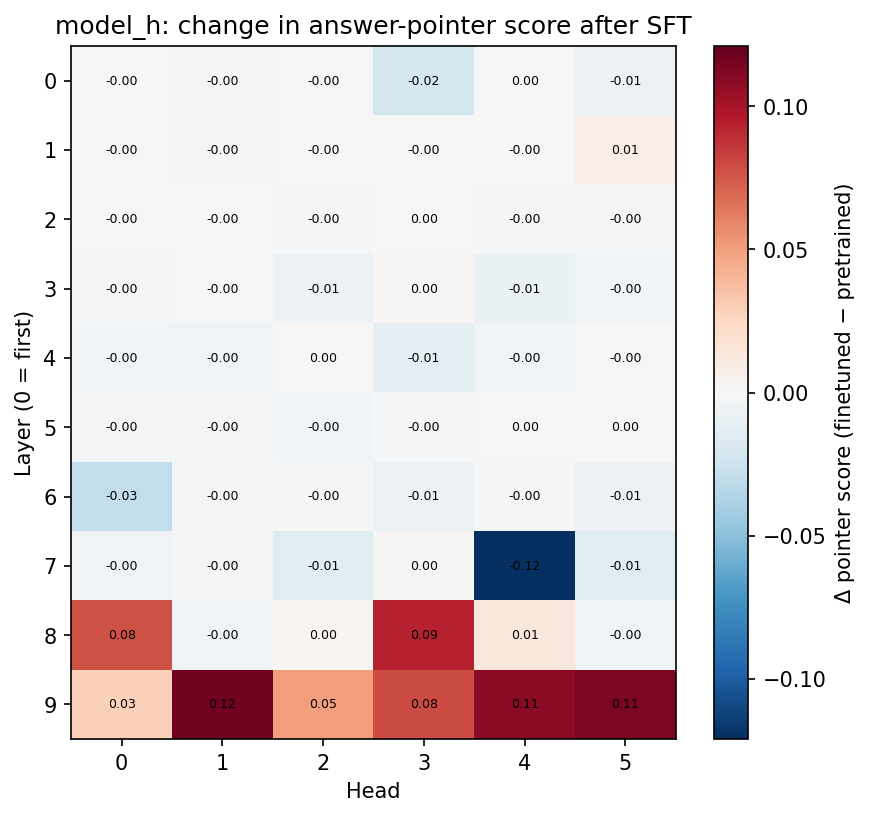
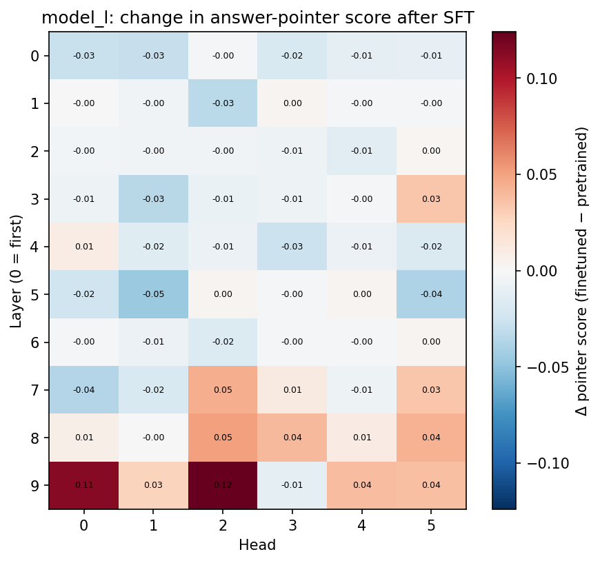

| | Model H | Model L |
|---|---|---|
| Best head, pretrained | 0.001 (no head prefers the answer) | 0.000 |
| Best head, finetuned | **L9H5, 0.091** | **L9H0, 0.101** |
| Largest gains | L9H1 +0.117, L9H5 +0.114, L9H4 +0.109, L8H3 +0.094, L9H3 +0.079 | L9H2 +0.124, L9H0 +0.113, L8H2 +0.051, L7H2 +0.045, L8H5 +0.043 |
| Largest gain in any head of layers 0–6 | +0.008 | +0.035 |
| Layer-mean pointer score, layer 8 | −0.005 → +0.024 | −0.009 → +0.016 |
| Layer-mean pointer score, layer 9 | −0.026 → **+0.057** | −0.018 → **+0.037** |

**Finetuning creates heads that look at the answer, and it creates them at the top of the network.**
Before finetuning, not one of the 60 heads in either model attends more to the correct entity than
to the distractors at the answer position. After finetuning, all six of Model H's layer-9 heads
gain (+0.03 to +0.12), plus L8H0 and L8H3. Model L's gains are concentrated in L9H0 and L9H2, with
smaller ones (≤ 0.05) spread over layers 7–9. In both models the lower layers are essentially
untouched. Finetuning *repurposed the
top of the network* rather than rebuilding its lower layers.

It is also a mechanistic reason the unseen-entity results are poor. A pointer score of ~0.1 means
the best heads put only ~10 percentage points more attention on the correct name than on a
distractor. That is enough to bias the output toward entities in the prompt when names are
familiar, but not enough to override a memorised name when they are not.

### 9.2 Heatmaps: pretrained vs finetuned, early and late layers

The same `ext3` prompt through the pretrained and finetuned model, layer 0 (early) and layer 9
(late):

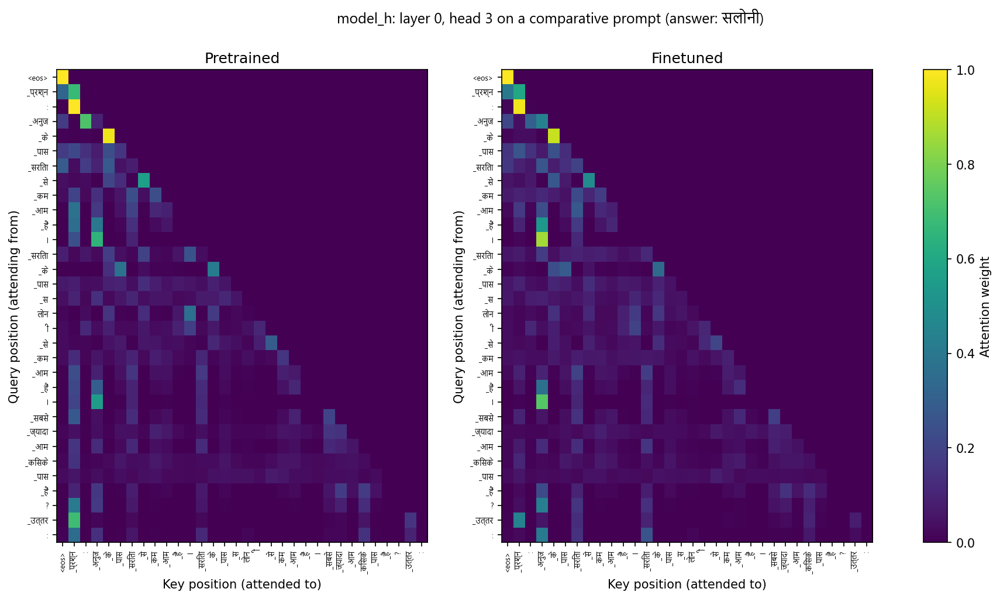
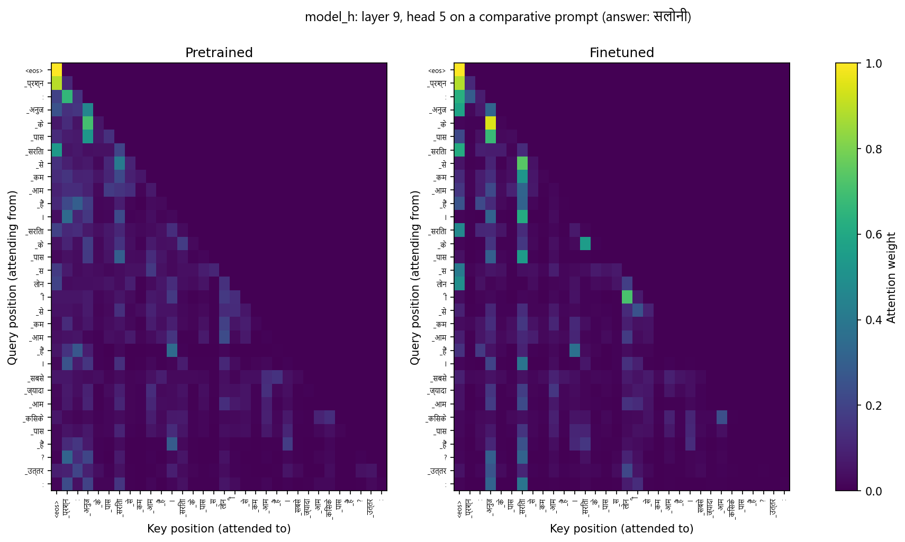
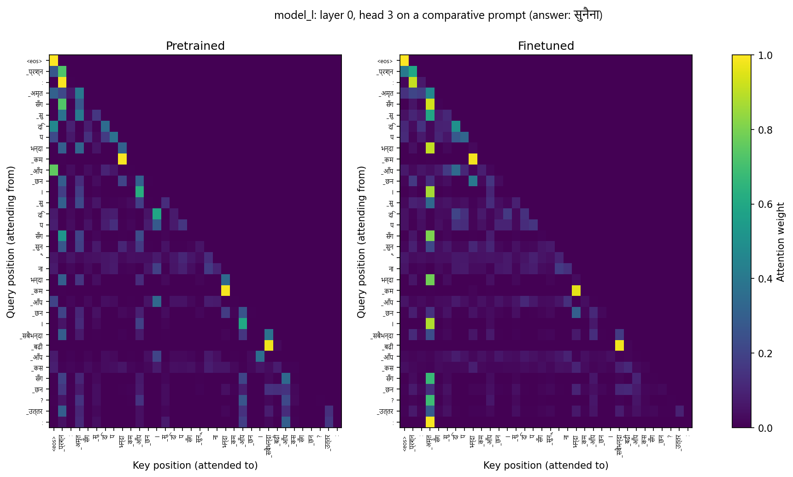
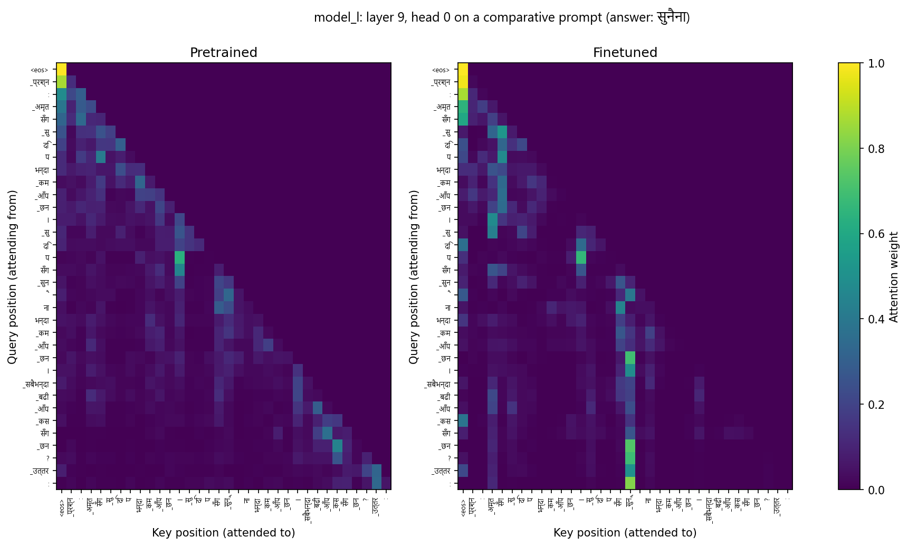

(Six pairs per model are in `report/figures/<lang>_ft_attn_L{0,9}H{0,3,5}.png`.)

- **Layer 0 is essentially unchanged.** The same sparse pattern appears before and after, consistent
  with the near-zero pointer-score change in the lower layers.
- **Layer 9 changes character.** In the pretrained model the late heads spread their mass over
  recent tokens (a diffuse band along the diagonal). After finetuning they form sharp vertical
  stripes on the *entity tokens*: the question and the answer marker read back to the names in the
  premises.
- **Model L's L9H0 shows the pointer directly.** On the prompt
  "अमृतसँग सुदिपभन्दा कम आँप छन। सुदिपसँग सुनैनाभन्दा कम आँप छन। सबैभन्दा बढी आँप कससँग छन?", the
  finetuned head's strongest column from the final `उत्तर:` position is the first token of **सुनैना**
  — the correct answer — while the pretrained head attends to the tokens just before it.

### 9.3 Local vs long-range attention: essentially unchanged with replay

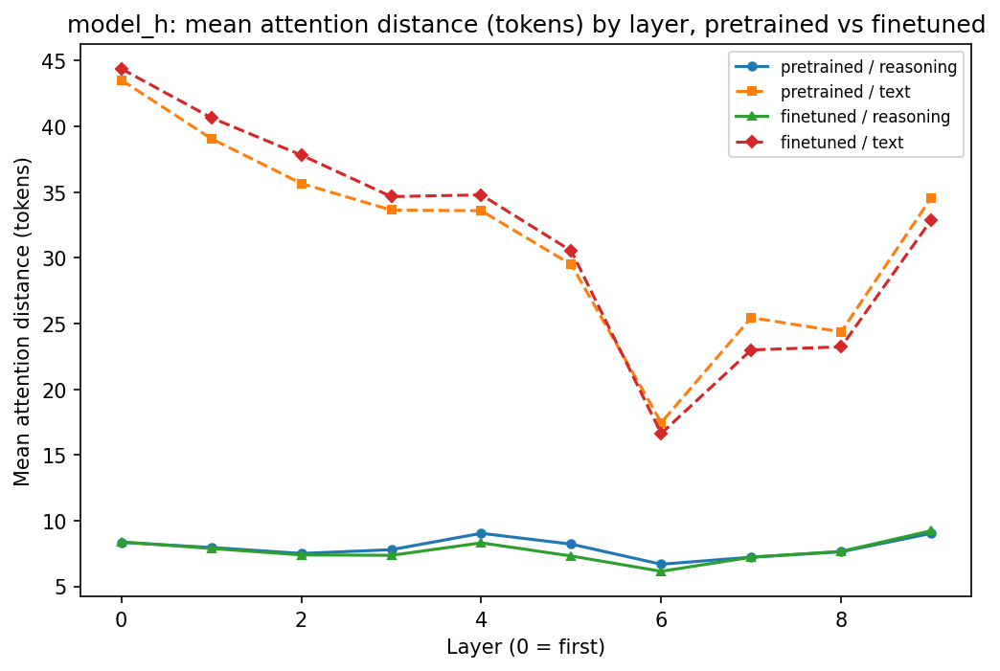
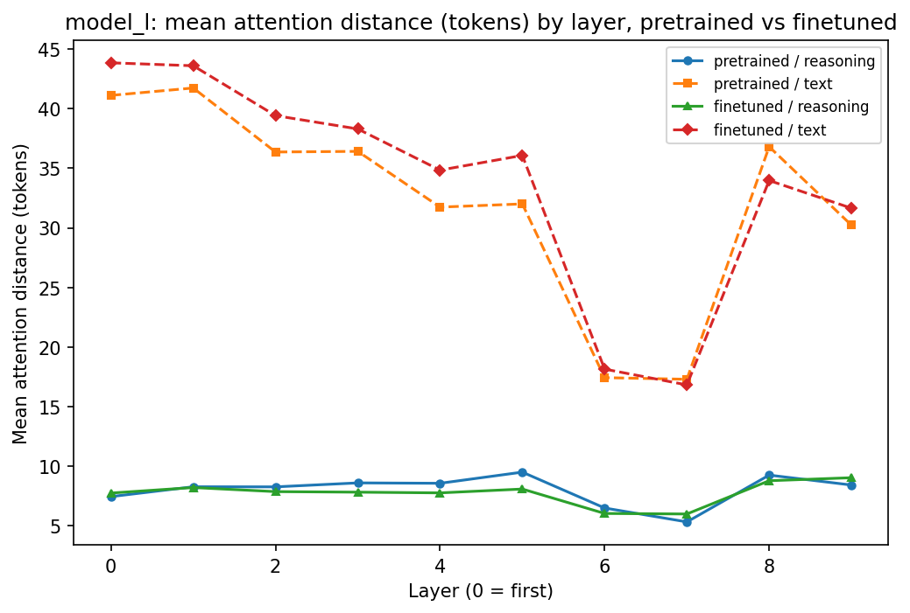

Mean attention distance on held-out text (tokens), pretrained → finetuned:

| Layer | 0 | 2 | 5 | **6** | 7 | 8 | 9 |
|---|---:|---:|---:|---:|---:|---:|---:|
| Model H | 43.5 → 44.4 | 35.7 → 37.8 | 29.5 → 30.5 | **17.5 → 16.6** | 25.4 → 23.0 | 24.4 → 23.2 | 34.6 → 32.9 |
| Model L | 41.1 → 43.8 | 36.4 → 39.4 | 32.0 → 36.1 | **17.4 → 18.1** | 17.3 → 16.8 | 36.8 → 34.0 | 30.2 → 31.7 |

- **On ordinary text, finetuning with replay left local vs long-range attention intact.** Every
  layer's mean distance is within 4.1 tokens of pretrained, and normalised entropy within 0.04. The
  early-diffuse → layer-6-local → wider-top profile is unchanged in both models.
- **On reasoning prompts, the only clear change is in Model L's top layers.** Normalised entropy in
  layers 7–9 falls from 0.716 / 0.612 / 0.687 to 0.546 / 0.537 / 0.587, while on text the same
  layers barely move (0.603 / 0.604 / 0.660 → 0.597 / 0.623 / 0.671). Model L's late heads became
  more focused *on reasoning prompts only*: a task-specific change, not drift. Model H's top layers
  change by less than 0.02 on the same prompts. Its task-specific change is entirely in *where* the
  heads point (§9.1), not in how spread their attention is.
- **The Phase-2 "layer 6 focusing layer" survives finetuning in both models** (H 17.5 → 16.6,
  L 17.4 → 18.1). Phase 2 proposed it as a property of the architecture and training budget rather
  than of the language, and it is robust to a task-specific update.
- **Why replay matters here.** The plain-SFT checkpoint of Model L, analysed the same way, showed
  large *global* shifts: layer 5 on text 32.0 → 19.8 tokens and layer 7 text entropy 0.603 → 0.448.
  None of these appear with replay. Those shifts were the model forgetting its language, not
  learning the task — the confound that analysing the replay model avoids.

### 9.4 Head specialisation

| Head roles (60 heads) | H reasoning prompts | H text | L reasoning prompts | L text |
|---|---|---|---|---|
| Pretrained | diffuse 38 · mixed 21 · prev-token 1 | diffuse 46 · mixed 9 · long-range 4 · prev 1 | diffuse 37 · mixed 19 · sink 3 · prev 1 | diffuse 42 · mixed 10 · long-range 7 · prev 1 |
| Finetuned | diffuse 42 · mixed 18 | diffuse 45 · mixed 9 · long-range 5 · prev 1 | diffuse 35 · mixed 24 · prev 1 | diffuse 42 · mixed 10 · long-range 7 · prev 1 |

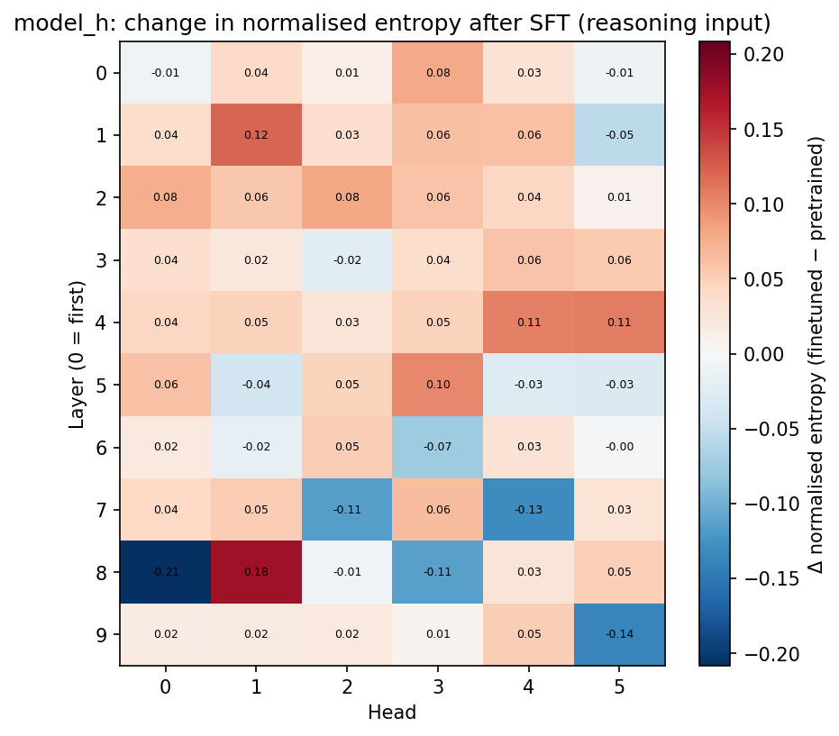
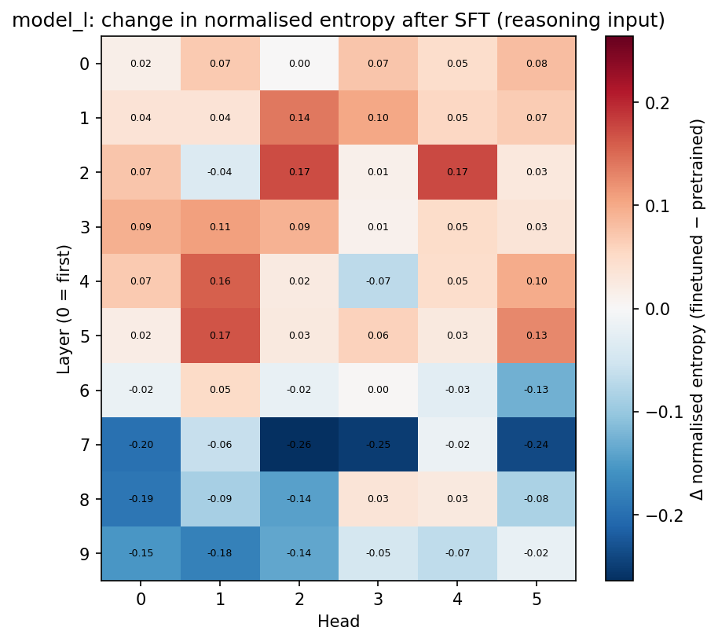

- **On text, head roles are unchanged** (Model L: identical counts; Model H: one head moves between
  diffuse and long-range).
- **On reasoning prompts, a few heads change role.** Model H loses its previous-token head. Model L
  loses its three attention-sink heads, and diffuse heads become mixed (37 → 35 diffuse, 19 → 24
  mixed), matching the lower late-layer entropy above.

The specialisation finetuning produced is not visible in these whole-sequence statistics. It is
**specific to the answer position and to entity tokens**, which is exactly what the pointer score
measures (§9.1). **Summary:** finetuning on comparative prompts, with replay, left each model's
attention organisation intact on ordinary text — early diffuse layers, a local layer 6, a wider top
— and wrote a narrow new function into its last layers: heads that point at the answer.

## 10. The whole project: answers to the four questions

### 10.1 How did data scale and quality differ between Model H and Model L?

| | Model H (Hindi) | Model L (Nepali) |
|---|---:|---:|
| Documents (train) | 3,577,045 | 5,526,928 |
| Tokens (all splits) | 517,640,653 | 572,506,257 |
| Manually collected share | 22.5% | 24.7% |
| Wikipedia available | 51.9M words | 8.5M words |
| Tokenizer fertility (Unigram 16k) | 1.273 tokens/word | 1.380 tokens/word |
| Bytes per token (test) | 10.28 | 12.51 |
| Tokens per parameter | 21.6 | 24.0 |

- **Scale: Nepali ended up *larger*, not smaller.** The resource asymmetry is real at the source
  (6× less Wikipedia; fastText has seen far more Hindi), but Phase 1's crawling closed it. Model L
  trained on 11% more tokens and 55% more documents.
- **Quality: Nepali was noisier.** The Nepali corpus is ~85% fast-crawled web text against Hindi's
  much larger curated share. It needed lower language-ID and quality thresholds to reach its size.
  And Hindi–Nepali are the same script, so language ID had to separate them on vocabulary alone.
  Phase 2 found the noise in generation rather than perplexity: stray-Latin rate 0.40% against a
  clean reference, and a weaker type–token ratio.
- **Phase 3 data was matched by design.** Same task mix, split sizes, seeds and leakage guarantees;
  each language's own names, grammar, digit script and spellings. Its quality was measured the same
  way in both: zero leakage, heuristics at chance, all labels solver-verified.

### 10.2 How do language-modelling and reasoning results compare across the two resource tiers?

| | Model H | Model L | Better |
|---|---:|---:|---|
| Test perplexity (Phase 2) | 31.01 | 52.16 | H (per token) |
| **Test bits-per-byte** (Phase 2) | 0.4819 | **0.4561** | **L** |
| Reasoning EM, seen entities (replay) | **0.422 ± 0.045** | 0.368 ± 0.011 | **H** |
| Reasoning EM, held-out wording (replay) | **0.397 ± 0.036** | 0.352 ± 0.011 | **H** |
| Reasoning EM, unseen entities (replay) | 0.129 ± 0.009 | 0.134 ± 0.004 | tie |
| Forgetting under plain SFT (val PPL) | 30 → 142 | 51 → 418,137 | H far more robust |
| Forgetting with replay | 30 → 35.5 | 51 → 76.3 | H |
| Layer-6 focusing (mean distance) | 17.46 | 17.43 | same |

**The rankings disagree across metrics, and none of the disagreements is a matter of resource tier
alone.**

- Model L is the better language model per byte of text — it had more, if noisier, data.
- Model H is the better finetuned reasoner on seen entities, by ~5 points.
- Neither generalises the comparison to new names.
- Model L's finetuning was far more fragile: a 3× higher selected LR, and a perplexity collapse
  without replay.
- The one attention property measured at every phase — layer 6 as the focusing layer — is identical
  across languages and survives finetuning in both.

### 10.3 What tokenizer and corpus factors most affected the lower-resource model?

1. **Token granularity.** Model L's tokens carry 22% more text (12.51 vs 10.28 bytes/token). This
   inflated its perplexity (the per-token gap reverses per byte). In Phase 3 it means names are
   split more often: only 58% of Nepali names are single tokens against 85% of Hindi names. The
   model must reproduce multi-token names from the prompt, and its name-completion errors (नबिन →
   नविना) are exactly the second token going wrong.
2. **Agglutinative postpositions.** Nepali attaches -को, -ले, -भन्दा, -सँग to the name. Phase 1 found
   these suffixes drive the fertility gap (1.380 vs 1.273). In reasoning prompts every entity mention
   is fused with its grammatical role, so the bare-name answer is never a standalone word in the
   prompt, as it is in Hindi.
3. **Normalisation that must differ per language.** Chandrabindu is folded in Hindi and kept in Nepali
   (Phase 1). Nepali's normaliser strips a final virama, so the corpus says छन and not छन्. And Nepali
   writes Devanagari digits. None of these hurt Model L once handled, but a pipeline tuned on Hindi
   would have fed Model L spellings it never saw, in every phase.
4. **Corpus composition over size.** Model L's corpus was larger but noisier. The noise surfaced in
   generation (Phase 2) and, plausibly, in how narrowly Model L's pretrained distribution
   concentrates. That would explain a sweep that preferred a large LR and a model that left its
   language-modelling basin so easily.

### 10.4 What evidence explains the observed differences?

| Observation | Evidence |
|---|---|
| Model L's higher perplexity is tokenizer, not capability | bits/token ratio 1.151 < bytes/token ratio 1.216; BPB ranking reverses (Phase 2 §6.2) |
| Model L is the better LM per byte | 11% more training tokens, 24.0 vs 21.6 tokens/parameter (Phase 2 §9) |
| Pretrained models cannot do the task at all | EM 0.000 on 5 splits × 2 models × 2 prompting modes; candidate choice below chance (§4) |
| SFT teaches format far more reliably than reasoning | stop rate 1–2% → 100%; candidate choice on `test_both` 0.27–0.34 vs chance 0.30 (§4.2) |
| The gap on unseen names is memorisation | 56–67% of errors are out-of-prompt training names; more data widens the gap (§6, §7.2) |
| Model H's seen-entity advantage is tokenization of names | 85% vs 58% single-token names; H vs L equal once memorisation dominates (§8) |
| Plain SFT destroys the LM; replay prevents it | PPL 418,137 vs 76 at the same LR for Model L; 142 vs 35.5 for Model H (§7.1) |
| Finetuning writes a new function into the top layers only | pointer-score gains concentrated in layers 8–9 (≤ 0.035 in any head of layers 0–6); attention on text and the layer-6 focusing layer unchanged (§9) |

**What the project as a whole shows.** At ~24M parameters and ~500M tokens, two independent
monolingual models learn their languages comparably well, once perplexity is replaced by
bits-per-byte. Their attention organises identically by depth. Comparative reasoning is not
something either model can do from pretraining. SFT gives both the format and a shallow, entity-bound
competence that transfers across wording but not across names. The lower-resource model's specific
difficulties trace back through its tokenizer to the morphology of the language, rather than to how
much text it had.

## 11. Independence verification

`python scripts/verify_independence.py` — five checks, all pass:

| Check | Result |
|---|---|
| No cross-language path references | pass |
| Zero document overlap | pass — 3,587,040 vs 5,536,919 documents, intersection 0 |
| Tokenizers differ | pass — distinct files; 5,695 of 16,000 pieces shared |
| Pretrained checkpoints independent | pass — 73 tensors, 0 shared storage, 0 identical, embedding cosine +0.00448 |
| **Finetuned checkpoints descend from their own language** (new) | pass — 10 Hindi + 10 Nepali checkpoints: every recorded init checkpoint and tokenizer is the run's own language; embedding cosine to own pretrained ≥ 0.875, to the other language's ≤ 0.0046; no identical tensors across languages for any run type |

The Phase-3 datasets share no person names across languages (asserted in `tests/test_reasoning.py`).
Each language's reasoning code imports only its own lexicon, templates, tokenizer and checkpoint,
through its own `config.py`.

## 12. Reproducibility and deliverables

```bash
pip install -r requirements.txt && pip install -e .
pytest tests/ -q                                  # 496 tests, including tests/test_reasoning.py (42)
python scripts/run_phase3.py --lang hindi         # dataset → baselines → sweep → main → size → report
python scripts/run_phase3.py --lang nepali
python scripts/phase3_compare.py                  # H vs L table + figure
python scripts/verify_independence.py
```

Every stage is resumable and skips completed work. Each run is identified by its directory name
(`replay_lr0.0001_s2`), and its full configuration is stored in its checkpoint and log. On one RTX
3050 Laptop GPU the complete Phase-3 pipeline for both languages (20 finetuning runs, 24
evaluations, two attention analyses) ran in under 1 h 35 min.

| Deliverable | Location |
|---|---|
| Dataset generator | `lma/reasoning/{facts,build}.py`, `<lang>/reasoning/{lexicon,templates,generate}.py` |
| Datasets | `<lang>/reasoning/data/` (val + 4 test splits committed; train on Drive, regenerable byte-for-byte) |
| Dataset report | `<lang>/reasoning/results/dataset_stats.md` |
| Finetuning code | `lma/reasoning/{sft_data,sft}.py`, `<lang>/reasoning/{config,finetune}.py` |
| Finetuning logs + curves | `<lang>/reasoning/logs/<run>/`, `report/figures/<lang>_sft_curves.png` |
| Finetuned checkpoints | Drive (`<lang>/reasoning/checkpoints/<run>/ckpt_best.pt`) |
| Evaluation + error analysis | `lma/reasoning/score.py`, `<lang>/reasoning/results/{summary.md,eval/}` |
| Attention analysis | `lma/reasoning/pointer.py`, `<lang>/reasoning/attention_compare.py`, `results/attention_compare.json` |
| H vs L comparison | `report/phase3_comparison.md`, `report/figures/phase3_h_vs_l_em.png` |
| Development log | `PHASE3_LOG.md` |
